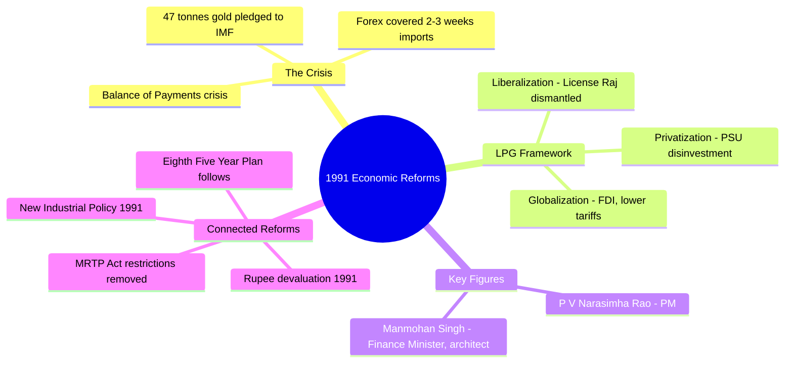

# NOTE — 1991 ECONOMIC REFORMS (LPG)
**Section:** GK | **Category:** Economy | **Topic:** 1991 Economic Reforms | **Slug:** `eco-1991-reforms`
**Source:** 🔧 GENERAL KNOWLEDGE (standard economy/modern history reference; not yet cross-checked against PARMAR SSC reference excerpt)
**Status:** 🔧 DRAFT — awaiting AIR-91 verification before publish
**PYQ Frequency:** 🔥 Very high-frequency Economy/Modern History crossover topic, connects to [[eco-five-year-plans-and-niti-aayog]] | **High Yield:** ✅

---

## 🎭 THE HOOK

In 1991, India came within days of defaulting on its international payments — foreign exchange reserves had fallen so low they could barely cover **two to three weeks of imports**, forcing the government to physically airlift **47 tonnes of gold** to the Bank of England and the Union Bank of Switzerland as collateral for an emergency loan. That humiliating crisis became the trigger for the most significant overhaul of India's economic policy since independence: a sweeping set of reforms under Prime Minister **P.V. Narasimha Rao** and Finance Minister **Dr. Manmohan Singh**, built around three pillars now universally remembered by the acronym **LPG — Liberalization, Privatization, Globalization**. India's "License Raj," a four-decade system of government permits and controls strangling private enterprise, was dismantled almost overnight.

---

## 📖 THE CORE

### The 1991 Crisis (Why Reforms Happened)
- **Balance of Payments crisis**: foreign exchange reserves fell to a level covering only **2-3 weeks** of imports.
- Triggered by a combination of: the 1991 Gulf War (oil price shock, remittance disruption from Indian workers in the Gulf), high fiscal deficits, and accumulated inefficiencies of the License Raj system.
- India pledged **47 tonnes of gold** as collateral to secure emergency loans from the **IMF**, and undertook a **Structural Adjustment Program**.

### The Reforms — LPG Framework
| Pillar | Meaning | Key Measures |
|---|---|---|
| **Liberalization** | Reducing government control/regulation over private enterprise | Dismantling the **License Raj** (industrial licensing requirements scrapped for most sectors); easing restrictions on private investment |
| **Privatization** | Reducing government ownership in the economy | Disinvestment in **Public Sector Undertakings (PSUs)**; opening sectors previously reserved for the public sector to private players |
| **Globalization** | Integrating India's economy with the world economy | Reducing import tariffs/duties; encouraging **Foreign Direct Investment (FDI)**; rupee devaluation to boost export competitiveness |

### Key Figures
- **Prime Minister**: P.V. Narasimha Rao.
- **Finance Minister**: **Dr. Manmohan Singh** — architect of the reforms, later became Prime Minister himself (2004-2014).
- **Manmohan Singh's 1991 budget speech** is widely remembered for the line (paraphrased): "No power on earth can stop an idea whose time has come" — referencing Victor Hugo, signaling the reforms' historic, irreversible intent.

### Other Key Reform Elements
- **Rupee devaluation** (1991): Indian Rupee devalued in two steps to boost export competitiveness and address the BoP crisis.
- **New Industrial Policy, 1991**: scrapped industrial licensing for most industries (except a small list on strategic/environmental grounds), removed restrictions under the **MRTP Act** (Monopolies and Restrictive Trade Practices Act) for large firms.
- **Reduction in import tariffs**: gradually lowered over subsequent years to integrate India into global trade.
- Connects directly to the **Eighth Five Year Plan (1992-97)**, the first Plan implemented after these reforms — see [[eco-five-year-plans-and-niti-aayog]].

---

## 🧠 THE MIND MAP

---

## 🔑 THE MNEMONIC

**"LPG fueled the recovery"** — Liberalization, Privatization, Globalization, the three-pillar acronym for the entire 1991 reform package.

**"47 tonnes of gold bought India time"** — the vivid, specific crisis-collateral fact anchoring why the reforms were urgent.

---

## 📌 THE PYQ ANCHOR

🔥 1991 Economic Reforms is a very high-frequency Economy/Modern History crossover topic, directly connecting to [[eco-five-year-plans-and-niti-aayog]]. 🔧 No literal 1991 Reforms question confirmed in the 23/46-shift CGL-2025 sample reviewed in this session, since this topic wasn't separately tagged during PYQ extraction — the LPG framework and key figures (Rao, Manmohan Singh) are textbook-standard SSC CGL Economy staples; recommend a dedicated archive cross-check.

---

## ⚠️ THE TRAP ALERT

- **P.V. Narasimha Rao was the Prime Minister; Dr. Manmohan Singh was the Finance Minister** who architected and implemented the reforms — a frequently tested role-pairing; don't swap the two positions.
- **The reforms are summarized as LPG — Liberalization, Privatization, Globalization** — NOT "Liberalization, Privatization, Globalization AND nationalization" or any other expanded acronym; exactly three pillars.
- **India pledged GOLD (47 tonnes), not foreign currency reserves directly**, as collateral to the IMF/international banks — a specific, frequently tested crisis-management detail.
- **The 1991 reforms are distinct from but connected to the Eighth Five Year Plan (1992-97)** — the Plan came AFTER and implemented within the new liberalized framework, not the cause of the reforms.

---

## ✅ ACTIVE RECALL

1. What crisis triggered India's 1991 economic reforms?
2. What collateral did India pledge to secure emergency loans during the crisis?
3. Who was the Prime Minister during the 1991 reforms, and who was the Finance Minister who architected them?
4. What does the LPG framework stand for?
5. What was the "License Raj," and what happened to it under these reforms?

*(Answers: 1–A Balance of Payments crisis, with foreign exchange reserves covering only 2-3 weeks of imports | 2–47 tonnes of gold, pledged to the Bank of England and the Union Bank of Switzerland | 3–P.V. Narasimha Rao (Prime Minister); Dr. Manmohan Singh (Finance Minister) | 4–Liberalization, Privatization, Globalization | 5–A four-decade system of government permits/licenses controlling private industrial activity; it was largely dismantled by the New Industrial Policy, 1991)*
