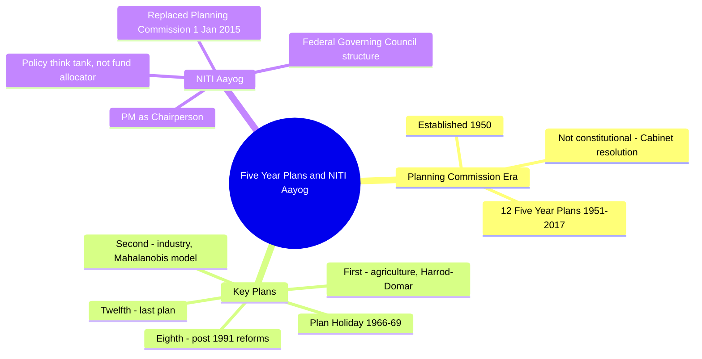

# NOTE — FIVE YEAR PLANS & NITI AAYOG
**Section:** GK | **Category:** Economy | **Topic:** Five Year Plans & NITI Aayog | **Slug:** `eco-five-year-plans-and-niti-aayog`
**Source:** 🔧 GENERAL KNOWLEDGE (standard economy/polity reference; not yet cross-checked against PARMAR SSC reference excerpt)
**Status:** 🔧 DRAFT — awaiting AIR-91 verification before publish
**PYQ Frequency:** 🔥 High-frequency Economy/Polity crossover topic | **High Yield:** ✅

---

## 🎭 THE HOOK

For 65 years, independent India ran its entire economic strategy in five-year blocks, an approach borrowed directly from the Soviet Union's centralized planning model — a striking choice for a country that simultaneously built a multi-party democracy and a free press. The **Planning Commission**, created in 1950, issued **12 Five Year Plans** before the entire system was scrapped in 2014-15 and replaced by something explicitly NOT a planning body: the **NITI Aayog** ("National Institution for Transforming India"), a policy think-tank with no power to allocate funds to states, a deliberate reversal of the old top-down model. The shift from Planning Commission to NITI Aayog is one of modern India's most consequential institutional changes, and SSC tests both halves of the story — what came before, and why it changed.

---

## 📖 THE CORE

### The Planning Commission Era (1950-2014)
- **Planning Commission** established in **1950** (a non-constitutional, non-statutory body, created by a Cabinet resolution — NOT mentioned in the Constitution).
- Issued **12 Five Year Plans** between **1951 and 2017** (the 12th Plan ran 2012-2017, though the Commission itself was replaced in 2014-15 partway through).
- **First Five Year Plan (1951-56)**: Focused on agriculture, based on the **Harrod-Domar model**.
- **Second Five Year Plan (1956-61)**: Focused on rapid industrialization, heavy industries — based on the **Mahalanobis model** (P.C. Mahalanobis), emphasizing capital goods industries.
- **Third Five Year Plan (1961-66)**: Aimed at self-reliant economic growth; disrupted by the **Indo-China War (1962)** and **Indo-Pakistan War (1965)**, plus successive droughts — often called a relative failure.
- **Plan Holiday (1966-69)**: A 3-year gap with NO Five Year Plan, due to the war/drought aftermath and currency devaluation; instead, **Annual Plans** were used.
- **Fourth Five Year Plan (1969-74)**: Focused on "Growth with Stability"; bank nationalization (1969) occurred during this period.
- **Fifth Five Year Plan (1974-79)**: Focus on poverty removal ("Garibi Hatao"); included the Emergency period (1975-77); terminated a year early by the Janata government.
- **Eighth Five Year Plan (1992-97)**: First plan after the 1991 economic liberalization reforms — see [[eco-1991-reforms]].
- **Twelfth Five Year Plan (2012-2017)**: The LAST Five Year Plan; theme "Faster, More Inclusive and Sustainable Growth."

### Transition to NITI Aayog
- **NITI Aayog** ("National Institution for Transforming India") replaced the Planning Commission, established **1 January 2015**.
- Functions as a **policy think-tank**, NOT a fund-allocating body — a fundamental structural shift; states now receive funds primarily through the **Finance Commission** and direct ministry transfers, not a central Plan allocation.
- Headed by the **Prime Minister** as Chairperson; includes a **Vice-Chairperson** and **CEO** (appointed positions), plus all state Chief Ministers and UT Lt. Governors as members of the **Governing Council** — a deliberately more FEDERAL, consultative structure compared to the more centralized Planning Commission.
- **First Vice-Chairperson**: Arvind Panagariya. 🔧 Current officeholders change periodically — verify currency before publish.

### Key Distinguishing Facts
- **Planning Commission was NOT a constitutional or statutory body** — created purely by a Cabinet resolution, and could be dissolved the same way (which is exactly what happened in 2014-15).
- **NITI Aayog has NO power to allocate funds** — its role is strategic/policy advisory, a deliberate design choice contrasting with the Planning Commission's centralized fund-allocation power.

---

## 🧠 THE MIND MAP

---

## 🔑 THE MNEMONIC

**"Plan, Plan, Plan... until 2015, then Think instead"** — the entire Planning Commission-to-NITI Aayog arc in one phrase.

**"Mahalanobis built industry, NITI Aayog builds policy"** — two contrasting institutional/intellectual approaches across India's economic planning history.

---

## 📌 THE PYQ ANCHOR

🔥 Five Year Plans & NITI Aayog is a high-frequency Economy/Polity crossover topic. 🔧 No literal Five Year Plans question confirmed in the 23/46-shift CGL-2025 sample reviewed in this session, since this topic wasn't separately tagged during PYQ extraction — Plan-to-focus-area matching and the Planning Commission-to-NITI Aayog transition are textbook-standard SSC CGL Economy staples; recommend a dedicated archive cross-check.

---

## ⚠️ THE TRAP ALERT

- **The Planning Commission was NEVER mentioned in the Constitution** — it was a Cabinet resolution creation, not a constitutional/statutory body; a frequently tested "is it constitutional" trap.
- **NITI Aayog CANNOT allocate funds to states** — a fundamental, frequently tested distinction from the Planning Commission's centralized fund-allocation role.
- **The Second Five Year Plan focused on INDUSTRY (Mahalanobis model)**, while the FIRST focused on AGRICULTURE (Harrod-Domar model) — a commonly swapped pairing.
- **"Plan Holiday" (1966-69) is a real, specific 3-year gap** with no Five Year Plan in effect, replaced by Annual Plans — don't assume the 12 Five Year Plans ran in unbroken sequence.

---

## ✅ ACTIVE RECALL

1. When was the Planning Commission established, and was it a constitutional body?
2. How many Five Year Plans did the Planning Commission issue, and over what years?
3. What model did the Second Five Year Plan rely on, and what was its focus?
4. What replaced the Planning Commission, and when?
5. What is the key structural difference between NITI Aayog and the Planning Commission?

*(Answers: 1–1950; NOT a constitutional body — created by a Cabinet resolution | 2–12 Five Year Plans, from 1951 to 2017 | 3–The Mahalanobis model; focused on rapid industrialization and heavy/capital goods industries | 4–NITI Aayog, established 1 January 2015 | 5–NITI Aayog is a policy think-tank with no power to allocate funds to states, unlike the Planning Commission, which centrally allocated Plan funds)*
