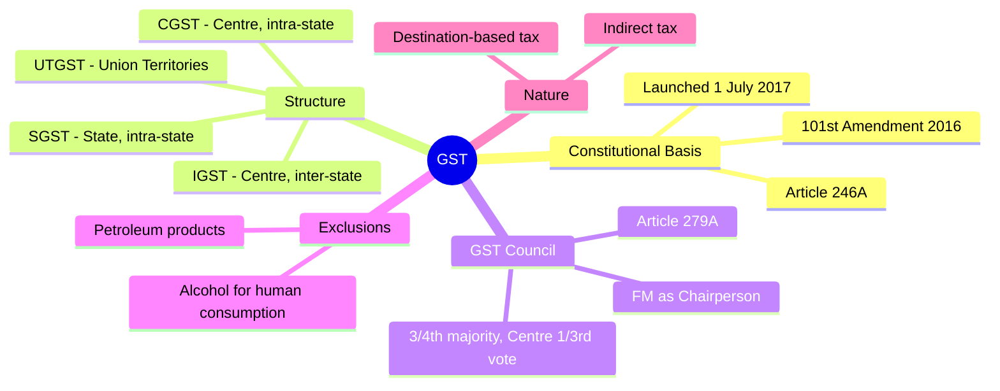

# NOTE — GOODS AND SERVICES TAX (GST)
**Section:** GK | **Category:** Economy | **Topic:** GST | **Slug:** `eco-gst`
**Source:** 🔧 GENERAL KNOWLEDGE (standard economy/polity reference; not yet cross-checked against PARMAR SSC reference excerpt)
**Status:** 🔧 DRAFT — awaiting AIR-91 verification before publish
**PYQ Frequency:** 🔥 Very high-frequency Economy/Polity crossover topic | **High Yield:** ✅

---

## 🎭 THE HOOK

Before midnight on **30 June-1 July 2017**, India had a tax system so fragmented that a single product crossing a state border could be taxed multiple times by multiple authorities — central excise duty, state VAT, octroi, entry tax, service tax, and more, layered on top of each other. At midnight, in a special joint session of Parliament dubbed reminiscent of the 1947 "Tryst with Destiny" moment, the **Goods and Services Tax (GST)** launched, replacing more than a dozen separate indirect taxes with a single, unified tax — sold under the slogan **"One Nation, One Tax."** It required amending the Constitution itself (the **101st Amendment Act, 2016**) to give both the Centre and States the simultaneous power to tax the same transactions, an unprecedented fiscal-federalism compromise.

---

## 📖 THE CORE

### Constitutional Basis & Launch
- Enabled by the **101st Constitutional Amendment Act, 2016** — inserted **Article 246A**, giving Parliament AND State Legislatures concurrent power to make laws on GST.
- Launched at midnight, **1 July 2017**, in a special session of Parliament.
- Replaced over a dozen indirect taxes: central excise duty, service tax, VAT, octroi, entry tax, luxury tax, and others.

### GST Structure (Dual GST Model)
| Component | Levied By | Applies To |
|---|---|---|
| **CGST** (Central GST) | Central Government | Intra-state (within one state) transactions |
| **SGST** (State GST) | State Government | Intra-state transactions (alongside CGST) |
| **IGST** (Integrated GST) | Central Government (then apportioned to states) | Inter-state (between states) transactions, and imports |
| **UTGST** (Union Territory GST) | Central Government | Intra-UT transactions (UTs without their own legislature) |

### GST Council
- A constitutional body (also created via the 101st Amendment, under **Article 279A**) that recommends GST rates, exemptions, and rules.
- **Chairperson**: Union Finance Minister.
- **Members**: Union Minister of State for Finance, and the Finance/Taxation Minister of EACH state — ensuring joint Centre-State decision-making.
- Decisions require a **3/4th majority** of weighted votes, where the **Centre's vote counts as 1/3rd** of total votes and **all states combined count as 2/3rd**.

### GST Rate Slabs
- Multiple slabs exist: commonly cited as **0%, 5%, 12%, 18%, 28%** (plus a special compensation cess on luxury/sin goods like tobacco, automobiles) — 🔧 exact slab structure has been revised periodically; verify current rates before publish.
- Essential goods (food staples, etc.) often fall under 0% or lower slabs; luxury/sin goods attract the highest slabs plus cess.

### Items OUTSIDE GST (Frequently Tested Exclusions)
- **Alcohol for human consumption** — remains outside GST, taxed separately by states.
- **Petroleum products** (petrol, diesel, crude oil, natural gas, ATF) — currently outside GST (taxed via central excise + state VAT), though the GST Council retains the power to bring them under GST in the future.

### Key Distinguishing Facts
- GST is a **destination-based** tax (collected by the state where goods/services are CONSUMED), NOT origin-based (where they are PRODUCED) — a fundamental conceptual shift from the earlier VAT/CST regime.
- GST is an **indirect tax**, ultimately borne by the end consumer, distinct from direct taxes like Income Tax.

---

## 🧠 THE MIND MAP

---

## 🔑 THE MNEMONIC

**"CGST and SGST share a state, IGST crosses the border"** — quick rule for which GST component applies to intra-state vs. inter-state transactions.

**"One Nation One Tax, except Alcohol and Petrol"** — GST's slogan paired with its two most frequently tested exclusions.

---

## 📌 THE PYQ ANCHOR

🔥 GST is a very high-frequency Economy/Polity crossover topic. 🔧 No literal GST question confirmed in the 23/46-shift CGL-2025 sample reviewed in this session, since this topic wasn't separately tagged during PYQ extraction — the 101st Amendment, GST Council voting structure, and GST exclusions are textbook-standard SSC CGL Economy staples; recommend a dedicated archive cross-check.

---

## ⚠️ THE TRAP ALERT

- **Alcohol for human consumption and petroleum products are OUTSIDE GST** — a very frequently tested exclusion; don't assume GST applies to literally all goods and services.
- **GST is DESTINATION-based, not origin-based** — tax revenue goes to the state of CONSUMPTION, not the state of PRODUCTION — a frequently tested conceptual distinction from the pre-GST VAT/CST system.
- **In GST Council voting, the Centre's vote counts as 1/3rd and all states COMBINED count as 2/3rd** — a frequently tested voting-weight structure; individual states don't have equal individual voting weight to the Centre.
- **GST required a CONSTITUTIONAL AMENDMENT (101st, 2016)** — because taxing power needed to be made concurrent between Centre and States; don't assume GST was implemented via ordinary legislation alone.

---

## ✅ ACTIVE RECALL

1. Which Constitutional Amendment enabled GST, and what Article did it insert?
2. When was GST launched in India?
3. What are the four components of India's Dual GST model, and what does each apply to?
4. Name two major categories of goods that remain OUTSIDE the GST regime.
5. Is GST a destination-based or origin-based tax? What does this mean?

*(Answers: 1–The 101st Constitutional Amendment Act, 2016; inserted Article 246A | 2–1 July 2017 | 3–CGST (Centre, intra-state), SGST (State, intra-state), IGST (Centre, inter-state/imports), UTGST (Union Territories) | 4–Alcohol for human consumption, and petroleum products (petrol, diesel, crude oil, natural gas, ATF) | 5–Destination-based; tax revenue goes to the state where goods/services are consumed, not where they are produced)*
