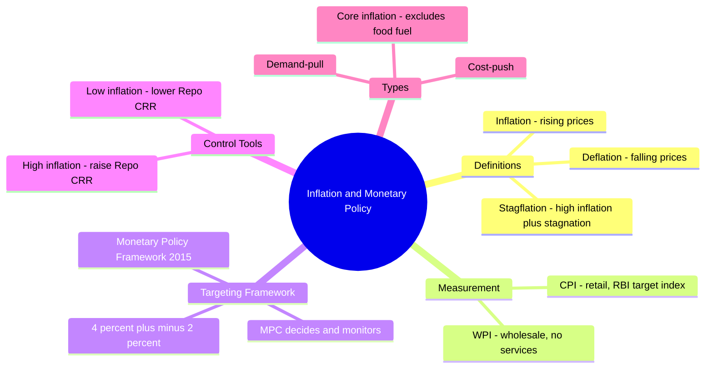

# NOTE — INFLATION & MONETARY POLICY
**Section:** GK | **Category:** Economy | **Topic:** Inflation & Monetary Policy | **Slug:** `eco-inflation-and-monetary-policy`
**Source:** 🔧 GENERAL KNOWLEDGE (standard economy reference; not yet cross-checked against PARMAR SSC reference excerpt)
**Status:** 🔧 DRAFT — awaiting AIR-91 verification before publish
**PYQ Frequency:** 🔥 Very high-frequency Economy topic, connects to [[eco-rbi-and-banking-system]] | **High Yield:** ✅

---

## 🎭 THE HOOK

India's central bank has a single number it's legally bound to defend, and that number isn't zero. The RBI doesn't aim to eliminate inflation entirely — it targets a SPECIFIC RANGE, **4% (+/- 2%)**, meaning anywhere from 2% to 6% is considered acceptable, formalized into law via the **Monetary Policy Framework Agreement (2015)** and the amended **RBI Act**. That might seem strange — why not target zero inflation? Because a small, steady, predictable rate of inflation is actually considered healthy for a growing economy: it encourages spending and investment over hoarding cash, while runaway inflation (or its opposite, deflation) both cause serious economic damage. Understanding WHY 4% (not 0%) is the target, and HOW the RBI tries to hit it, is the foundation of one of SSC's most consistently tested Economy topics.

---

## 📖 THE CORE

### What Is Inflation?
- **Inflation**: a sustained increase in the general price level of goods/services over time, reducing the purchasing power of money.
- **Deflation**: the OPPOSITE — a sustained DECREASE in the general price level (also harmful — can cause reduced spending, as consumers wait for prices to fall further, hurting economic growth).
- **Stagflation**: a rare, particularly damaging combination of high inflation AND stagnant economic growth (plus high unemployment) occurring simultaneously.

### Measuring Inflation (India's Two Main Indices)
| Index | Full Name | Released By | Measures |
|---|---|---|---|
| **CPI** | Consumer Price Index | National Statistical Office (NSO) | Retail/consumer-level price changes — the index the RBI officially TARGETS for monetary policy |
| **WPI** | Wholesale Price Index | Office of the Economic Adviser, Ministry of Commerce | Wholesale/producer-level price changes — does NOT include services, unlike CPI |

### Inflation Targeting Framework
- **Target**: **4% CPI inflation, with a tolerance band of +/- 2%** (i.e., 2%-6% considered acceptable) — formalized by the **Monetary Policy Framework Agreement, 2015**, and the **RBI Act amendment, 2016**.
- If inflation breaches the band for 3 consecutive quarters, the RBI must submit a report to the Government explaining why and proposing remedial action.
- Decided/monitored by the **Monetary Policy Committee (MPC)** — see [[eco-rbi-and-banking-system]].

### RBI's Tools to Control Inflation
| Situation | RBI Action | Tool Used |
|---|---|---|
| **High inflation** (too much money chasing goods) | Tighten money supply | RAISE Repo Rate, RAISE CRR — makes borrowing costlier, reduces money supply |
| **Low inflation / slow growth** | Loosen money supply | LOWER Repo Rate, LOWER CRR — makes borrowing cheaper, stimulates spending/investment |

### Other Key Inflation-Related Concepts
- **Demand-Pull Inflation**: caused by excess DEMAND relative to supply (e.g., too much money in circulation, low interest rates encouraging spending).
- **Cost-Push Inflation**: caused by rising PRODUCTION COSTS (e.g., higher raw material/wage/fuel costs), pushing prices up independent of demand.
- **Core Inflation**: inflation EXCLUDING volatile items like food and fuel — used to gauge underlying, more stable price trends.
- **Hyperinflation**: an extreme, often politically/economically catastrophic form of inflation, typically defined as exceeding 50% per MONTH (a rare, severe scenario; not typically a concern in India's modern economic history).

---

## 🧠 THE MIND MAP

---

## 🔑 THE MNEMONIC

**"4 plus or minus 2, that's the RBI's cue"** — the inflation target band, the single most-tested numerical fact in this topic.

**"CPI is what RBI watches, WPI is what factories feel"** — quick distinction between the consumer-facing and producer-facing price indices.

---

## 📌 THE PYQ ANCHOR

🔥 Inflation & Monetary Policy is a very high-frequency Economy topic, directly connecting to [[eco-rbi-and-banking-system]]. 🔧 No literal Inflation question confirmed in the 23/46-shift CGL-2025 sample reviewed in this session, since this topic wasn't separately tagged during PYQ extraction — the 4%+/-2% target, CPI vs. WPI, and demand-pull vs. cost-push inflation are textbook-standard SSC CGL Economy staples; recommend a dedicated archive cross-check.

---

## ⚠️ THE TRAP ALERT

- **The RBI officially targets CPI inflation, NOT WPI** — a frequently tested index-confusion trap; WPI is tracked but is not the formal monetary-policy target.
- **The inflation target is 4% with a +/- 2% band (i.e., 2%-6% acceptable)**, NOT a target of 0% — don't assume the RBI aims to eliminate inflation entirely.
- **Deflation is NOT simply "good" because prices fall** — it can be economically damaging, discouraging spending as consumers wait for further price drops, and is treated as seriously as high inflation by economists.
- **To FIGHT inflation, the RBI RAISES rates (Repo, CRR)**; to STIMULATE a sluggish economy, it LOWERS them — a frequently reversed cause-effect relationship in MCQs.

---

## ✅ ACTIVE RECALL

1. What is the RBI's official inflation target, and what tolerance band is allowed?
2. Which price index does the RBI officially target for monetary policy — CPI or WPI?
3. What is the key difference between CPI and WPI in terms of coverage?
4. If inflation is too high, does the RBI raise or lower the Repo Rate? Why?
5. What is the difference between demand-pull and cost-push inflation?

*(Answers: 1–4% CPI inflation, with a tolerance band of +/- 2% (i.e., 2%-6%) | 2–CPI (Consumer Price Index) | 3–CPI measures retail/consumer-level prices and includes services; WPI measures wholesale/producer-level prices and does NOT include services | 4–Raises it; raising the Repo Rate makes borrowing costlier, reducing money supply and cooling demand-driven price rises | 5–Demand-pull inflation is caused by excess demand relative to supply; cost-push inflation is caused by rising production costs pushing prices up independent of demand)*
