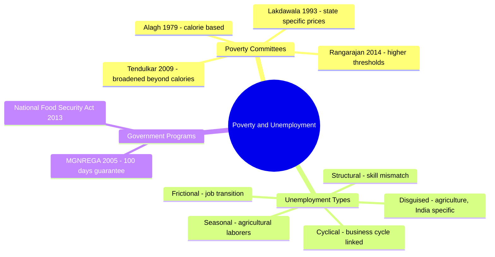

# NOTE — POVERTY & UNEMPLOYMENT IN INDIA
**Section:** GK | **Category:** Economy | **Topic:** Poverty & Unemployment | **Slug:** `eco-poverty-and-unemployment-in-india`
**Source:** 🔧 GENERAL KNOWLEDGE (standard economy reference; not yet cross-checked against PARMAR SSC reference excerpt)
**Status:** 🔧 DRAFT — awaiting AIR-91 verification before publish (⚠️ poverty-line figures and methodology are periodically revised — verify currency)
**PYQ Frequency:** 🔥 High-frequency Economy topic, connects to [[eco-five-year-plans-and-niti-aayog]] | **High Yield:** ✅

---

## 🎭 THE HOOK

For decades, India measured poverty almost entirely through one narrow lens: could a person afford enough CALORIES per day? The earliest official poverty line, set by the **Planning Commission** based on work by economist **Y.K. Alagh** (1979) and later refined by the **Lakdawala Committee** (1993) and the **Tendulkar Committee** (2009), was calorie-intake-based — a method increasingly criticized as too narrow, ignoring housing, healthcare, and education costs entirely. The debate over HOW to measure poverty has been almost as politically contentious as poverty itself, with each new committee's revised methodology often producing dramatically different "official" poverty rates for the same country in the same year.

---

## 📖 THE CORE

### Poverty Measurement — Key Committees
| Committee | Year | Approach |
|---|---|---|
| **Y.K. Alagh Committee** | 1979 | First official poverty line, based on calorie intake norms |
| **Lakdawala Committee** | 1993 | Refined poverty estimation, state-specific price indices |
| **Tendulkar Committee** | 2009 | Shifted from PURE calorie-based measurement to also include spending on health, education, and other essentials — broadened the definition |
| **Rangarajan Committee** | 2014 | Further revised methodology; proposed higher poverty-line thresholds than Tendulkar's |

### Types of Unemployment (Frequently Tested)
| Type | Definition |
|---|---|
| **Disguised Unemployment** | More people are employed in an activity than actually needed (common in Indian agriculture) — removing the "extra" workers wouldn't reduce output |
| **Seasonal Unemployment** | Unemployment that occurs during certain times of the year (e.g., agricultural laborers between harvest/sowing seasons) |
| **Structural Unemployment** | Mismatch between workers' skills and available job requirements, often due to economic/technological shifts |
| **Cyclical Unemployment** | Tied to the business cycle — rises during economic downturns/recessions, falls during expansions |
| **Frictional Unemployment** | Short-term unemployment while transitioning between jobs |
| **Open Unemployment** | Workers who are willing and able to work but cannot find any employment at all |

### Key Government Programs (Frequently Tested)
- **MGNREGA** (Mahatma Gandhi National Rural Employment Guarantee Act, 2005): guarantees **100 days** of wage employment per year to rural households willing to do unskilled manual labour — a frequently tested numerical fact.
- **National Food Security Act, 2013**: legal entitlement to subsidized food grains for a large portion of the population, addressing food-based poverty dimensions.
- **PM-KISAN**: direct income support scheme for farmers.

### Key Distinguishing Facts
- **Disguised unemployment is most associated with the AGRICULTURAL sector** in India — a large rural workforce technically "employed" but not adding proportional output; a frequently tested sector-association.
- **MGNREGA guarantees 100 days of employment, NOT a permanent job** — a legal GUARANTEE of wage work up to that limit, not unlimited employment.
- **Poverty-line methodology has changed multiple times** (Alagh → Lakdawala → Tendulkar → Rangarajan), each producing different official poverty percentages for India — a frequently tested "which committee revised what" sequence.

---

## 🧠 THE MIND MAP

---

## 🔑 THE MNEMONIC

**"Alagh counted calories, Tendulkar counted more"** — the methodological shift from pure calorie-based to broader poverty measurement.

**"100 days, not a lifetime job — that's MGNREGA's promise"** — the precise scope of MGNREGA's employment guarantee.

---

## 📌 THE PYQ ANCHOR

🔥 Poverty & Unemployment is a high-frequency Economy topic, connecting to [[eco-five-year-plans-and-niti-aayog]]. 🔧 No literal Poverty/Unemployment question confirmed in the 23/46-shift CGL-2025 sample reviewed earlier in this session, since this topic wasn't separately tagged during PYQ extraction — unemployment-type definitions and MGNREGA's "100 days" fact are textbook-standard SSC CGL Economy staples; recommend a dedicated archive cross-check.

---

## ⚠️ THE TRAP ALERT

- **Disguised unemployment is most associated with AGRICULTURE in India**, not industry or services — a frequently tested sector-specific association.
- **MGNREGA guarantees exactly 100 DAYS of employment per year**, not a permanent job or unlimited days — a frequently tested precise numerical fact.
- **The Tendulkar Committee (2009) BROADENED poverty measurement beyond pure calorie intake** — don't assume all poverty-line committees used the same calorie-only methodology; this was a deliberate methodological shift.
- **Structural and Cyclical unemployment are DIFFERENT** — Structural is about skill MISMATCH (often permanent without retraining); Cyclical is tied to the business cycle (temporary, recovers with economic growth) — a frequently confused pair.

---

## ✅ ACTIVE RECALL

1. What was the basis of India's first official poverty line (Y.K. Alagh Committee, 1979)?
2. How did the Tendulkar Committee (2009) change poverty measurement methodology?
3. What is "disguised unemployment," and which sector is it most associated with in India?
4. What does MGNREGA guarantee, and for how many days per year?
5. What is the difference between structural and cyclical unemployment?

*(Answers: 1–Calorie intake norms | 2–It broadened poverty measurement beyond pure calorie intake to also include spending on health, education, and other essentials | 3–A situation where more people are employed in an activity than actually needed, so removing some workers wouldn't reduce output; most associated with agriculture in India | 4–100 days of wage employment per year for rural households willing to do unskilled manual labour | 5–Structural unemployment results from a skill-mismatch with available jobs (often persistent); cyclical unemployment is tied to the business cycle, rising in downturns and falling in expansions)*
