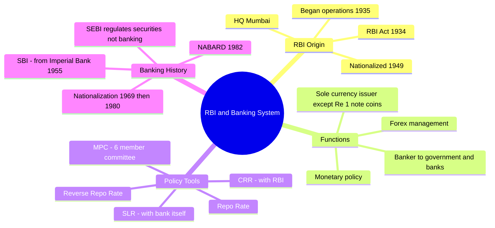

# NOTE — RBI & BANKING SYSTEM
**Section:** GK | **Category:** Economy | **Topic:** RBI & Banking System | **Slug:** `eco-rbi-and-banking-system`
**Source:** 🔧 GENERAL KNOWLEDGE (standard economy reference; not yet cross-checked against PARMAR SSC reference excerpt)
**Status:** 🔧 DRAFT — awaiting AIR-91 verification before publish
**PYQ Frequency:** 🔥 Very high-frequency Economy topic | **High Yield:** ✅

---

## 🎭 THE HOOK

India's central bank was originally a PRIVATE institution — founded under the **Reserve Bank of India Act, 1934**, and only **nationalized in 1949**, two years after independence. The **Reserve Bank of India (RBI)** is the institution that quietly controls something every single Indian interacts with daily: the value and supply of money itself. It sets the interest rates that determine your home loan EMI, decides how much cash banks must keep in reserve, prints (and destroys) the currency in your wallet, and serves as the "lender of last resort" when commercial banks run into trouble — a role dramatically tested during India's periodic banking crises. Few institutions affect ordinary economic life as constantly and invisibly as the RBI, which is exactly why it's one of SSC's most reliable Economy topics.

---

## 📖 THE CORE

### RBI: Origin & Structure
- Established under the **Reserve Bank of India Act, 1934**; began operations **1 April 1935**.
- Headquartered in **Mumbai**.
- **Nationalized in 1949** — transitioned from private shareholding to full government ownership.
- Headed by the **Governor** (currently appointed for a typically 3-year term, renewable); 🔧 current Governor's name changes periodically, verify currency.
- **First Governor**: Sir Osborne Smith (a Briton); **First Indian Governor**: C.D. Deshmukh.

### Key Functions of RBI
- **Sole authority to issue currency notes** in India (EXCEPT the ₹1 note and coins, which are issued by the **Government of India**, though distributed by RBI — a frequently tested exception).
- **Banker to the Government**: manages government accounts, public debt.
- **Banker's Bank**: holds reserves of commercial banks, acts as lender of last resort.
- **Monetary Policy**: controls money supply and credit via tools like the **Repo Rate**, **Reverse Repo Rate**, **Cash Reserve Ratio (CRR)**, **Statutory Liquidity Ratio (SLR)**.
- **Regulator of the banking sector**: licenses banks, sets prudential norms, conducts inspections.
- **Foreign exchange management**: custodian of India's foreign exchange reserves, manages exchange rate stability under FEMA (Foreign Exchange Management Act, 1999).

### Key Monetary Policy Tools (Frequently Tested)
| Tool | Definition |
|---|---|
| **Repo Rate** | Rate at which RBI lends short-term funds to commercial banks (against government securities) |
| **Reverse Repo Rate** | Rate at which RBI borrows funds FROM commercial banks (absorbing excess liquidity) |
| **Cash Reserve Ratio (CRR)** | Percentage of a bank's total deposits that must be kept as cash reserve WITH the RBI |
| **Statutory Liquidity Ratio (SLR)** | Percentage of a bank's total deposits that must be maintained in liquid assets (cash, gold, approved securities) — but held BY the bank itself, not with RBI |
| **Bank Rate** | Rate at which RBI lends long-term funds to commercial banks (distinct from the more frequently-used Repo Rate) |
| **Monetary Policy Committee (MPC)** | A 6-member committee (3 RBI + 3 government-appointed) that decides the Repo Rate; established under the RBI Act amendment, 2016 |

### Indian Banking Structure (Broad Overview)
- **Scheduled Commercial Banks**: Public Sector Banks (e.g., SBI), Private Sector Banks, Foreign Banks, Regional Rural Banks (RRBs), Small Finance Banks, Payments Banks.
- **State Bank of India (SBI)**: India's largest public sector bank, with roots tracing to the **Imperial Bank of India** (itself formed in 1921 from three Presidency Banks); nationalized/restructured into SBI in **1955**.
- **Bank Nationalization**: 14 major private banks nationalized in **1969** (under Indira Gandhi); 6 more in **1980**.
- **NABARD** (National Bank for Agriculture and Rural Development): apex institution for rural/agricultural credit, established **1982**.
- **SEBI** (Securities and Exchange Board of India): regulates the securities/stock market, NOT banking — a frequently confused regulator, distinct from RBI's banking-sector role.

---

## 🧠 THE MIND MAP

---

## 🔑 THE MNEMONIC

**"CRR sits with RBI, SLR stays at home"** — the key distinction between the two reserve ratios and where each is held.

**"1935 born, 1949 nationalized, Mumbai based"** — RBI's three foundational facts in one line.

---

## 📌 THE PYQ ANCHOR

🔥 RBI & Banking System is a very high-frequency Economy topic. 🔧 No literal RBI question confirmed in the 23/46-shift CGL-2025 sample reviewed in this session, since this topic wasn't separately tagged during PYQ extraction — Repo/Reverse Repo Rate definitions and RBI's founding facts are textbook-standard SSC CGL Economy staples; recommend a dedicated archive cross-check.

---

## ⚠️ THE TRAP ALERT

- **The ₹1 note and coins are issued by the GOVERNMENT OF INDIA, not the RBI** — RBI issues all OTHER currency notes; a frequently tested exception.
- **CRR is held WITH the RBI; SLR is held BY the bank itself** (in liquid assets) — a very commonly confused pair of reserve requirements.
- **RBI was originally a PRIVATE institution (1935-1949)**, only nationalized in 1949 — don't assume it was government-owned from inception.
- **SEBI regulates the securities/stock market, NOT banking** — a frequently tested regulator-mix-up; RBI regulates banks, SEBI regulates capital markets.

---

## ✅ ACTIVE RECALL

1. When was the RBI established, and when did it begin operations?
2. When was the RBI nationalized?
3. What is the difference between CRR and SLR?
4. Who issues the ₹1 note and coins in India, if not the RBI?
5. What is the Monetary Policy Committee (MPC), and what does it decide?

*(Answers: 1–Established under the RBI Act, 1934; began operations 1 April 1935 | 2–1949 | 3–CRR (Cash Reserve Ratio) is held WITH the RBI as cash; SLR (Statutory Liquidity Ratio) is held BY the bank itself in liquid assets like cash, gold, or approved securities | 4–The Government of India | 5–A 6-member committee (3 from RBI, 3 government-appointed) established in 2016 that decides the Repo Rate)*
