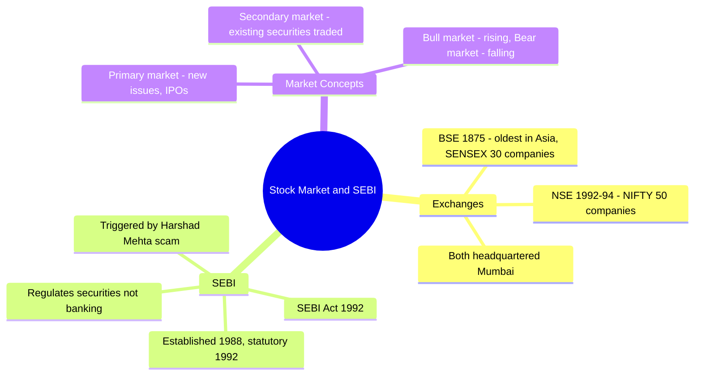

# NOTE — STOCK MARKET & SEBI
**Section:** GK | **Category:** Economy | **Topic:** Stock Market & SEBI | **Slug:** `eco-stock-market-and-sebi`
**Source:** 🔧 GENERAL KNOWLEDGE (standard economy reference; not yet cross-checked against PARMAR SSC reference excerpt)
**Status:** 🔧 DRAFT — awaiting AIR-91 verification before publish
**PYQ Frequency:** 🔥 High-frequency Economy topic, connects to [[eco-rbi-and-banking-system]] | **High Yield:** ✅

---

## 🎭 THE HOOK

Asia's oldest stock exchange isn't in Tokyo or Shanghai — it's in Mumbai. The **Bombay Stock Exchange (BSE)**, established in **1875**, predates the National Stock Exchange by well over a century and is the oldest stock exchange in all of Asia. But for decades, India's securities markets operated with minimal regulatory oversight, until a series of market scandals (most notably the 1992 Harshad Mehta securities scam) forced the government to give its market regulator real legal teeth — transforming the **Securities and Exchange Board of India (SEBI)** from an advisory body into a statutory authority with actual enforcement power.

---

## 📖 THE CORE

### Major Indian Stock Exchanges
- **Bombay Stock Exchange (BSE)**: established **1875**, Asia's OLDEST stock exchange; benchmark index is the **SENSEX** (Sensitive Index, top 30 companies by market capitalization).
- **National Stock Exchange (NSE)**: established **1992**, began operations **1994**; benchmark index is the **NIFTY 50** (top 50 companies).
- Both exchanges are headquartered in **Mumbai**.

### SEBI — Securities and Exchange Board of India
- Established **1988** as a non-statutory body; given STATUTORY powers via the **SEBI Act, 1992** — converting it from an advisory body into a legally empowered regulator.
- Headquartered in **Mumbai**.
- Primary regulator of India's securities/capital markets — distinct from the RBI, which regulates banking (see [[eco-rbi-and-banking-system]]).
- **Functions**: protecting investor interests, regulating stock exchanges and market intermediaries (brokers, merchant bankers), regulating IPOs (Initial Public Offerings) and mutual funds, preventing fraudulent/unfair trade practices (insider trading, market manipulation).
- Trigger for statutory empowerment: the **1992 Harshad Mehta Securities Scam**, which exposed massive gaps in market oversight and accelerated SEBI's transformation into a powerful statutory regulator.

### Key Market Concepts
- **IPO (Initial Public Offering)**: the process by which a private company first sells shares to the public, becoming a publicly listed company.
- **Primary Market**: where NEW securities are issued/sold for the first time (e.g., IPOs).
- **Secondary Market**: where EXISTING securities are bought/sold among investors (the day-to-day stock exchange trading most people refer to as "the stock market").
- **Bull Market**: a period of RISING stock prices/investor optimism.
- **Bear Market**: a period of FALLING stock prices/investor pessimism.
- **Market Capitalization**: total value of a company's outstanding shares (share price × number of shares).
- **Mutual Fund**: a pooled investment vehicle managed by professionals, investing collected funds across diversified securities.

### Key Distinguishing Facts
- **BSE is OLDER (1875) but NSE introduced ELECTRONIC/screen-based trading first (1994)**, modernizing Indian stock trading and pushing BSE to also adopt electronic systems.
- **SENSEX tracks 30 companies (BSE); NIFTY 50 tracks 50 companies (NSE)** — a frequently tested index-size distinction.
- **SEBI regulates the SECURITIES MARKET; RBI regulates BANKING** — two entirely separate regulatory domains, frequently tested as a distinction (see [[eco-rbi-and-banking-system]]).

---

## 🧠 THE MIND MAP

---

## 🔑 THE MNEMONIC

**"BSE is older, NSE is bigger by count"** — BSE (1875, oldest) vs. NSE (NIFTY 50, more companies tracked than SENSEX's 30).

**"SEBI for shares, RBI for banks"** — the clean regulatory-domain split between India's two major financial regulators.

---

## 📌 THE PYQ ANCHOR

🔥 Stock Market & SEBI is a high-frequency Economy topic, directly connecting to [[eco-rbi-and-banking-system]]. 🔧 No literal Stock Market question confirmed in the 23/46-shift CGL-2025 sample reviewed earlier in this session, since this topic wasn't separately tagged during PYQ extraction — BSE/NSE founding facts and SEBI's regulatory role are textbook-standard SSC CGL Economy staples; recommend a dedicated archive cross-check.

---

## ⚠️ THE TRAP ALERT

- **BSE (1875) is Asia's OLDEST stock exchange**, not NSE — a frequently tested founding-date superlative.
- **SENSEX tracks 30 companies; NIFTY 50 tracks 50 companies** — don't reverse these numbers or exchange associations.
- **SEBI regulates the SECURITIES market; RBI regulates BANKING** — two distinct regulators with separate domains; don't conflate their functions.
- **SEBI became a STATUTORY body only in 1992 (SEBI Act)**, despite being established in 1988 — a frequently tested "established vs. empowered" date distinction.

---

## ✅ ACTIVE RECALL

1. Which is Asia's oldest stock exchange, and when was it established?
2. What are the benchmark indices of the BSE and NSE, and how many companies does each track?
3. When was SEBI established, and when did it become a statutory body?
4. What event accelerated SEBI's transformation into a powerful statutory regulator?
5. What is the difference between the Primary and Secondary markets?

*(Answers: 1–The Bombay Stock Exchange (BSE), established in 1875 | 2–BSE: SENSEX (30 companies); NSE: NIFTY 50 (50 companies) | 3–Established 1988; became statutory via the SEBI Act, 1992 | 4–The 1992 Harshad Mehta Securities Scam | 5–The Primary Market is where new securities are issued for the first time (e.g., IPOs); the Secondary Market is where existing securities are traded among investors)*
