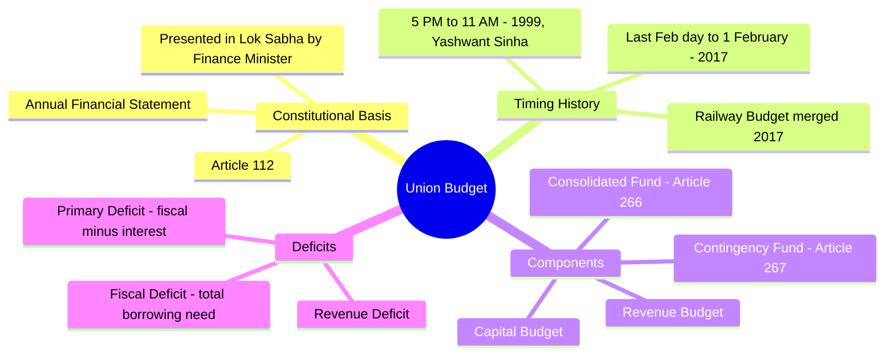

# NOTE — UNION BUDGET BASICS
**Section:** GK | **Category:** Economy | **Topic:** Union Budget | **Slug:** `eco-union-budget-basics`
**Source:** 🔧 GENERAL KNOWLEDGE (standard economy/polity reference; not yet cross-checked against PARMAR SSC reference excerpt)
**Status:** 🔧 DRAFT — awaiting AIR-91 verification before publish
**PYQ Frequency:** 🔥 High-frequency Economy/Polity crossover topic, connects to [[polity-money-bill]] | **High Yield:** ✅

---

## 🎭 THE HOOK

For 92 years, India's Union Budget was presented at exactly **5:00 PM** — a timing relic of the British colonial era, set to align with morning hours in London so British officials could read the announcement fresh. That tradition finally broke in **1999**, when Finance Minister **Yashwant Sinha** shifted the presentation to **11:00 AM**, a small but symbolic act of shedding a colonial-era convention nearly 50 years after independence. The Budget itself — formally the **Annual Financial Statement**, required under **Article 112** of the Constitution — is the single most consequential financial document India produces each year, and a handful of its structural facts (who presents it, when, and what categories of spending it covers) are tested in SSC GK almost every cycle.

---

## 📖 THE CORE

### Constitutional Basis
- The Union Budget is formally called the **Annual Financial Statement**, required under **Article 112** of the Constitution — a statement of estimated government receipts and expenditure for a financial year.
- Presented by the **Finance Minister** in the **Lok Sabha**.
- India's financial year runs **1 April to 31 March**.

### Historical Timing Shifts
- Traditionally presented at **5:00 PM** (a colonial-era convention); changed to **11:00 AM** by Finance Minister **Yashwant Sinha** in **1999**.
- Traditionally presented on the **last working day of February**; shifted to **1 February** starting **2017** (under Arun Jaitley) to allow budget implementation from the start of the financial year (1 April) rather than mid-year.
- The **Railway Budget**, historically a SEPARATE budget presented before the Union Budget (a tradition dating to 1924), was **MERGED into the Union Budget starting 2017** — ending a 92-year-old separate presentation tradition.

### Budget Components
- **Revenue Budget**: Revenue Receipts (tax + non-tax revenue) and Revenue Expenditure (day-to-day government operating costs, no asset creation).
- **Capital Budget**: Capital Receipts (loans, disinvestment proceeds) and Capital Expenditure (asset creation — infrastructure, etc.).
- **Consolidated Fund of India**: ALL government revenues, loans raised, and repayments flow into this; expenditure from it requires Parliamentary approval (Article 266).
- **Contingency Fund of India**: For urgent, unforeseen expenditure; President has access, later regularized by Parliament (Article 267).
- **Public Account of India**: Holds funds where the government acts as a banker/trustee (e.g., provident funds), not government's own money.

### Types of Deficits (Frequently Tested)
| Deficit Type | Definition |
|---|---|
| **Revenue Deficit** | Revenue Expenditure exceeds Revenue Receipts |
| **Fiscal Deficit** | Total Expenditure exceeds Total Receipts EXCLUDING borrowings — i.e., the total amount the government needs to BORROW |
| **Primary Deficit** | Fiscal Deficit MINUS Interest Payments — shows the deficit excluding the burden of past borrowing |

### Budget Passage Process
- Budget is presented, followed by a **General Discussion**, then detailed scrutiny via **Demand for Grants** examined by Parliamentary Standing Committees, then the **Appropriation Bill** (authorizes withdrawal from the Consolidated Fund) and the **Finance Bill** (gives effect to taxation proposals) are passed.
- The Finance Bill is typically treated as a **Money Bill** (see [[polity-money-bill]]) — meaning the Rajya Sabha's role is advisory/limited (14-day window only).

---

## 🧠 THE MIND MAP

---

## 🔑 THE MNEMONIC

**"5 PM became 11 AM in '99, last-Feb became 1st Feb in 2017"** — the two historic Budget-timing reforms, with their years and finance ministers.

**"Fiscal minus Interest equals Primary"** — the quick formula distinguishing Fiscal Deficit from Primary Deficit.

---

## 📌 THE PYQ ANCHOR

🔥 Union Budget Basics is a high-frequency Economy/Polity crossover topic, directly connecting to [[polity-money-bill]]. 🔧 No literal Union Budget question confirmed in the 23/46-shift CGL-2025 sample reviewed in this session, since this topic wasn't separately tagged during PYQ extraction — Article 112, deficit definitions, and the 2017 timing/Railway Budget merger reforms are textbook-standard SSC CGL Economy staples; recommend a dedicated archive cross-check.

---

## ⚠️ THE TRAP ALERT

- **The Railway Budget was a SEPARATE budget from 1924 until 2017**, when it was merged into the Union Budget — don't assume India always had a single unified budget presentation.
- **Fiscal Deficit ≠ Revenue Deficit** — Fiscal Deficit measures TOTAL borrowing need (total expenditure minus total receipts excluding borrowings); Revenue Deficit measures only the gap in DAY-TO-DAY (revenue) accounts — a frequently tested distinction.
- **The Budget presentation date moved from the last day of February to 1 February starting 2017** — under Arun Jaitley, not Yashwant Sinha (who changed the TIME, not the DATE, back in 1999) — don't conflate the two separate reforms or their respective ministers.
- **The Finance Bill is typically a Money Bill**, giving the Rajya Sabha only a limited, 14-day advisory role — don't assume both Houses have equal say over budget-related taxation legislation.

---

## ✅ ACTIVE RECALL

1. Under which Article of the Constitution is the Union Budget (Annual Financial Statement) required?
2. Who presents the Union Budget, and in which House?
3. What two timing changes did the Union Budget undergo, and in which years?
4. What is the difference between Fiscal Deficit and Primary Deficit?
5. What happened to the Railway Budget in 2017?

*(Answers: 1–Article 112 | 2–The Finance Minister, in the Lok Sabha | 3–Presentation time shifted from 5 PM to 11 AM in 1999 (Yashwant Sinha); presentation date shifted from the last day of February to 1 February starting 2017 (Arun Jaitley) | 4–Fiscal Deficit is the total amount the government needs to borrow (total expenditure minus total receipts excluding borrowings); Primary Deficit is Fiscal Deficit minus interest payments | 5–It was merged into the Union Budget, ending a separate presentation tradition dating to 1924)*
