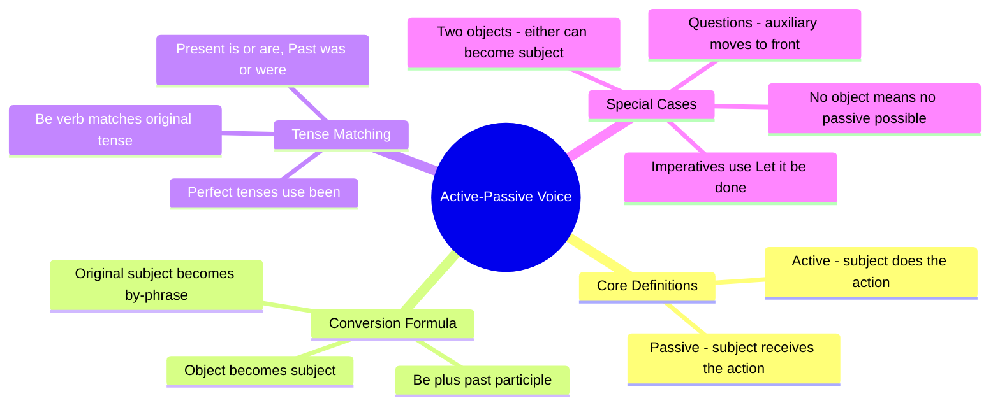

# NOTE — ACTIVE-PASSIVE VOICE
**Section:** English | **Category:** Grammar | **Topic:** Active-Passive Voice | **Slug:** `eng-active-passive-voice`
**Source:** 🔧 GENERAL KNOWLEDGE (standard English grammar reference; not yet cross-checked against PARMAR SSC reference excerpt)
**Status:** 🔧 DRAFT — awaiting AIR-91 verification before publish
**PYQ Frequency:** 🔥 Phase-2 backlog topic (from original CHANAKYA Smart Notes system doc) | **High Yield:** ✅

---

## 🎭 THE HOOK

"The dog bit the man" and "The man was bitten by the dog" describe the exact same event — but grammatically, they're built in opposite directions. In the first sentence, the dog (the DOER) is the subject; in the second, the man (the RECEIVER of the action) is the subject, and the dog gets demoted to an optional "by"-phrase at the end. That's the entire concept behind Active and Passive Voice: which noun gets to sit in the subject's chair. SSC's Voice-conversion questions test exactly one mechanical skill — can you correctly flip a sentence's structure, adjust its verb form, and preserve its tense, all without changing its meaning — and once you've internalized the conversion formula, it becomes one of the fastest-scoring question types in the entire English section.

---

## 📖 THE CORE

### Core Definitions
- **Active Voice**: Subject performs the action. (*"She writes a letter."*)
- **Passive Voice**: Subject receives the action; the doer becomes optional, introduced by "by." (*"A letter is written by her."*)

### The Conversion Formula
- **Active → Passive**: Object of the active sentence becomes the SUBJECT of the passive sentence; the verb changes to **"be" + past participle** (matching the original tense); the original subject becomes the **"by" + object** phrase (often omittable if unimportant/obvious).
- General pattern: **Object + form of "be" (matching tense) + past participle + by + Subject**.

### Tense-by-Tense Passive Formation (Frequently Tested)
| Tense | Active Example | Passive Example |
|---|---|---|
| Simple Present | She writes a letter. | A letter is written by her. |
| Simple Past | She wrote a letter. | A letter was written by her. |
| Simple Future | She will write a letter. | A letter will be written by her. |
| Present Continuous | She is writing a letter. | A letter is being written by her. |
| Past Continuous | She was writing a letter. | A letter was being written by her. |
| Present Perfect | She has written a letter. | A letter has been written by her. |
| Past Perfect | She had written a letter. | A letter had been written by her. |
| Modal (can/should/must) | She can write a letter. | A letter can be written by her. |

### Special Cases (Frequently Tested)
- **Sentences with NO object cannot be converted to passive voice** — e.g., intransitive verbs ("He sleeps," "She laughs") have no object to promote to subject, so no passive form exists.
- **Imperative sentences (commands)**: Active "Close the door" → Passive "Let the door be closed" (a distinctive structural pattern, different from declarative-sentence conversion).
- **Sentences with TWO objects** (indirect + direct object, e.g., "He gave her a book"): EITHER object can become the subject of the passive sentence — "She was given a book by him" OR "A book was given to her by him."
- **Questions**: Active "Did she write the letter?" → Passive "Was the letter written by her?" — auxiliary verb moves to the front, matching question word order.
- **Modal verbs (can, could, should, must, may)**: retain the modal, followed by "be" + past participle (e.g., "must be done," "can be written").

### When NOT to Use "By" Phrase
- The "by + doer" phrase is often dropped when the doer is unknown, obvious, or unimportant — e.g., "The window was broken" (doer unspecified) is more natural than always forcing "by someone."

---

## 🧠 THE MIND MAP

---

## 🔑 THE MNEMONIC

**"Object jumps to the front, doer drops to 'by'"** — the one-line summary of every Active-to-Passive conversion.

**"No object, no passive"** — instantly rules out intransitive-verb sentences from passive conversion, a frequently tested elimination check.

---

## 📌 THE PYQ ANCHOR

🔥 Active-Passive Voice was explicitly listed as a Phase-2 backlog topic in the original CHANAKYA Smart Notes system document. 🔧 No PYQ data from this session's CGL-2025 GK extraction applies here, since this is an English topic, not GK — this session's extraction scope was GK-only. Active-Passive conversion (especially tense-matching and imperative-sentence conversion) is consistently one of the highest-frequency English Grammar topics across SSC CGL Tier 1 historically; recommend a dedicated English PYQ archive review.

---

## ⚠️ THE TRAP ALERT

- **Intransitive verbs (no object) CANNOT be converted to passive voice** — a sentence like "He sleeps" has no valid passive form; don't force a conversion where none exists.
- **Imperative sentences use a DIFFERENT passive pattern ("Let + object + be + past participle")**, NOT the standard object-subject swap — e.g., "Open the window" → "Let the window be opened," not "The window is opened."
- **The "be" verb in the passive MUST match the original sentence's exact tense** — a common error is using the wrong "be" form (e.g., using simple "is" when the original was Present Continuous, which requires "is being").

---

## ✅ ACTIVE RECALL

1. What is the core structural difference between Active and Passive Voice?
2. What is the general formula for converting an Active sentence to Passive?
3. Can a sentence with an intransitive verb (no object) be converted to passive voice? Why or why not?
4. How is an imperative sentence (a command) converted to passive voice? Give an example.
5. Convert this sentence to passive voice: "She is writing a letter."

*(Answers: 1–In Active Voice, the subject performs the action; in Passive Voice, the subject receives the action | 2–Object becomes the subject + "be" (matching tense) + past participle + "by" + original subject | 3–No, because there is no object to promote to the subject position in the passive sentence | 4–Using "Let + object + be + past participle," e.g., "Close the door" → "Let the door be closed" | 5–"A letter is being written by her.")*
