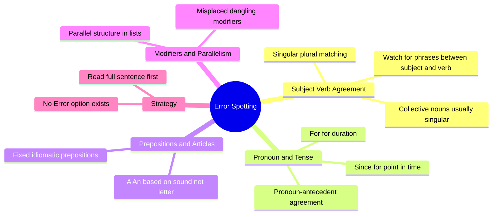

# NOTE — ERROR SPOTTING
**Section:** English | **Category:** Grammar | **Topic:** Error Spotting | **Slug:** `eng-error-spotting`
**Source:** 🔧 GENERAL KNOWLEDGE (standard English grammar reference; not yet cross-checked against PARMAR SSC reference excerpt)
**Status:** 🔧 DRAFT — awaiting AIR-91 verification before publish
**PYQ Frequency:** 🔥 Phase-2 backlog topic (from original CHANAKYA Smart Notes system doc) | **High Yield:** ✅

---

## 🎭 THE HOOK

Error Spotting questions don't test whether you know grammar rules in the abstract — they test whether you can catch a SPECIFIC sentence breaking ONE of roughly a dozen recurring rules, usually in a way designed to sound almost right. SSC doesn't invent new grammar mistakes each year; it recycles the same handful of error categories — subject-verb agreement, pronoun mismatches, wrong prepositions, tense inconsistency — dressed up in different sentences. Once you've internalized the dozen or so categories examiners actually draw from, Error Spotting stops being a test of "do you know English" and becomes a test of "can you pattern-match fast," which is a completely different, much more coachable skill.

---

## 📖 THE CORE

### The Recurring Error Categories (Frequently Tested)

**1. Subject-Verb Agreement**
- Singular subject → singular verb; plural subject → plural verb.
- Trap: a long phrase between subject and verb (e.g., "The list of items **are** long" — WRONG; should be "**is**" since "list," not "items," is the subject).
- Collective nouns (team, family, jury) usually take a SINGULAR verb in standard usage.

**2. Pronoun Errors**
- Pronoun must agree in number/gender with its antecedent (e.g., "Everyone should bring **their** book" is commonly flagged in formal SSC grammar as needing "**his/her**" — though usage varies; SSC typically tests the traditional rule).
- Reflexive pronoun misuse: "He hurt **himself**" (correct) vs. "He hurt **him**" (wrong, if referring to the same person).

**3. Tense Errors**
- Inconsistent tense within a sentence (e.g., "He **was** going to the market and **buys** vegetables" — mixing past and present incorrectly).
- "Since" pairs with Present Perfect/Past Perfect tense + a POINT IN TIME; "For" pairs with a DURATION (e.g., "I have lived here **since** 2015" vs. "I have lived here **for** 5 years").

**4. Preposition Errors**
- Fixed/idiomatic prepositions (e.g., "married **to**," not "married **with**"; "different **from**," not "different **than**" in strict formal usage; "good **at**," not "good **in**" for skills).

**5. Articles (A/An/The)**
- "A" before consonant SOUNDS, "An" before vowel SOUNDS (not just letters — e.g., "an hour" because "h" is silent; "a university" because "u" sounds like "yu").

**6. Modifiers (Misplaced/Dangling)**
- A modifying phrase should sit next to the word it modifies (e.g., "Walking down the street, **the trees looked beautiful**" — WRONG, implies the trees were walking; should be "Walking down the street, **I saw that the trees looked beautiful**").

**7. Parallelism**
- Items in a list/comparison must share the same grammatical form (e.g., "She likes **swimming, running, and to cycle**" — WRONG; should be "swimming, running, and **cycling**").

**8. Redundancy / Faulty Comparison**
- Avoid double comparatives/superlatives ("more better" — WRONG; "better" alone is correct) and incomplete comparisons ("India's population is larger than **China**" — WRONG if comparing population to a country, not a population; should be "than **China's**").

### Approach Strategy
- Read the ENTIRE sentence first before marking an error — many SSC Error Spotting questions split a sentence into 3-4 underlined segments, and the error may not be in the most "obvious-looking" segment.
- If no error is found after checking all categories, some SSC formats include a **"No Error"** option — don't force-find an error if the sentence is genuinely correct.

---

## 🧠 THE MIND MAP

---

## 🔑 THE MNEMONIC

**"SPTAMPR"** — Subject-verb, Pronoun, Tense, Articles, Modifiers, Parallelism, Redundancy — the seven recurring error categories SSC draws from, condensed into one scannable acronym.

**"Since for a POINT, For for a STRETCH"** — instantly resolves the most commonly tested Since-vs-For confusion.

---

## 📌 THE PYQ ANCHOR

🔥 Error Spotting was explicitly listed as a Phase-2 backlog topic in the original CHANAKYA Smart Notes system document. 🔧 No PYQ data from this session's CGL-2025 GK extraction applies here, since Error Spotting is an English topic, not GK — this session's extraction scope was GK-only. Error Spotting (especially Subject-Verb Agreement and Since/For) is consistently one of the highest-frequency English topics across SSC CGL Tier 1 historically; recommend a dedicated English PYQ archive review.

---

## ⚠️ THE TRAP ALERT

- **A long phrase between subject and verb is the #1 Subject-Verb Agreement trap** — always identify the TRUE grammatical subject, ignoring intervening phrases, before checking verb agreement.
- **"Since" requires a specific POINT IN TIME; "For" requires a DURATION** — using them interchangeably is one of the most frequently tested single-word errors.
- **Faulty/incomplete comparisons** (comparing a country's population to another country, instead of to that country's population) are a subtle but recurring trap — always check that BOTH sides of a comparison are the same type of thing.

---

## ✅ ACTIVE RECALL

1. What is the most common trap in Subject-Verb Agreement errors?
2. What's the difference between using "since" and "for" in a sentence about duration?
3. How do you decide between using "a" or "an" before a word?
4. What is a "dangling modifier," and give an example of how it creates an error.
5. What is "faulty comparison," and what category of error does "India's population is larger than China" (instead of "China's") fall under?

*(Answers: 1–A long phrase appearing between the subject and verb, causing the verb to mistakenly agree with a nearby noun instead of the true subject | 2–"Since" is used with a specific point in time (e.g., since 2015); "for" is used with a duration (e.g., for 5 years) | 3–Based on the SOUND of the following word, not its spelling — "a" before consonant sounds, "an" before vowel sounds | 4–A modifying phrase placed so it appears to describe the wrong noun, e.g., "Walking down the street, the trees looked beautiful" (implying the trees were walking) | 5–Faulty/incomplete comparison — comparing a population (a number) to a country (an entity), rather than to that country's population)*
