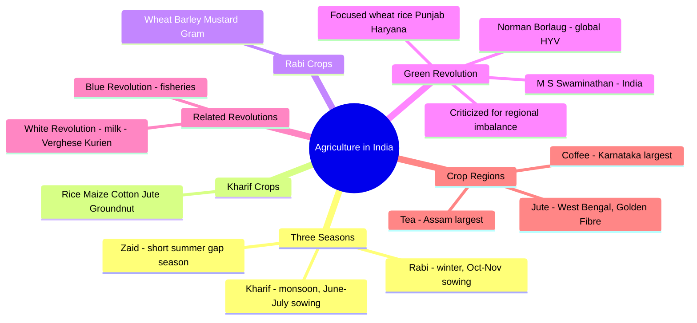

# NOTE — AGRICULTURE IN INDIA
**Section:** GK | **Category:** Geography | **Topic:** Agriculture | **Slug:** `geo-agriculture`
**Source:** 🔧 GENERAL KNOWLEDGE (standard geography/economy reference; not yet cross-checked against PARMAR SSC reference excerpt)
**Status:** 🔧 DRAFT — awaiting AIR-91 verification before publish
**PYQ Frequency:** 🔥 Phase-2 backlog topic (from original CHANAKYA Smart Notes system doc) | **High Yield:** ✅

---

## 🎭 THE HOOK

India runs three farming calendars at once, layered on top of each other, named after seasons most Indians associate with festivals rather than farm work. **Kharif** crops are sown with the monsoon's arrival and harvested as it retreats; **Rabi** crops are sown right after the monsoon leaves and harvested as summer heat returns; and squeezed into the gap between the two sits **Zaid** — a short, intensive summer cropping season most aspirants forget exists at all, reserved for fast-growing, irrigation-dependent crops like watermelon and cucumber. Getting this three-season rhythm right — which crop belongs to which season, and why — is one of the most reliably profitable things an SSC aspirant can memorize, because Indian agriculture questions test almost nothing else as consistently.

---

## 📖 THE CORE

### The Three Cropping Seasons
| Season | Sowing | Harvesting | Key Crops |
|---|---|---|---|
| **Kharif** ("monsoon crop") | June-July (with monsoon onset) | September-October | **Rice, Maize, Cotton, Jute, Groundnut, Soybean, Bajra (Pearl Millet)** |
| **Rabi** ("winter crop") | October-November (post-monsoon) | March-April | **Wheat, Barley, Mustard, Gram (Chickpea), Peas** |
| **Zaid** (short summer season) | March-June (between Rabi harvest and Kharif sowing) | Before monsoon onset | **Watermelon, Cucumber, Muskmelon, Vegetables — short-duration, irrigation-dependent crops** |

### The "Green Revolution" (Frequently Tested Era)
- Launched in India starting mid-1960s, primarily associated with **M.S. Swaminathan** (often called the "Father of the Green Revolution in India"), building on high-yield variety (HYV) seed technology pioneered globally by **Norman Borlaug**.
- Focused initially on **wheat and rice**, concentrated in states like **Punjab, Haryana, and Western UP** — areas with reliable irrigation.
- Key elements: HYV seeds, chemical fertilizers, pesticides, expanded irrigation, mechanization.
- Criticized for regional imbalance (benefited irrigated northwest India disproportionately) and environmental concerns (groundwater depletion, soil degradation from intensive fertilizer use).
- Related: **White Revolution** (Operation Flood, milk production, associated with **Verghese Kurien**) and **Blue Revolution** (fisheries) are SEPARATE, commonly confused "revolutions" — don't mix these up with the Green Revolution.

### Major Crop-to-Region Associations (Frequently Tested)
- **Rice**: West Bengal, Uttar Pradesh, Punjab (largest producers vary by year; West Bengal/UP historically top producers).
- **Wheat**: Uttar Pradesh, Punjab, Madhya Pradesh — India's primary Rabi cereal.
- **Cotton**: Gujarat, Maharashtra — grown extensively in Black/Regur soil regions.
- **Sugarcane**: Uttar Pradesh, Maharashtra.
- **Tea**: Assam (largest producer), West Bengal (Darjeeling), Tamil Nadu, Kerala — requires laterite/well-drained soil, high rainfall, and hilly terrain.
- **Coffee**: Karnataka (largest producer), Kerala, Tamil Nadu — grown mainly in the Western Ghats.
- **Jute**: West Bengal — known as the "Golden Fibre" of India.

### Irrigation & Land Use
- Major irrigation sources: canals, wells/tube wells (largest contributor today), tanks.
- **Net Sown Area** vs. **Gross Cropped Area**: Gross Cropped Area accounts for multiple cropping on the same land within a year (e.g., a field used for both Kharif and Rabi crops counts twice in Gross Cropped Area but once in Net Sown Area).

---

## 🧠 THE MIND MAP

---

## 🔑 THE MNEMONIC

**"Kharif comes with rain, Rabi comes with cold, Zaid is the short gap in between"** — the three-season cycle in one sentence.

**"Green for grain, White for milk, Blue for fish"** — the three colour-coded agricultural revolutions and what each targeted, preventing mix-ups.

---

## 📌 THE PYQ ANCHOR

🔥 Agriculture was explicitly listed as a Phase-2 backlog topic in the original CHANAKYA Smart Notes system document. 🔧 No literal Agriculture question confirmed in the 23/46-shift CGL-2025 sample reviewed in this session — Kharif/Rabi crop classification and the Green Revolution's key figures are textbook-standard SSC CGL Geography/Economy staples; recommend archive cross-check.

---

## ⚠️ THE TRAP ALERT

- **Rice is a KHARIF crop, Wheat is a RABI crop** — the single most commonly tested crop-season pairing; don't reverse them.
- **M.S. Swaminathan led India's Green Revolution; Norman Borlaug pioneered the underlying HYV technology globally** — both names are tested, but represent different scopes (India-specific vs. global pioneer).
- **The Green Revolution, White Revolution, and Blue Revolution are THREE SEPARATE initiatives** (grain, milk, fisheries respectively) — a frequently tested "which revolution is associated with which person/sector" trap; don't conflate Verghese Kurien (milk) with Swaminathan (grain).
- **Zaid is a real, distinct third cropping season** (not just "leftover" farming) — frequently the most-forgotten of the three seasons in aspirant recall.

---

## ✅ ACTIVE RECALL

1. Name India's three cropping seasons, along with their approximate sowing periods.
2. Give two examples of Kharif crops and two examples of Rabi crops.
3. Who is known as the "Father of the Green Revolution in India," and which crops did it primarily focus on?
4. What are the White Revolution and Blue Revolution associated with, and who is linked to the White Revolution?
5. Which Indian state is the largest producer of tea? Which is the largest producer of coffee?

*(Answers: 1–Kharif (June-July sowing), Rabi (October-November sowing), Zaid (March-June, short summer season) | 2–Kharif: rice, cotton (or maize, jute, groundnut); Rabi: wheat, mustard (or barley, gram) | 3–M.S. Swaminathan; primarily focused on wheat and rice | 4–White Revolution = milk production (Operation Flood, associated with Verghese Kurien); Blue Revolution = fisheries | 5–Tea: Assam; Coffee: Karnataka)*
