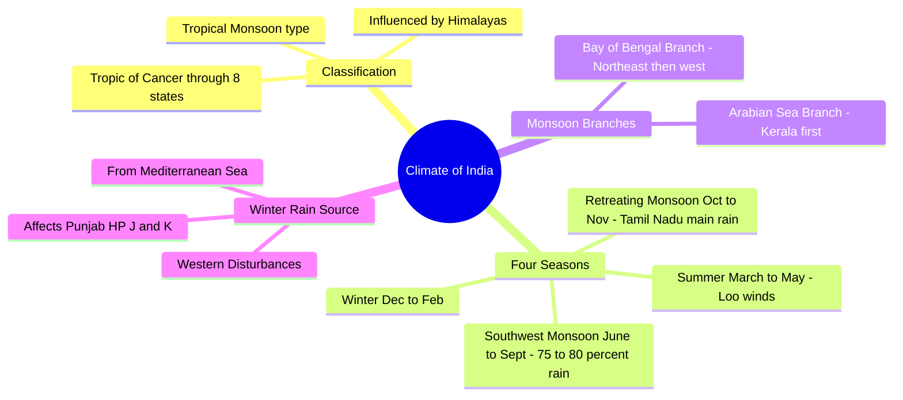

# NOTE — CLIMATE OF INDIA
**Section:** GK | **Category:** Geography | **Topic:** Climate | **Slug:** `geo-climate`
**Source:** 🔧 GENERAL KNOWLEDGE (standard geography reference; not yet cross-checked against PARMAR SSC reference excerpt)
**Status:** 🔧 DRAFT — awaiting AIR-91 verification before publish
**PYQ Frequency:** 🔥 Phase-2 backlog topic (from original CHANAKYA Smart Notes system doc) | **High Yield:** ✅

---

## 🎭 THE HOOK

Every June, something happens over the Indian Ocean that the entire agricultural economy of a billion-plus people depends on: wind direction itself reverses. For half the year, dry winds blow from land to sea; then, driven by a temperature difference between a rapidly heating Asian landmass and a comparatively cooler ocean, the wind flips and starts carrying moisture-loaded air FROM the sea TOWARD the land instead. This seasonal reversal — the **Monsoon** — is so fundamental to India's climate that the entire system is officially classified as a **"Monsoon type" of climate**, the only climate classification named after a single weather phenomenon's behavior rather than a temperature/rainfall range. A poor monsoon year doesn't just mean less rain — historically, it has meant famine, and even today, it still moves the agricultural economy of an entire nation.

---

## 📖 THE CORE

### Overall Classification
- India's climate is classified as **"Tropical Monsoon"** type — characterized by a complete seasonal wind reversal that brings concentrated, heavy rainfall in specific months.
- Influenced by: latitude (Tropic of Cancer passes through the middle of India), the **Himalayas** (acting as a climatic barrier, blocking cold Central Asian winds and trapping monsoon moisture), distance from the sea, altitude, and relief.

### The Four Seasons (India Meteorological Department Classification)
| Season | Months | Key Feature |
|---|---|---|
| **Winter (Cold Weather Season)** | December - February | Generally dry, clear skies; cold waves in north India; light rainfall in some regions from "Western Disturbances" |
| **Summer (Hot Weather Season)** | March - May | Rising temperatures; **Loo** (hot, dry winds) in north/northwest India; pre-monsoon showers ("Mango showers" in some southern regions) |
| **Southwest Monsoon Season (Rainy Season)** | June - September | Main rainy season; accounts for roughly **75-80% of India's annual rainfall**; monsoon winds arrive via two branches |
| **Retreating/Northeast Monsoon Season** | October - November | Southwest monsoon withdraws; **Tamil Nadu and parts of the southeastern coast receive their MAIN rainfall during this period**, from the retreating Northeast Monsoon (a major exception to the general June-September rainy pattern) |

### Monsoon Mechanics
- **Two branches of Southwest Monsoon**:
  - **Arabian Sea Branch** — arrives first, brings rain to the Western Ghats (Kerala typically receives India's FIRST monsoon rainfall, around 1 June).
  - **Bay of Bengal Branch** — moves up through the northeast, curves westward, brings rain to West Bengal, the Northeast, and gradually the Indo-Gangetic plains.
- **Mechanism (simplified)**: differential heating between the Asian landmass (heats up faster, creating a low-pressure zone) and the relatively cooler Indian Ocean (high-pressure) drives moisture-laden winds from sea to land in summer; the pattern reverses in winter (land cools faster, creating high pressure, pushing dry winds from land to sea — the Northeast Monsoon).
- **Tropic of Cancer** passes through 8 Indian states: Gujarat, Rajasthan, Madhya Pradesh, Chhattisgarh, Jharkhand, West Bengal, Tripura, and Mizoram.

### Western Disturbances
- Winter rainfall/snowfall in north India (Punjab, Himachal Pradesh, J&K) is caused by **Western Disturbances** — low-pressure systems originating over the **Mediterranean Sea**, traveling eastward, distinct from the monsoon system entirely.

---

## 🧠 THE MIND MAP

---

## 🔑 THE MNEMONIC

**"Kerala first, Tamil Nadu last"** — Kerala gets the FIRST monsoon rainfall (Southwest, ~1 June); Tamil Nadu gets its MAIN rainfall LAST (Northeast retreating monsoon, Oct-Nov) — the two standout exceptions in India's monsoon timing.

**"75-80% in one season"** — the Southwest Monsoon (June-September) alone delivers the vast majority of India's annual rainfall.

---

## 📌 THE PYQ ANCHOR

🔥 Climate was explicitly listed as a Phase-2 backlog topic in the original CHANAKYA Smart Notes system document. 🔧 No literal Climate question confirmed in the 23/46-shift CGL-2025 sample reviewed in this session — monsoon branches, Tamil Nadu's exceptional rainfall pattern, and Western Disturbances are textbook-standard SSC CGL Geography staples; recommend archive cross-check.

---

## ⚠️ THE TRAP ALERT

- **Tamil Nadu receives its MAIN rainfall from the RETREATING Northeast Monsoon (Oct-Nov), NOT the Southwest Monsoon (Jun-Sep)** — a very frequently tested exception to the general Indian rainfall pattern.
- **Western Disturbances originate over the MEDITERRANEAN SEA**, not the Arabian Sea or Bay of Bengal — and bring WINTER rain/snow to north India, completely separate from the monsoon system.
- **Kerala typically receives India's FIRST monsoon rainfall** (around 1 June, via the Arabian Sea branch) — don't confuse with the Bay of Bengal branch, which arrives in the Northeast first.
- **"Loo"** refers to hot, dry summer winds in north/northwest India (March-May) — don't confuse with monsoon winds, which are moisture-laden.

---

## ✅ ACTIVE RECALL

1. How is India's overall climate classified, and what is its defining feature?
2. What percentage of India's annual rainfall comes from the Southwest Monsoon season (June-September)?
3. Name the two branches of the Southwest Monsoon, and which Indian region/state each reaches first.
4. Which Indian state/region receives its MAIN rainfall from the Northeast (retreating) Monsoon rather than the Southwest Monsoon?
5. What causes winter rainfall/snowfall in north India, and where does this weather system originate?

*(Answers: 1–"Tropical Monsoon" type; defined by a seasonal reversal of wind direction | 2–Roughly 75-80% | 3–Arabian Sea Branch (reaches Kerala/Western Ghats first) and Bay of Bengal Branch (reaches the Northeast first) | 4–Tamil Nadu (and parts of the southeastern coast) | 5–Western Disturbances, originating over the Mediterranean Sea)*
