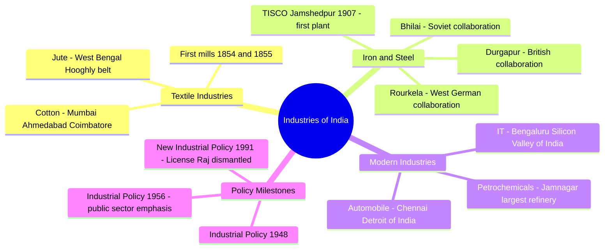

# NOTE — INDUSTRIES OF INDIA
**Section:** GK | **Category:** Geography | **Topic:** Industries of India | **Slug:** `geo-industries-of-india`
**Source:** 🔧 GENERAL KNOWLEDGE (standard geography/economy reference; not yet cross-checked against PARMAR SSC reference excerpt)
**Status:** 🔧 DRAFT — awaiting AIR-91 verification before publish
**PYQ Frequency:** 🔥 High-frequency Geography/Economy crossover topic, connects to [[geo-soils.md]] and [[hist-mauryan-empire]] | **High Yield:** ✅

---

## 🎭 THE HOOK

India's first modern textile mill opened in **Mumbai in 1854**, and that single industrial seed eventually grew into a sprawling map of regional industrial clusters, each one rooted in a specific local resource: cotton mills cluster where cotton grows AND humid coastal air keeps thread from snapping (Mumbai, Ahmedabad); jute mills cluster almost exclusively around the Hooghly River in West Bengal, near both the raw jute fields of the Ganga delta AND a navigable river for export; iron and steel plants cluster near the coal-and-iron-ore belt of Chhotanagpur Plateau, because moving raw materials is far more expensive than moving finished steel. Indian industry isn't randomly scattered — it's a map of resource logic.

---

## 📖 THE CORE

### Major Industries & Their Hubs (Frequently Tested)
| Industry | Major Hub(s) | Key Resource Logic |
|---|---|---|
| **Cotton Textiles** | Mumbai, Ahmedabad, Coimbatore | Humid climate (prevents thread breakage) + cotton-growing Black Soil regions nearby |
| **Jute Textiles** | West Bengal (Hooghly River belt) | Proximity to jute-growing Ganga delta + river transport for export |
| **Iron & Steel** | Jamshedpur (Jharkhand — TISCO, India's first major steel plant, 1907), Bhilai (Chhattisgarh), Durgapur (West Bengal), Rourkela (Odisha) | Proximity to the Chhotanagpur Plateau's coal AND iron ore deposits |
| **IT/Software** | Bengaluru ("Silicon Valley of India"), Hyderabad, Pune, Chennai | Skilled workforce, favorable government policy, established tech ecosystem |
| **Automobile** | Chennai ("Detroit of India"), Pune, Gurugram | Established component-supplier ecosystems, port access (Chennai) |
| **Petrochemicals** | Jamnagar (Gujarat, world's largest oil refining complex, Reliance), Vadodara | Proximity to crude oil import/refining infrastructure |
| **Sugar** | Uttar Pradesh, Maharashtra | Proximity to sugarcane-growing regions |
| **Shipbuilding** | Kochi, Visakhapatnam, Mumbai | Coastal port access |

### Key Historical/Foundational Facts
- **First cotton textile mill** in India: established in **Mumbai, 1854**.
- **First jute mill**: established near **Kolkata (Rishra), 1855**.
- **Tata Iron and Steel Company (TISCO/Tata Steel)**, established **1907** at **Jamshedpur**, was India's FIRST major iron and steel plant, founded by **Jamsetji Tata**.
- **Bhilai Steel Plant** (Chhattisgarh) was established with **Soviet Union** collaboration; **Rourkela Steel Plant** (Odisha) with **West German** collaboration; **Durgapur Steel Plant** (West Bengal) with **British** collaboration — all part of post-independence Second Five Year Plan-era industrialization (see [[eco-five-year-plans-and-niti-aayog]]).

### Industrial Policy Milestones
- **Industrial Policy Resolution, 1948**: first post-independence industrial policy, established a mixed economy framework.
- **Industrial Policy Resolution, 1956**: emphasized the PUBLIC sector's dominant role, classified industries into three categories by ownership structure (exclusively state, mixed, or private).
- **New Industrial Policy, 1991**: dismantled most licensing requirements (the "License Raj") as part of the broader 1991 economic reforms (see [[eco-1991-reforms]]).

---

## 🧠 THE MIND MAP

---

## 🔑 THE MNEMONIC

**"Cotton needs humidity, Jute needs the Hooghly, Steel needs Chhotanagpur"** — three classic industries, each tied to its defining resource logic.

**"Bhilai-Soviet, Rourkela-German, Durgapur-British"** — the three Second-Plan-era steel plants and their foreign collaboration partners.

---

## 📌 THE PYQ ANCHOR

🔥 Industries of India is a high-frequency Geography/Economy crossover topic, connecting to [[eco-five-year-plans-and-niti-aayog]] and [[eco-1991-reforms]]. 🔧 No literal Industries question confirmed in the 23/46-shift CGL-2025 sample reviewed earlier in this session, since this topic wasn't separately tagged during PYQ extraction — industry-hub matching and steel-plant foreign-collaboration facts are textbook-standard SSC CGL Geography/Economy staples; recommend a dedicated archive cross-check.

---

## ⚠️ THE TRAP ALERT

- **TISCO (Jamshedpur, 1907) was India's FIRST major iron and steel plant**, founded by Jamsetji Tata — predating the post-independence public-sector steel plants by four decades; a frequently tested "first" fact.
- **Bhilai, Rourkela, and Durgapur steel plants each had a DIFFERENT foreign collaboration partner** (Soviet Union, West Germany, Britain respectively) — a frequently tested, easily-scrambled trio.
- **Jute industry clusters almost EXCLUSIVELY around West Bengal's Hooghly River**, NOT spread evenly across jute-growing states — a frequently tested geographic concentration fact.
- **The "License Raj" was dismantled by the New Industrial Policy, 1991**, NOT the 1956 Industrial Policy Resolution, which actually EXPANDED public-sector dominance — don't confuse the two policy directions.

---

## ✅ ACTIVE RECALL

1. Where and when was India's first cotton textile mill established? Its first jute mill?
2. Which company built India's first major iron and steel plant, and where?
3. Name the three Second-Plan-era steel plants and their respective foreign collaboration partners.
4. What is Bengaluru commonly nicknamed, and why?
5. What major policy change did the New Industrial Policy, 1991 bring about?

*(Answers: 1–Cotton: Mumbai, 1854; Jute: near Kolkata (Rishra), 1855 | 2–Tata Iron and Steel Company (TISCO), at Jamshedpur, 1907, founded by Jamsetji Tata | 3–Bhilai (Soviet Union), Rourkela (West Germany), Durgapur (Britain) | 4–"Silicon Valley of India," due to its concentration of IT/software companies | 5–It dismantled most industrial licensing requirements (the "License Raj"), part of the broader 1991 economic liberalization reforms)*
