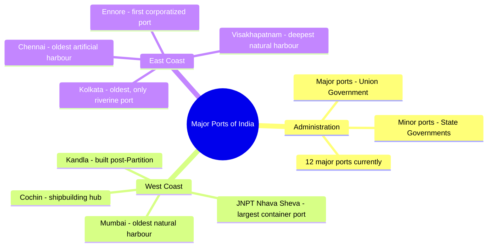

# NOTE — MAJOR PORTS OF INDIA
**Section:** GK | **Category:** Geography | **Topic:** Major Ports of India | **Slug:** `geo-major-ports-of-india`
**Source:** 🔧 GENERAL KNOWLEDGE (standard geography reference; not yet cross-checked against PARMAR SSC reference excerpt)
**Status:** 🔧 DRAFT — awaiting AIR-91 verification before publish
**PYQ Frequency:** 🔥 High-frequency Geography topic, connects to [[geo-industries-of-india]] | **High Yield:** ✅

---

## 🎭 THE HOOK

India has roughly **7,500 kilometres of coastline**, and along it sits a deliberately split port system: **Major Ports**, directly administered/regulated by the Union Government, and hundreds of **Minor/Intermediate Ports**, administered by state governments. That single administrative split is itself a frequently tested fact, but the more reliably-tested layer underneath it is simpler: each major port has a defining specialty or superlative — India's largest port by container traffic, its first artificially-built major port, its only major LANDLOCKED-feeling port tucked deep in a creek — and matching port to superlative is the exam's favourite move.

---

## 📖 THE CORE

### Administrative Structure
- **Major Ports**: administered/regulated by the UNION (Central) Government, under the Major Port Authorities Act, 2021 (replacing the earlier Major Port Trusts Act, 1963).
- **Minor/Intermediate Ports**: administered by STATE Governments — a frequently tested Centre-vs-State port-administration split.
- India currently has **12 Major Ports** (this number has changed over time as ports were added/reclassified — verify current count).

### Major Ports — West Coast (Frequently Tested)
| Port | State | Note |
|---|---|---|
| **Kandla (Deendayal Port)** | Gujarat | Built post-independence (1950s) specifically to compensate for the loss of Karachi port to Pakistan after Partition |
| **Mumbai Port** | Maharashtra | One of India's oldest and busiest natural harbours |
| **Jawaharlal Nehru Port (Nhava Sheva)** | Maharashtra | India's LARGEST container port by traffic volume; built to relieve congestion at Mumbai Port |
| **Mormugao** | Goa | Known for iron ore exports |
| **New Mangalore** | Karnataka | — |
| **Cochin (Kochi)** | Kerala | Natural harbour, major shipbuilding hub |

### Major Ports — East Coast
| Port | State | Note |
|---|---|---|
| **Kolkata (including Haldia)** | West Bengal | India's OLDEST major port, and the only major RIVERINE port (on the Hooghly River, not directly on the open sea) |
| **Paradip** | Odisha | Major for mineral/ore exports |
| **Visakhapatnam (Vizag)** | Andhra Pradesh | India's deepest natural harbour port on the east coast |
| **Chennai** | Tamil Nadu | One of India's oldest artificial harbours |
| **Ennore (Kamarajar Port)** | Tamil Nadu | India's first major port structured as a CORPORATIZED entity (company, not a trust) from inception |
| **V.O. Chidambaranar (Tuticorin)** | Tamil Nadu | — |

### Other Notable Port
- **Port Blair**: Andaman & Nicobar Islands — administered differently, given the Union Territory's distinct status.

### Key Distinguishing Facts
- **Jawaharlal Nehru Port (Nhava Sheva)** is India's LARGEST port by CONTAINER traffic — built specifically to decongest the older, naturally-formed Mumbai Port.
- **Kolkata Port is India's OLDEST major port AND its only major RIVERINE port** — situated on the Hooghly River rather than directly on open coastline, requiring constant dredging to remain navigable.
- **Kandla Port (Gujarat)** was built specifically as a REPLACEMENT for Karachi Port after Partition (1947) moved Karachi to Pakistan — a frequently tested historical-cause fact.
- **Ennore (Kamarajar) Port** was India's first port set up as a fully CORPORATIZED entity, distinct from the trust-based structure of older major ports.

---

## 🧠 THE MIND MAP

---

## 🔑 THE MNEMONIC

**"Kolkata is oldest and riverine, JNPT is largest and container-focused"** — the two most-tested port superlatives, kept distinct.

**"Kandla replaced Karachi after Partition"** — the historical-cause anchor for Kandla's existence.

---

## 📌 THE PYQ ANCHOR

🔥 Major Ports of India is a high-frequency Geography topic, connecting to [[geo-industries-of-india]]. 🔧 No literal Major Ports question confirmed in the 23/46-shift CGL-2025 sample reviewed earlier in this session, since this topic wasn't separately tagged during PYQ extraction — port-to-state matching and port superlatives are textbook-standard SSC CGL Geography staples; recommend a dedicated archive cross-check.

---

## ⚠️ THE TRAP ALERT

- **Kolkata Port is the ONLY major RIVERINE port**, situated on the Hooghly River, not directly on open coastline — a frequently tested unique-status fact.
- **Jawaharlal Nehru Port (Nhava Sheva) is India's LARGEST port by container traffic**, NOT Mumbai Port — don't confuse the two adjacent Maharashtra ports; JNPT was built specifically to relieve Mumbai Port's congestion.
- **Major Ports are Union-administered; Minor/Intermediate Ports are State-administered** — a frequently tested administrative-split fact.
- **Kandla Port was built specifically to replace Karachi Port after Partition (1947)** — don't assume it predates independence; it's a post-1947 strategic creation.

---

## ✅ ACTIVE RECALL

1. What is the difference between a "Major Port" and a "Minor/Intermediate Port" in terms of administration?
2. Which port is India's largest by container traffic, and why was it built?
3. Which port is India's oldest major port, and what unique geographic feature distinguishes it from most other major ports?
4. Why was Kandla Port built, and when?
5. Which port was India's first to be structured as a corporatized entity?

*(Answers: 1–Major Ports are administered by the Union Government; Minor/Intermediate Ports are administered by State Governments | 2–Jawaharlal Nehru Port (Nhava Sheva), Maharashtra; built to relieve congestion at the older Mumbai Port | 3–Kolkata Port; it is the only major RIVERINE port, situated on the Hooghly River rather than directly on open coastline | 4–Built post-independence (1950s) in Gujarat to replace Karachi Port, lost to Pakistan after Partition (1947) | 5–Ennore (Kamarajar) Port, Tamil Nadu)*
