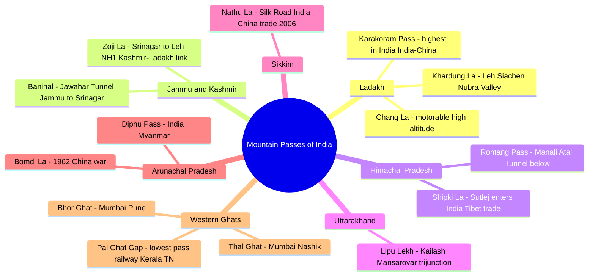

# NOTE — MOUNTAIN PASSES OF INDIA
**Section:** GK | **Category:** Geography | **Topic:** Mountain Passes of India | **Slug:** `geo-mountain-passes-of-india`
**Source:** 🔧 GENERAL KNOWLEDGE (standard physical geography reference; not yet cross-checked against PARMAR SSC reference excerpt)
**Status:** 🔧 DRAFT — awaiting AIR-91 verification before publish
**PYQ Frequency:** 🔥 High-frequency — pass-state matching and strategic importance are standard SSC CGL Geography questions | **High Yield:** ✅

---

## 🎭 THE HOOK

Before roads and railways, mountain passes were everything — the only corridors through which armies, traders, pilgrims, and conquerors could cross the Himalayas. Alexander's generals used them. The Silk Road ran through them. India's border conflicts today still hinge on controlling them. SSC CGL tests mountain passes the same way it tests rivers: give the pass name, identify the state, name the countries or regions it connects. Learn the pass → state → connection pattern, and this topic is locked.

---

## 📖 THE CORE

### Mountain Passes — Master Table

#### Himalayan Passes (Northern India)

| Pass | State/UT | Connects | Altitude | Key Fact |
|---|---|---|---|---|
| **Karakoram Pass** | Ladakh (J&K) | India ↔ China (Xinjiang) | ~5,540 m | Highest pass in India; on the ancient trade route to Central Asia |
| **Chang La** | Ladakh | India (Leh) ↔ Pangong Lake area | ~5,360 m | One of the highest motorable roads in world |
| **Khardung La** | Ladakh | Leh ↔ Siachen Glacier / Nubra Valley | ~5,359 m | Previously claimed as world's highest motorable road; gateway to Siachen |
| **Zoji La** | Jammu & Kashmir | Srinagar ↔ Leh (Ladakh) | ~3,529 m | Only pass connecting Kashmir Valley and Ladakh; NH1; snowed over in winter |
| **Banihal Pass** | Jammu & Kashmir | Jammu ↔ Srinagar (Kashmir Valley) | ~2,832 m | **Jawahar Tunnel** passes through it; connects Jammu to Kashmir Valley; route used year-round |
| **Pir Panjal Pass** | Jammu & Kashmir | Kashmir Valley ↔ Jammu | ~3,490 m | One of the principal passes across Pir Panjal Range |
| **Rohtang Pass** | Himachal Pradesh | Manali ↔ Lahaul-Spiti | ~3,978 m | Connects Kullu Valley with Lahaul-Spiti; **Atal Tunnel** (opened 2020) goes through the mountain below this pass |
| **Shipki La** | Himachal Pradesh | India ↔ Tibet (China) | ~3,933 m | Sutlej River enters India through this pass; trade route |
| **Baralacha La** | Himachal Pradesh | Lahaul-Spiti ↔ Ladakh | ~4,890 m | Connects Manali-Leh Highway |
| **Lipu Lekh** | Uttarakhand | India ↔ Tibet (China) | ~5,334 m | Kali River rises near here; trijunction point (India-China-Nepal); Kailash Mansarovar route |
| **Mana Pass** | Uttarakhand | India ↔ Tibet (China) | ~5,610 m | Near Badrinath; Saraswati River |
| **Nathu La** | Sikkim | India ↔ Tibet (China) | ~4,310 m | Part of ancient Silk Road; reopened in 2006 for India-China trade; **strategic military significance** |
| **Jelep La** | Sikkim/Arunachal | India ↔ Tibet (China) | ~4,270 m | Historical Bhutan trade route; Teesta River valley |
| **Bomdi La** | Arunachal Pradesh | India ↔ Tibet (China) | ~2,217 m | Used during 1962 Sino-Indian War; Kameng River area |
| **Diphu Pass (Patkai Pass)** | Arunachal Pradesh | India ↔ Myanmar | — | Northeast frontier; Patkai Range |

#### Passes in Peninsular India / Western Ghats

| Pass | State | Connects | Key Fact |
|---|---|---|---|
| **Pal Ghat Gap (Palakkad Gap)** | Kerala/Tamil Nadu border | Kerala coast ↔ Tamil Nadu (Coimbatore) | Lowest pass through Western Ghats; NH 544; railway line through it; important for Kerala's trade |
| **Thal Ghat (Kasara Ghat)** | Maharashtra | Mumbai ↔ Nashik (Mumbai-Agra highway) | Western Ghats pass; NH3 |
| **Bhor Ghat** | Maharashtra | Mumbai ↔ Pune (Deccan Plateau) | Western Ghats; Mumbai-Pune route (NH 48 and railway) |

---

### State-wise Quick Reference

| State | Key Pass(es) |
|---|---|
| **Ladakh** | Karakoram Pass (highest in India), Chang La, Khardung La |
| **J&K** | Zoji La (NH1, Srinagar-Leh), Banihal (Jawahar Tunnel), Pir Panjal |
| **Himachal Pradesh** | Rohtang (Atal Tunnel), Shipki La (Sutlej enters India), Baralacha La |
| **Uttarakhand** | Lipu Lekh (Kailash Mansarovar), Mana Pass |
| **Sikkim** | Nathu La (Silk Road, India-China trade), Jelep La |
| **Arunachal Pradesh** | Bomdi La (1962 war), Diphu/Patkai Pass (India-Myanmar) |
| **Kerala/Tamil Nadu** | Pal Ghat Gap (lowest pass in Western Ghats, railway) |
| **Maharashtra** | Thal Ghat (Mumbai-Nashik), Bhor Ghat (Mumbai-Pune) |

---

## 🧠 THE MIND MAP

---

## 🔑 THE MNEMONIC

**"KARAKORAM is the KING — highest pass in India, India-China border, Ladakh"** — single anchor for the highest pass question.

**"ZOJI LA = ZERO LINK between Kashmir and Ladakh"** — Zoji La is the only road link between Srinagar and Leh; when it snows over, Ladakh is cut off.

**"NATHU LA = NATH (lord) of the Silk Road"** — Nathu La was the historic Silk Road pass into Tibet; reopened for trade in 2006.

**"PAL GHAT GAP = the GATE in the Ghats"** — it's the lowest and most-used pass through the Western Ghats; the only railway through the Ghats passes here.

**"BANIHAL has a TUNNEL (Jawahar) — so Jammu-Srinagar doesn't need the pass directly"** — Jawahar Tunnel is built inside/near Banihal Pass mountain.

---

## 📌 THE PYQ ANCHOR

🔥 Most frequently tested: Nathu La (Sikkim, India-China, Silk Road), Zoji La (J&K, Srinagar-Leh, only link), Rohtang (Himachal, Atal Tunnel), Karakoram Pass (highest in India, Ladakh), Pal Ghat Gap (lowest Western Ghats pass, Kerala-TN, railway). Banihal-Jawahar Tunnel pair is also tested. 🔧 No specific CGL 2025 PYQ confirmed from 23/46-shift sample; recommend dedicated archive cross-check.

---

## ⚠️ THE TRAP ALERT

- **Karakoram Pass** is the **HIGHEST PASS IN INDIA** (~5,540 m) — don't confuse with K2 (Karakoram Range peak) or Khardung La (previously claimed as highest motorable road but that claim has been disputed).
- **Zoji La connects Kashmir Valley with Ladakh via NH1** — it is the ONLY road link between Srinagar and Leh; snowing over in winter effectively cuts off Ladakh by road.
- **Nathu La is in SIKKIM**, NOT in any other northeastern state — it was part of the historic Silk Road and was reopened for India-China trade in **2006** (40 years after it was closed in 1962).
- **Pal Ghat Gap** (Palakkad Gap) is the LOWEST pass through the Western Ghats — it has a RAILWAY running through it, which is the critical fact SSC tests (not just that it's a road).
- **Rohtang Pass and Atal Tunnel are different things**: Rohtang Pass is the high mountain pass above; **Atal Rohtang Tunnel** (opened October 2020) is the tunnel built THROUGH the mountain BELOW the pass to provide year-round road access to Lahaul-Spiti.
- **Bomdi La** is in Arunachal Pradesh, associated with the **1962 Sino-Indian War** — Chinese forces captured Bomdi La during that conflict.

---

## ✅ ACTIVE RECALL

1. Which is the highest pass in India, and in which state/UT is it located?
2. What is Zoji La and why is it strategically important?
3. Nathu La connects India with which country, is in which state, and what is its historical significance?
4. Which pass through the Western Ghats is the lowest and has a railway running through it?
5. What is the relationship between Rohtang Pass and the Atal Tunnel?

*(Answers: 1–Karakoram Pass (~5,540 m); located in Ladakh; connects India with China (Xinjiang) | 2–Zoji La is a mountain pass in Jammu & Kashmir (altitude ~3,529 m) on NH1; it is the ONLY road link connecting Srinagar (Kashmir Valley) with Leh (Ladakh); when it is snowed under in winter, Ladakh becomes road-isolated | 3–Nathu La connects India with Tibet (China); it is in Sikkim; historically it was part of the ancient Silk Road trade route; it was reopened for India-China trade in 2006, 44 years after being closed following the 1962 war | 4–Pal Ghat Gap (Palakkad Gap) on the Kerala-Tamil Nadu border; it is the lowest and widest gap in the Western Ghats and has a railway line running through it connecting the Kerala coast with Coimbatore in Tamil Nadu | 5–Rohtang Pass is the high mountain pass (~3,978 m) on the Manali-Leh route in Himachal Pradesh; the Atal Rohtang Tunnel is a highway tunnel built through the mountain BELOW the pass, opened in October 2020, providing year-round road access to Lahaul-Spiti without having to cross the pass)*
