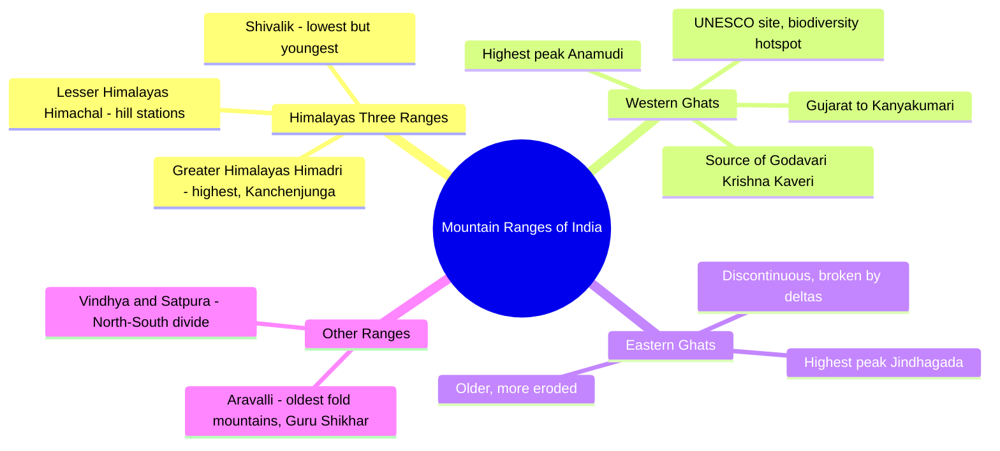

# NOTE — MOUNTAIN RANGES OF INDIA
**Section:** GK | **Category:** Geography | **Topic:** Mountain Ranges of India | **Slug:** `geo-mountain-ranges-of-india`
**Source:** 🔧 GENERAL KNOWLEDGE (standard geography reference; not yet cross-checked against PARMAR SSC reference excerpt)
**Status:** 🔧 DRAFT — awaiting AIR-91 verification before publish
**PYQ Frequency:** 🔥 Very high-frequency Geography topic, connects to [[geo-rivers-of-india]] | **High Yield:** ✅

---

## 🎭 THE HOOK

The Himalayas aren't one mountain range — they're three, stacked like layers of a cake, each younger and lower than the one beneath it as you move south. The **Greater Himalayas (Himadri)** hold the world's highest peaks; below them, the **Lesser/Middle Himalayas (Himachal)** are older in human terms (hill stations, not summits); and at the very base, the **Shivalik Range** is the YOUNGEST of the three, geologically speaking, despite being the lowest in elevation — a counterintuitive fact that trips up nearly every aspirant the first time they encounter it. Meanwhile, far to the south, an entirely different and much OLDER mountain system — the Western and Eastern Ghats — frames the Peninsular Plateau, built from some of the most ancient rock on the subcontinent.

---

## 📖 THE CORE

### The Himalayas — Three Parallel Ranges (North to South)
| Range | Also Called | Elevation | Key Features |
|---|---|---|---|
| **Greater Himalayas** | Himadri | Highest (avg. 6,000m+) | Permanently snow-covered; contains Mt. Everest, Kanchenjunga (India's highest peak) |
| **Lesser/Middle Himalayas** | Himachal | 3,700-4,500m | Hill stations (Shimla, Darjeeling, Mussoorie); forested |
| **Shivalik Range** | Outer Himalayas | 900-1,100m (lowest) | YOUNGEST geologically, made of unconsolidated sediment from the other two ranges; contains "Duns" (valleys, e.g., Dehradun) |

- The Himalayas formed from the collision of the **Indian Plate** with the **Eurasian Plate**, beginning roughly **50 million years ago** — still an active, rising mountain system (seismically active, hence frequent earthquakes in the region).
- **Kanchenjunga** (Sikkim) is India's highest peak and the world's THIRD highest (after Everest and K2, both outside India's territory in the conventional sense — Everest in Nepal/China, K2 in Pakistan-administered Kashmir/China border).

### The Western Ghats
- Run along India's western coast, from **Gujarat/Maharashtra border down to Kanyakumari** (Tamil Nadu), roughly parallel to the Arabian Sea coastline.
- Older and more continuous than the Eastern Ghats; a **UNESCO World Heritage Site** (recognized as one of the world's 8 "hottest hotspots" of biological diversity).
- Source of major Peninsular rivers: Godavari, Krishna, Kaveri all originate here.
- Highest peak: **Anamudi** (Kerala) — also the highest peak in Peninsular India.
- Causes the **rain-shadow effect** — the windward (western) side gets heavy monsoon rainfall; the leeward (eastern) side is comparatively dry.

### The Eastern Ghats
- Run along India's eastern coast, discontinuous (broken by major river deltas — Godavari, Krishna, Kaveri cut through them on their way to the Bay of Bengal).
- Lower and OLDER (more eroded) than the Western Ghats, but geologically more ancient in origin.
- Highest peak: **Jindhagada/Arma Konda** (Andhra Pradesh) — relatively modest compared to Western Ghats peaks.

### Other Notable Ranges
- **Aravalli Range** (Rajasthan, Gujarat, Haryana, Delhi): one of the OLDEST fold mountain systems in the world (Precambrian era); highest peak **Guru Shikhar** (Mount Abu, Rajasthan).
- **Vindhya Range**: traditionally considered the symbolic dividing line between North and South India.
- **Satpura Range**: runs roughly parallel to the Vindhyas, south of the Narmada; the Narmada-Tapi rivers flow through the rift valley between the Vindhya and Satpura ranges.
- **Patkai Hills**: northeastern hill ranges, forming part of India's border with Myanmar.

---

## 🧠 THE MIND MAP

---

## 🔑 THE MNEMONIC

**"Lowest in height, youngest in age — that's the Shivalik's strange stage"** — the counterintuitive Shivalik fact: lowest elevation, youngest geological age.

**"Western Ghats catch the rain, Eastern Ghats stay drier and plain"** — the rain-shadow effect distinguishing the two Ghats' rainfall patterns.

---

## 📌 THE PYQ ANCHOR

🔥 Mountain Ranges is a very high-frequency Geography topic, directly connecting to [[geo-rivers-of-india]] (Western Ghats as river source). 🔧 No literal Mountain Ranges question confirmed in the 23/46-shift CGL-2025 sample reviewed earlier in this session — the three Himalayan ranges, Western vs. Eastern Ghats, and the Aravalli's "oldest fold mountain" status are textbook-standard SSC CGL Geography staples; recommend archive cross-check.

---

## ⚠️ THE TRAP ALERT

- **The Shivalik Range is the LOWEST in elevation but the YOUNGEST geologically** — a frequently tested, counterintuitive pairing; don't assume "youngest" means "highest."
- **The Western Ghats are OLDER and more CONTINUOUS than the Eastern Ghats**, despite the Eastern Ghats sometimes being assumed older due to greater erosion — erosion level doesn't equal age; the Western Ghats are geologically younger in formation terms relative to peninsular bedrock context but more intact as a range.
- **The Aravalli Range is one of the WORLD'S OLDEST fold mountain systems** — a frequently tested superlative; don't confuse with the Himalayas, which are the YOUNGEST major mountain system.
- **Kanchenjunga (Sikkim), not any peak in the Western/Eastern Ghats, is India's highest peak** — Anamudi is only the highest in Peninsular India specifically.

---

## ✅ ACTIVE RECALL

1. Name the three parallel ranges of the Himalayas, from highest to lowest elevation.
2. Which Himalayan range is geologically the YOUNGEST, despite having the lowest elevation?
3. What rivers originate in the Western Ghats?
4. Which mountain range is considered one of the world's oldest fold mountain systems, and what is its highest peak?
5. What causes the rain-shadow effect associated with the Western Ghats?

*(Answers: 1–Greater Himalayas (Himadri), Lesser/Middle Himalayas (Himachal), Shivalik Range, from highest to lowest | 2–The Shivalik Range | 3–Godavari, Krishna, and Kaveri (among others) | 4–The Aravalli Range; highest peak is Guru Shikhar (Mount Abu, Rajasthan) | 5–The Western Ghats block monsoon winds, causing heavy rainfall on the windward (western) side and comparatively dry conditions on the leeward (eastern) side)*
