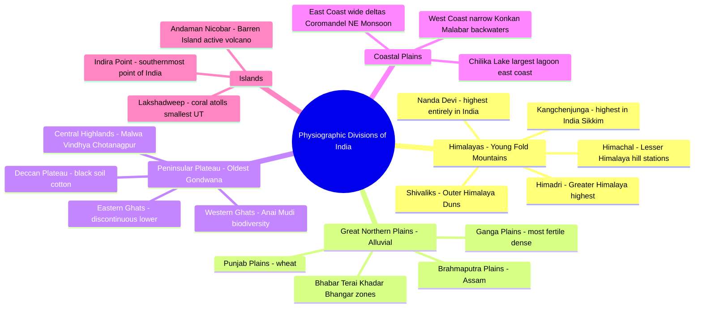

# NOTE — PHYSIOGRAPHIC DIVISIONS OF INDIA
**Section:** GK | **Category:** Geography | **Topic:** Physiographic Divisions of India | **Slug:** `geo-physiographic-divisions-of-india`
**Source:** 🔧 GENERAL KNOWLEDGE (standard physical geography reference; not yet cross-checked against PARMAR SSC reference excerpt)
**Status:** 🔧 DRAFT — awaiting AIR-91 verification before publish
**PYQ Frequency:** 🔥 Very high-frequency — physiographic unit identification, state-wise features, and superlatives are standard SSC CGL Geography questions | **High Yield:** ✅

---

## 🎭 THE HOOK

India is not one landscape — it is five completely different worlds stacked into a single country. The Himalayas in the north are geologically young, still rising, and define everything from India's climate to its international borders. The Great Plains below them are the most fertile and densely populated strip of land on Earth. South of that, the ancient Peninsular Plateau is among the oldest landmasses on the planet. Flanked by two coastal strips and two island chains, this is a country whose entire physical character can be understood through five divisions — and SSC CGL tests exactly that.

---

## 📖 THE CORE

### The 5 Physiographic Divisions

---

### 1. The Himalayan Mountain System

**Formation**: Formed by the collision of the Indian Plate with the Eurasian Plate (convergent plate boundary); result of the Tethys Sea closing — geologically YOUNG fold mountains (Cenozoic era)

**Three Parallel Ranges (North to South)**:
| Range | Local Name | Key Feature |
|---|---|---|
| **Greater Himalaya (Himadri)** | Innermost, highest range | Mt. Everest (8,849 m — highest peak on Earth); always snow-covered |
| **Lesser Himalaya (Himachal)** | Middle range | Shimla, Mussoorie, Nainital, Darjeeling hill stations; Kashmir Valley between Himadri and Himachal |
| **Outer Himalaya (Shivaliks)** | Southernmost; lowest | Foothills; "Duns" (longitudinal valleys — Dehradun, Kotli Dun, Patli Dun) between Shivaliks and Himachal |

**Key Himalayan Sub-divisions**:
- **Punjab Himalayas**: Between Indus and Sutlej rivers
- **Kumaon Himalayas**: Between Sutlej and Kali rivers (Uttarakhand)
- **Nepal Himalayas**: Between Kali and Teesta rivers
- **Assam Himalayas**: Between Teesta and Dihang rivers

**Notable Peaks**:
| Peak | Height | Location |
|---|---|---|
| **Mt. Everest** | 8,849 m | Nepal-China border; highest in world |
| **K2 (Godwin Austen)** | 8,611 m | Pakistan-administered Kashmir; 2nd highest in world |
| **Kangchenjunga** | 8,586 m | Sikkim/Nepal border; 3rd highest; **highest peak in India** |
| **Nanda Devi** | 7,816 m | Uttarakhand; highest peak ENTIRELY within India |

---

### 2. The Great Northern Plains (Indo-Gangetic-Brahmaputra Plains)

**Formation**: Formed by deposition of alluvial sediments brought down by Himalayan rivers over millions of years; the world's largest alluvial plain

**Sub-divisions**:
| Sub-division | Rivers | States |
|---|---|---|
| **Punjab Plains** | Indus, Jhelum, Chenab, Ravi, Beas, Sutlej | Punjab, Haryana |
| **Ganga Plains** | Ganga and its tributaries (Yamuna, Ghaghra, Gandak, Kosi) | UP, Bihar, West Bengal |
| **Brahmaputra Plains** | Brahmaputra | Assam |

**Key Features**:
- Most densely populated region of India
- Most fertile agricultural land (wheat in Punjab/Haryana; rice in Bihar/WB/Assam)
- **Bhabar**: Coarse pebble-laden zone immediately below the Shivaliks where Himalayan rivers emerge onto the plains; streams disappear underground here
- **Terai**: Marshy, swampy belt south of Bhabar; streams re-emerge; dense forest; now largely cleared for agriculture
- **Khadar**: Newer, younger alluvial deposits near river channels; more fertile
- **Bhangar**: Older, higher alluvial deposits away from river channels; contains **Kankar** (impure calcium carbonate nodules)
- **Doab**: Land between two rivers ("do" = two, "ab" = water); e.g., Bist Doab (Beas-Sutlej), Ganga-Yamuna Doab

---

### 3. The Peninsular Plateau

**Formation**: One of the **oldest and most stable landmasses on Earth** — a part of the ancient Gondwana land; composed of hard crystalline igneous and metamorphic rocks

**Two Main Divisions**:
| Division | Location | Key Feature |
|---|---|---|
| **Central Highlands** | North of Narmada river | Malwa Plateau (MP), Vindhya Range, Bundelkhand Plateau, Baghelkhand Plateau, Chotanagpur Plateau (Jharkhand) |
| **Deccan Plateau** | South of Narmada river | Triangular; bounded by Western Ghats (west), Eastern Ghats (east), Satpura Range (north) |

**Western Ghats (Sahyadri)**:
- Run parallel to west coast; form western edge of Deccan Plateau
- **Passes**: Thal Ghat (Mumbai-Pune), Bhor Ghat, Pal Ghat (Gap)
- **Highest peaks**: Anai Mudi (2,695 m — highest peak in South India and in the Western Ghats), Dodabetta (2,637 m — highest in Nilgiris)
- UNESCO Biodiversity Hotspot

**Eastern Ghats**:
- Discontinuous; parallel to east coast
- Lower than Western Ghats; cut by rivers
- **Highest peak**: Jindhagada (Andhra Pradesh) 🔧 VERIFY; Mahendragiri (Odisha) also cited

**Notable Plateaus**:
- **Chotanagpur Plateau** (Jharkhand): Rich in minerals (coal, iron ore, mica, copper)
- **Malwa Plateau** (MP/Rajasthan): Black cotton soil (regur); wheat and cotton
- **Deccan Trap** (Maharashtra/parts of MP, Goa, Karnataka): Ancient lava flows created black basaltic rock; excellent for cotton cultivation

---

### 4. The Coastal Plains

**West Coast (Arabian Sea side)**:
| Section | States | Feature |
|---|---|---|
| **Konkan Coast** | Maharashtra, Goa | Narrow, rocky; 500 km long |
| **Malabar Coast** | Karnataka, Kerala | Widest section; **Backwaters (Lagoons)** — Kerala's famous backwaters (Vembanad Lake) |
| **Gujarat Coast** | Gujarat | Gulf of Khambhat (Cambay), Gulf of Kachchh |

**East Coast (Bay of Bengal side)**:
| Section | States | Feature |
|---|---|---|
| **Utkal Coast** | Odisha | Chilika Lake (largest coastal lagoon in India) |
| **Northern Circars** | Andhra Pradesh, part of Odisha | Deltaic plains of Krishna, Godavari |
| **Coromandel Coast** | Tamil Nadu, south AP | Chennai; gets rain from NE Monsoon (Oct-Dec) when rest of India is dry |

**Key differences**:
- West Coast: Narrow; steep; no major deltas; heavy rainfall from SW Monsoon
- East Coast: Wider; flat; major river deltas (Ganga, Mahanadi, Godavari, Krishna, Cauvery); gets NE Monsoon in winter

---

### 5. The Islands

**Andaman & Nicobar Islands (Bay of Bengal)**:
- ~572 islands; southernmost point of India = **Indira Point** (Great Nicobar Island)
- **Barren Island**: India's only **active volcano**; also the only active volcano in South Asia
- Narcondam Island: Dormant volcano
- Strategic location near Malacca Strait

**Lakshadweep Islands (Arabian Sea)**:
- 36 islands; all **coral islands** (atolls)
- Smallest Union Territory of India by area
- Only Muslim-majority UT of India
- Minicoy Island: Southernmost; has a lighthouse; Mahl language spoken

---

### Key Superlatives & SSC-Tested Facts

| Superlative | Answer |
|---|---|
| Highest peak in India | Kangchenjunga (8,586 m) — on Sikkim-Nepal border |
| Highest peak ENTIRELY within India | Nanda Devi (7,816 m), Uttarakhand |
| Highest peak in South India | Anai Mudi (2,695 m), Kerala (Western Ghats) |
| Largest coastal lagoon in India | Chilika Lake, Odisha |
| India's only active volcano | Barren Island, Andaman & Nicobar |
| Oldest landmass in India | Peninsular Plateau (Gondwana land remnant) |
| Youngest mountains in India | Himalayas (young fold mountains) |
| Most fertile region | Great Northern Plains (alluvial soil) |
| Smallest UT by area | Lakshadweep |
| Southernmost point of India | Indira Point, Great Nicobar Island |

---

## 🧠 THE MIND MAP

---

## 🔑 THE MNEMONIC

**"5 Divisions: HIM-PLAIN-PEN-COAST-ISLAND"** — Himalayas, Plains, Peninsular Plateau, Coastal Plains, Islands — the five in order north to south.

**"Three Himalayan rows: Himadri (Highest), Himachal (Hill stations), Shivaliks (Shivling foothills)"** — the three parallel ranges south-to-north memory hook.

**"Bhabar disappears, Terai reappears"** — the groundwater belt sequence below the Shivaliks.

**"WEST is narrow and rocky; EAST is wide with deltas"** — the coastal plains contrast.

---

## 📌 THE PYQ ANCHOR

🔥 Consistently tested: Kangchenjunga as India's highest peak (common trap: some say K2 is "India's" because it's in disputed Kashmir), Anai Mudi as South India's highest, Barren Island as India's only active volcano, Chilika Lake as India's largest coastal lagoon, Indira Point as southernmost point. Bhabar/Terai/Khadar/Bhangar zone distinction is a geography favourite. 🔧 No specific CGL 2025 PYQ confirmed from 23/46-shift sample; recommend dedicated archive cross-check.

---

## ⚠️ THE TRAP ALERT

- **Kangchenjunga (8,586 m) is India's highest peak** — K2 (8,611 m) is higher but lies in Pakistan-administered Kashmir (Gilgit-Baltistan), not in Indian territory; Kangchenjunga is on the Sikkim-Nepal border, partially in Indian territory.
- **Nanda Devi (7,816 m) is the highest peak ENTIRELY within India** — Kangchenjunga is higher but shared with Nepal.
- **Anai Mudi (2,695 m)** is the highest peak in South India and in the Western Ghats — located in Kerala (Eravikulam National Park).
- **Barren Island** (Andaman & Nicobar) is India's **ONLY ACTIVE VOLCANO** — Narcondam Island has a dormant volcano; don't confuse the two.
- **Western Ghats are higher than Eastern Ghats** — Eastern Ghats are discontinuous, lower, and cut through by major Peninsular rivers flowing eastward.
- **Coromandel Coast** (Tamil Nadu) gets rain from the **NORTHEAST monsoon** (Oct-Dec) — the opposite of the rest of India which gets rain from SW Monsoon (Jun-Sep).
- **Lakshadweep** is India's **SMALLEST Union Territory by area** (not by population) — it is also the only Muslim-majority UT.

---

## ✅ ACTIVE RECALL

1. Name the three parallel ranges of the Himalayas from north to south (innermost to outermost).
2. What is the difference between Bhabar and Terai?
3. Which is the highest peak entirely within Indian territory (not shared with any other country)?
4. Where is India's only active volcano located?
5. How do the West Coast and East Coast plains differ in terms of width and monsoon pattern?

*(Answers: 1–Greater Himalaya (Himadri) → Lesser Himalaya (Himachal) → Outer Himalaya (Shivaliks), from north/innermost to south/outermost | 2–Bhabar: coarse pebble belt at the foot of Shivaliks where rivers disappear underground; Terai: marshy belt south of Bhabar where underground streams re-emerge at the surface | 3–Nanda Devi (7,816 m) in Uttarakhand — entirely within India; Kangchenjunga is higher but shared with Nepal | 4–Barren Island, in the Andaman & Nicobar Islands (Bay of Bengal) — India's only active volcano and the only active volcano in South Asia | 5–West Coast: narrow, steep, rocky, no major deltas, gets heavy SW Monsoon rainfall; East Coast: wider, flat, major river deltas, gets rainfall from the NE Monsoon (Oct-Dec))*
