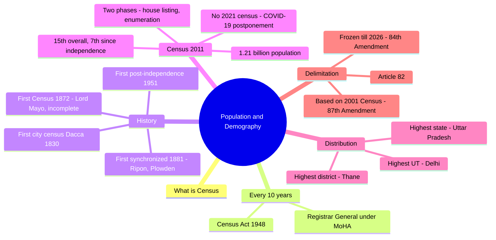

# NOTE — POPULATION & DEMOGRAPHY OF INDIA
**Section:** GK | **Category:** Geography | **Topic:** Population & Demography (Census 2011) | **Slug:** `geo-population-and-demography-of-india`
**Source:** PARMAR SSC reference notes (Census chapter, found within the rendered page range while sourcing folk-dance content) — pages covering "Census 2011" and "History of Census"
**Status:** 🔧 DRAFT — awaiting AIR-91 verification before publish (⚠️ HIGH PRIORITY: this entire topic is built around Census 2011 — no Census has been conducted since due to COVID-19 postponement per the source material; AIR-91 must check whether a newer Census has since occurred, as this note may now be one full Census cycle out of date)
**PYQ Frequency:** 🔥 Very high-frequency Geography/Static GK topic | **High Yield:** ✅

---

## 🎭 THE HOOK

India's most recent full national headcount happened in **2011** — and as of this note's drafting, it remains the most recent, because the next scheduled Census (due 2021) was postponed indefinitely due to COVID-19. That means every "current population of India" fact most people casually cite is actually a 2011 snapshot, now over a decade stale, projected forward by demographers rather than directly counted. The 2011 Census itself was India's **15th Census overall** but only the **7th since independence** — the British colonial administration had already been counting India's population for nearly 80 years before 1947, starting with an incomplete, non-synchronized count in 1872.

---

## 📖 THE CORE

### What Is a Census?
- The official enumeration of population conducted periodically by the government, every **10 years**.
- Conducted by the **Office of the Registrar General and Census Commissioner of India**, under the **Ministry of Home Affairs (MoHA)**.
- Legal basis: the **Census Act, 1948**.

### History of the Census
- **First Census**: **1872**, under Viceroy **Lord Mayo** — non-synchronized and incomplete (different regions counted at different times).
- **First COMPLETE/SYNCHRONIZED Census**: **1881**, during Lord Ripon's viceroyalty, under Census Commissioner **W.C. Plowden**.
- **First city-level Census**: **Dacca (Dhaka)**, **1830**, conducted by **Henry Walter** — predating the first national census by over 40 years.
- **First Census after independence**: **1951**.
- **2011 Census**: the **15th Census overall**, but the **7th since independence**.
- **No Census was held in 2021**, due to COVID-19 — a postponement with no confirmed rescheduled date at the time this reference material was compiled.

### Census 2011 — Key Numbers
- **Total population**: approximately **1,210.2 million (1.21 billion)**.
- India accounted for roughly **17.5% of the world's population** at the time (compared to China's ~19.4%) — India's population was, even then, noted as exceeding Brazil's by a wide margin.
- **Male population**: ~623.7 million (51.54%); **Female population**: ~585.5 million (48.46%).
- **States/UTs covered**: 35; **Districts covered**: 640 (at the time of the 2011 count — India's district count has since increased through state reorganizations).
- Conducted in TWO phases: **House Listing** (April-September 2010) and **Population Enumeration** (9-28 February 2011).
- **Motto**: "Our Census, Our Future."

### Population Distribution (2011)
| Category | Highest | Lowest |
|---|---|---|
| **State** | Uttar Pradesh (~16% of India's total population) | Sikkim |
| **Union Territory** | Delhi | Lakshadweep |
| **District** | Thane (Maharashtra) | Dibang Valley (Arunachal Pradesh) |
| **City** | Mumbai | — |

### Growth Rate (2001-2011 Decadal)
- **Annual average growth rate**: approximately **1.64%**.
- **Decadal growth rate (2001-2011)**: approximately **17.64%** — Male: ~17.19%, Female: ~18.12% (female growth rate slightly higher).

### Related Constitutional Fact: Delimitation
- **Article 82**: empowers Parliament to enact a Delimitation Act after each Census, to readjust constituency boundaries/seat allocation.
- Delimitation based on population has been **FROZEN until 2026**, via the **84th Constitutional Amendment** — meaning parliamentary seat numbers have NOT been reallocated to reflect population changes since the freeze, to avoid penalizing states with successful population-control programs.
- The **87th Constitutional Amendment** based the most recent delimitation EXERCISE (of constituency boundaries within existing seat totals, not seat NUMBERS) on the **2001 Census** data.

---

## 🧠 THE MIND MAP

---

## 🔑 THE MNEMONIC

**"1872 began it, 1881 completed it, 1951 restarted it, 2011 is the last one (so far)"** — the four landmark Census years in India's enumeration history.

**"UP is biggest, Sikkim is smallest, Delhi tops the UTs"** — the three most commonly tested population-distribution superlatives from Census 2011.

---

## 📌 THE PYQ ANCHOR

🔥 Population & Demography is a very high-frequency Geography/Static GK topic, sourced directly from the PARMAR SSC reference's Census chapter. 🔧 No literal Census question confirmed in the 23/46-shift CGL-2025 sample reviewed earlier in this session — Census history facts (first Census, first synchronized Census) and 2011 population superlatives are textbook-standard SSC CGL Geography staples; recommend a dedicated archive cross-check. ⚠️ Given the 2021 Census postponement noted in the source material, AIR-91 must verify whether a Census has since been conducted, which would make this entire note's "latest Census" framing outdated.

---

## ⚠️ THE TRAP ALERT

- **The first Census (1872) was INCOMPLETE/non-synchronized**; the first COMPLETE/synchronized Census was in **1881** — a frequently tested distinction between these two early counts.
- **The 2011 Census was India's 15th OVERALL but only the 7th SINCE INDEPENDENCE** — don't conflate these two different counts.
- **Delimitation (seat reallocation) has been FROZEN until 2026** via the 84th Amendment — population growth since 2001/2011 has NOT translated into proportionally more parliamentary seats for fast-growing states, a frequently tested nuance.
- **No Census was conducted in 2021** due to COVID-19 — as of this note's source material, 2011 remained the most recent Census; this is the single most time-sensitive fact in this entire note and MUST be reverified.

---

## ✅ ACTIVE RECALL

1. When was India's first Census conducted, and what was notable about it?
2. When was India's first complete/synchronized Census, and under whose viceroyalty?
3. What was India's total population per the 2011 Census, and what percentage of the world's population did this represent?
4. Which state had the highest population in the 2011 Census, and which had the lowest?
5. What does Article 82 deal with, and what has frozen its standard operation until 2026?

*(Answers: 1–1872, under Viceroy Lord Mayo; it was incomplete/non-synchronized | 2–1881, during Lord Ripon's viceroyalty, under Census Commissioner W.C. Plowden | 3–Approximately 1.21 billion (1,210.2 million); roughly 17.5% of the world's population | 4–Highest: Uttar Pradesh; Lowest: Sikkim | 5–Article 82 empowers Parliament to enact a Delimitation Act after each Census to readjust constituency boundaries/seats; this has been frozen until 2026 by the 84th Constitutional Amendment)*
