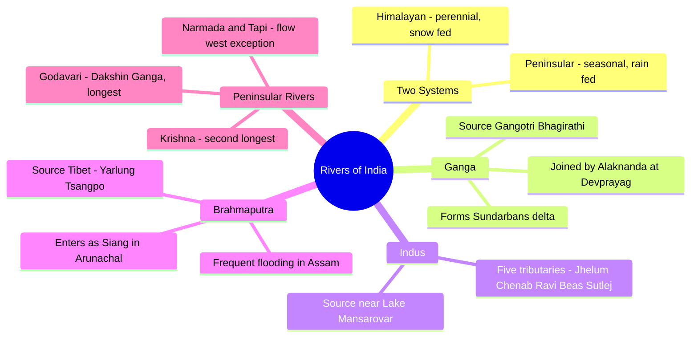

# NOTE — RIVERS OF INDIA
**Section:** GK | **Category:** Geography | **Topic:** Rivers of India | **Slug:** `geo-rivers-of-india`
**Source:** 🔧 GENERAL KNOWLEDGE (standard geography reference; not yet cross-checked against PARMAR SSC reference excerpt)
**Status:** 🔧 DRAFT — awaiting AIR-91 verification before publish
**PYQ Frequency:** 🔥 Very high-frequency Geography topic | **High Yield:** ✅

---

## 🎭 THE HOOK

India's rivers split into two families that don't just differ in geography — they differ in AGE itself. The **Himalayan rivers** (Ganga, Indus, Brahmaputra) are **perennial**, fed by melting snow and glaciers year-round, and are GEOLOGICALLY OLDER than the very mountains they flow through — they cut their valleys as the Himalayas were still rising, staying ahead of the uplift. The **Peninsular rivers** (Godavari, Krishna, Narmada, Tapi) are entirely different: seasonal, monsoon-dependent, flowing over some of the OLDEST and most geologically stable rock in the world — the Deccan Plateau. One river family is older than its mountains; the other flows over rock older than almost anything else on the subcontinent. That contrast is the spine of nearly every "Himalayan vs. Peninsular river" SSC question.

---

## 📖 THE CORE

### Two River Systems
| Feature | Himalayan Rivers | Peninsular Rivers |
|---|---|---|
| **Origin** | Himalayas (snow/glacier-fed) | Deccan Plateau / Central Highlands (rain-fed) |
| **Flow type** | **Perennial** (year-round flow) | **Seasonal** (monsoon-dependent, reduced flow in dry months) |
| **Examples** | Ganga, Indus, Brahmaputra, Yamuna | Godavari, Krishna, Narmada, Tapi, Mahanadi, Kaveri |
| **Course** | Long, winding (youthful, still eroding) | Shorter, more direct (mature, stable beds) |
| **Drainage pattern** | Antecedent/consequent (cuts across mountains) | Mostly flow into the Bay of Bengal (EAST), except Narmada and Tapi which flow WEST into the Arabian Sea |

### The Ganga System
- **Source**: **Gangotri Glacier** (Gaumukh), Uttarakhand — originates as the **Bhagirathi**, joined by the **Alaknanda** at **Devprayag** to officially become the "Ganga."
- **Major tributaries**: Yamuna, Son, Gandak, Kosi, Ghaghara (left/right bank mix).
- **Length**: ~2,525 km — India's longest river flowing entirely/mostly within India (the Indus and Brahmaputra also flow through India but originate/pass through other countries extensively).
- Flows through UP, Bihar, West Bengal; forms the **Sundarbans Delta** (with the Brahmaputra) before entering the Bay of Bengal — the world's largest river delta.

### The Indus System
- **Source**: near **Lake Mansarovar**, Tibet (China).
- Flows through Jammu & Kashmir, then predominantly through **Pakistan** before reaching the Arabian Sea.
- Major tributaries (the "Five Rivers" of Punjab): **Jhelum, Chenab, Ravi, Beas, Sutlej** — giving Punjab its name ("Land of Five Rivers").

### The Brahmaputra System
- **Source**: near **Lake Mansarovar**, Tibet, known as the **Yarlung Tsangpo** in Tibet.
- Enters India in Arunachal Pradesh (as the **Siang/Dihang**), flows through Assam (as the **Brahmaputra**), then into Bangladesh (as the **Jamuna**).
- Notably referred to in masculine grammatical form in regional naming convention (most Indian rivers are referred to in feminine form) — a frequently cited cultural-linguistic trivia fact.
- Known for severe, recurring **flooding** in Assam due to heavy monsoon discharge and a relatively young, unstable channel.

### Peninsular Rivers
| River | Origin | Flows Into | Note |
|---|---|---|---|
| **Godavari** | Trimbakeshwar, Maharashtra (Western Ghats) | Bay of Bengal | Longest Peninsular river; called "Dakshin Ganga" (Ganga of the South) |
| **Krishna** | Mahabaleshwar, Maharashtra | Bay of Bengal | Second-longest Peninsular river |
| **Kaveri (Cauvery)** | Talakaveri, Karnataka (Western Ghats) | Bay of Bengal | Forms Shivanasamudra Falls; subject of the long-running Cauvery water dispute (Karnataka-Tamil Nadu) |
| **Narmada** | Amarkantak, Madhya Pradesh | **Arabian Sea** (WEST-flowing — exception) | Flows through a rift valley between the Vindhya and Satpura ranges |
| **Tapi (Tapti)** | Multai, Madhya Pradesh | **Arabian Sea** (WEST-flowing — exception) | Also flows through a rift valley, parallel to Narmada |
| **Mahanadi** | Chhattisgarh | Bay of Bengal | Known for the Hirakud Dam, one of the world's longest dams |

---

## 🧠 THE MIND MAP

---

## 🔑 THE MNEMONIC

**"Narmada and Tapi swim against the current"** — the two major Peninsular rivers that flow WEST into the Arabian Sea, against the general eastward Peninsular drainage pattern.

**"Jhelum Chenab Ravi Beas Sutlej — JCRBS gave Punjab its name"** — the five Indus tributaries forming "Panj-ab" (five waters).

---

## 📌 THE PYQ ANCHOR

🔥 Rivers of India is a very high-frequency Geography topic. 🔧 No literal Rivers question confirmed in the 23/46-shift CGL-2025 sample reviewed earlier in this session, since this topic wasn't separately tagged during PYQ extraction — Himalayan vs. Peninsular distinction, river origins, and the Narmada/Tapi west-flow exception are textbook-standard SSC CGL Geography staples; recommend a dedicated archive cross-check.

---

## ⚠️ THE TRAP ALERT

- **Narmada and Tapi are the two major exceptions flowing WEST into the Arabian Sea** — almost all other major Peninsular rivers flow EAST into the Bay of Bengal; a very frequently tested directional trap.
- **The Ganga officially "begins" at Devprayag**, where the Bhagirathi and Alaknanda merge — not at Gangotri itself, which is the source of the Bhagirathi specifically.
- **The Indus and Brahmaputra both originate near Lake Mansarovar in Tibet**, NOT in India — a frequently tested origin-location trap, since both are closely associated with India.
- **Godavari is the LONGEST Peninsular river**, not Krishna — don't swap the two; Godavari is called "Dakshin Ganga," Krishna is the second-longest.

---

## ✅ ACTIVE RECALL

1. What is the fundamental difference between Himalayan and Peninsular rivers in terms of water source and flow pattern?
2. Where does the Ganga officially "begin," and from which two rivers' confluence?
3. Name the five tributaries of the Indus that give Punjab its name.
4. Which two major Peninsular rivers flow WEST into the Arabian Sea, against the general pattern?
5. Which is the longest Peninsular river, and what is its nickname?

*(Answers: 1–Himalayan rivers are perennial (snow/glacier-fed, year-round flow); Peninsular rivers are seasonal (monsoon/rain-fed, reduced in dry months) | 2–At Devprayag, Uttarakhand, where the Bhagirathi and Alaknanda rivers merge | 3–Jhelum, Chenab, Ravi, Beas, Sutlej | 4–Narmada and Tapi | 5–Godavari; nicknamed "Dakshin Ganga" (Ganga of the South))*
