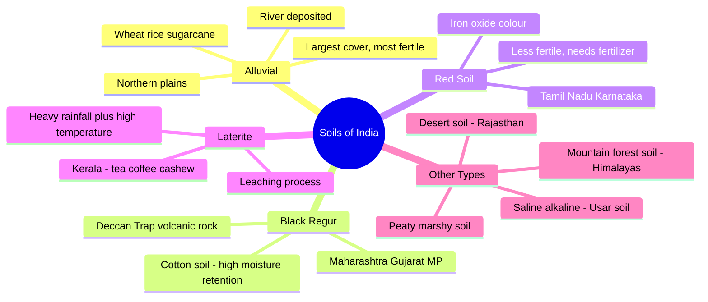

# NOTE — SOILS OF INDIA
**Section:** GK | **Category:** Geography | **Topic:** Soils | **Slug:** `geo-soils`
**Source:** 🔧 GENERAL KNOWLEDGE (standard geography reference; not yet cross-checked against PARMAR SSC reference excerpt)
**Status:** 🔧 DRAFT — awaiting AIR-91 verification before publish
**PYQ Frequency:** 🔥 Phase-2 backlog topic (from original CHANAKYA Smart Notes system doc) | **High Yield:** ✅

---

## 🎭 THE HOOK

India's most agriculturally important soil doesn't come from rock breaking down where it sits — it comes from thousands of kilometres away, carried and deposited by rivers over millennia. **Alluvial soil**, formed by sediment dropped by the Indus-Ganga-Brahmaputra river system, covers the largest area of any soil type in India and feeds the largest concentration of farmland on the subcontinent. At the opposite extreme sits **Black soil** (Regur soil) — born not from rivers but from volcanic rock, the cooled lava beds of the **Deccan Trap**, and famous for one property that makes it perfect for a single crop: it holds moisture so well that it's nicknamed "cotton soil," India's best natural environment for growing cotton without irrigation.

---

## 📖 THE CORE

### Major Soil Types (Frequently Tested)
| Soil Type | Also Called | Formed From | Found In | Best For |
|---|---|---|---|---|
| **Alluvial Soil** | — | River-deposited sediment (Indus-Ganga-Brahmaputra system) | Northern plains (UP, Bihar, Punjab, Haryana, West Bengal); largest soil cover in India | Wheat, rice, sugarcane, most cereals — India's most fertile soil |
| **Black Soil** | Regur soil / "cotton soil" | Weathering of Deccan Trap volcanic (basalt) rock | Maharashtra, Madhya Pradesh, Gujarat, parts of Karnataka, Andhra Pradesh | Cotton (high moisture retention) |
| **Red Soil** | — | Weathering of ancient crystalline/igneous rocks; red colour from iron oxide | Tamil Nadu, Karnataka, parts of Odisha, Chhattisgarh, eastern Maharashtra | Less fertile than alluvial/black; needs fertilizers; groundnut, millets |
| **Laterite Soil** | — | Intense leaching under high rainfall + high temperature (tropical monsoon conditions) | Kerala, parts of Karnataka, Odisha, hill areas of NE states | Tea, coffee, cashew (after fertilizer treatment); poor in nitrogen/lime |
| **Desert/Arid Soil** | — | Arid climate weathering; sandy, low humus | Rajasthan (Thar Desert), parts of Gujarat, Haryana | Limited agriculture without irrigation; some drought-resistant crops |
| **Mountain/Forest Soil** | — | Forest litter decomposition in hilly/mountainous regions | Himalayan region, hill states | Tea, spices, fruits, depending on elevation |
| **Saline/Alkaline Soil** | Usar soil | Excess salt accumulation, often from poor drainage/irrigation practices | Parts of Punjab, Haryana, UP, Gujarat, Maharashtra | Largely infertile unless reclaimed |
| **Peaty/Marshy Soil** | — | Accumulation of organic/decomposed plant matter in waterlogged areas | Parts of Kerala, Odisha, West Bengal, Bihar (Kosi area), Uttarakhand | Rice (in some reclaimed areas) |

### Key Distinguishing Facts
- **Alluvial soil** is India's LARGEST soil cover by area, and the MOST fertile and agriculturally productive type overall.
- **Black soil's** signature property is its **high moisture-retention capacity**, due to high clay content — it swells when wet and cracks when dry (self-ploughing characteristic).
- **Red soil's** colour comes from **iron oxide** content in the parent rock; generally less fertile than alluvial or black soil, requiring fertilizers/irrigation for good yields.
- **Laterite soil** forms specifically under conditions of **heavy rainfall + high temperature**, causing intense **leaching** that washes away silica and leaves behind iron/aluminium oxides — explains its concentration in high-rainfall regions like Kerala.

---

## 🧠 THE MIND MAP

---

## 🔑 THE MNEMONIC

**"Alluvial feeds the most, Black grows the cotton, Red needs help, Laterite leaches in the rain"** — four major soil types and their defining trait, in one line.

**"River makes Alluvial, Lava makes Black, Iron makes Red, Rain leaches Laterite"** — the formation-cause shorthand for the four most-tested soil types.

---

## 📌 THE PYQ ANCHOR

🔥 Soils was explicitly listed as a Phase-2 backlog topic in the original CHANAKYA Smart Notes system document. 🔧 No literal Soils question confirmed in the 23/46-shift CGL-2025 sample reviewed in this session — soil-type-to-state matching and soil-to-crop matching are textbook-standard SSC CGL Geography staples; recommend archive cross-check.

---

## ⚠️ THE TRAP ALERT

- **Black soil (Regur) is volcanic in origin (Deccan Trap), NOT river-deposited** — don't confuse its formation with Alluvial soil's river-sediment origin.
- **Alluvial soil is the LARGEST soil cover in India**, not Black soil — a frequently tested "which soil covers the most area" trap, since Black soil's "cotton soil" fame sometimes leads aspirants to over-credit its coverage.
- **Laterite soil is generally POOR in nitrogen and lime**, despite forming in fertile-seeming high-rainfall tropical regions — counterintuitive, since heavy rain might suggest fertility, but the leaching process actually strips nutrients away.
- **Red soil's colour comes from IRON OXIDE**, not organic matter or volcanic ash — don't confuse the cause of its colour with Black soil's volcanic origin.

---

## ✅ ACTIVE RECALL

1. Which soil type covers the largest area in India, and how is it formed?
2. What is Black soil also called, and what gives it its name? What is its key agricultural property?
3. What gives Red soil its characteristic colour?
4. Under what conditions does Laterite soil form, and what nutrient deficiency is it known for?
5. Where is Desert/Arid soil predominantly found in India?

*(Answers: 1–Alluvial soil; formed by sediment deposited by the Indus-Ganga-Brahmaputra river system | 2–Regur soil / "cotton soil," named for its suitability to cotton cultivation due to high moisture retention | 3–Iron oxide content in the parent rock | 4–Heavy rainfall combined with high temperature, causing intense leaching; known for nitrogen and lime deficiency | 5–Rajasthan (Thar Desert), and parts of Gujarat and Haryana)*
