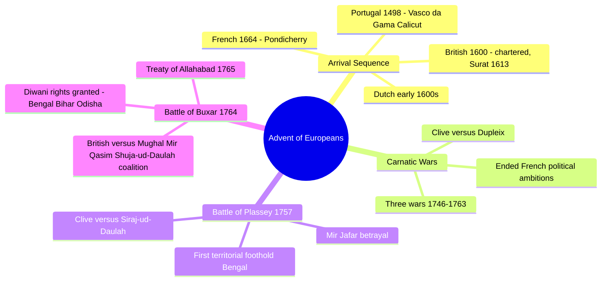

# NOTE — ADVENT OF EUROPEANS & RISE OF THE EAST INDIA COMPANY
**Section:** GK | **Category:** History | **Topic:** Advent of Europeans & East India Company | **Slug:** `hist-advent-of-europeans-and-east-india-company`
**Source:** 🔧 GENERAL KNOWLEDGE (standard modern history reference; not yet cross-checked against PARMAR SSC reference excerpt)
**Status:** 🔧 DRAFT — awaiting AIR-91 verification before publish
**PYQ Frequency:** 🔥 Very high-frequency Modern History topic, bridges [[hist-mughal-empire]] and [[hist-revolt-of-1857]] | **High Yield:** ✅

---

## 🎭 THE HOOK

Four European powers raced to India over roughly two centuries, each hunting the same prize — spices, textiles, and trade access — and each eventually losing to the same rival: the British. **Portugal arrived first** (Vasco da Gama, 1498), **the Dutch came next** chasing the spice trade, **the British East India Company** followed in 1600, and **the French** arrived last, in 1664 — yet it was the LAST-ARRIVING British company that ultimately out-competed all three earlier rivals, transforming itself from a trading corporation into the de facto ruler of an entire subcontinent. The hinge moment was a single 1757 battle in Bengal — not even a particularly large one by later standards — that handed the Company its first real territorial foothold, and from there, the conquest never really stopped.

---

## 📖 THE CORE

### European Arrivals (Chronological Order)
| Power | Arrival | Key Figure/Event |
|---|---|---|
| **Portugal** | 1498 | **Vasco da Gama** landed at **Calicut** — the FIRST European sea route to India, via the Cape of Good Hope |
| **Dutch** | Early 1600s | Dutch East India Company (VOC) — primarily focused on the Indonesian spice trade, less dominant in mainland India |
| **British** | 1600 | English East India Company chartered by **Queen Elizabeth I** (31 December 1600) — first trading post established at **Surat** (1613) |
| **Danish** | 1620 | Smaller-scale presence (Tranquebar, Serampore) — less historically prominent |
| **French** | 1664 | French East India Company — established settlements including **Pondicherry**, became British's PRIMARY European rival in India |

### Anglo-French Rivalry — The Carnatic Wars
- Three **Carnatic Wars** (roughly 1746-1763) were fought between British and French forces (often using Indian proxy rulers/allies) for dominance in South India, mirroring the broader European Anglo-French colonial rivalry.
- **Robert Clive** (British) and **Joseph François Dupleix** (French) were key rival commanders/administrators during this period.
- The Third Carnatic War's resolution (Treaty of Paris, 1763) effectively ENDED French ambitions for political dominance in India, leaving the British East India Company as the dominant European power.

### The Battle of Plassey (1757)
- Fought between the **British East India Company** (led by **Robert Clive**) and **Siraj-ud-Daulah**, the Nawab of Bengal — with British victory secured largely through the BETRAYAL of Siraj-ud-Daulah by his own commander, **Mir Jafar** (bribed by the British).
- Considered the FOUNDATIONAL event establishing British political/territorial control in India — the Company's first major territorial foothold, in Bengal.
- Mir Jafar was installed as a PUPPET Nawab of Bengal, subordinate to British interests.

### The Battle of Buxar (1764)
- Fought between the British East India Company and a COMBINED force of the Nawab of Bengal (**Mir Qasim**, who had replaced the unreliable Mir Jafar), the Nawab of Awadh (**Shuja-ud-Daulah**), and the MUGHAL EMPEROR **Shah Alam II** himself.
- Decisive BRITISH VICTORY — arguably MORE significant than Plassey in establishing British supremacy, since it defeated a combined coalition INCLUDING the nominal Mughal Emperor.
- Resulted in the **Treaty of Allahabad (1765)**, under which the Mughal Emperor granted the East India Company **DIWANI RIGHTS** (the right to collect revenue) over **Bengal, Bihar, and Odisha** — transforming the Company from a trading entity into a genuine territorial REVENUE-COLLECTING power.

### Key Distinguishing Facts
- **Plassey (1757) established British TERRITORIAL control; Buxar (1764) established British POLITICAL/FISCAL supremacy** (via Diwani rights) — both are essential, distinct milestones, frequently tested together as a pair.
- **Mir Jafar's BETRAYAL was decisive at Plassey** — a frequently tested specific causal mechanism, distinguishing this battle from a purely military victory.
- **Buxar involved the Mughal Emperor HIMSELF (Shah Alam II)**, unlike Plassey, which involved only the Bengal Nawab — a frequently tested distinction in the scale/significance of the two battles.
- **The Diwani grant (1765) is the single most consequential administrative milestone** in the EIC's transition from trading company to territorial ruler.

---

## 🧠 THE MIND MAP

---

## 🔑 THE MNEMONIC

**"Portugal first, Dutch for spice, British for power, French lost the race"** — the four European arrivals and their distinct outcomes.

**"Plassey took the land, Buxar took the treasury"** — the functional distinction between the two pivotal battles.

---

## 📌 THE PYQ ANCHOR

🔥 Advent of Europeans & East India Company is a very high-frequency Modern History topic, bridging [[hist-mughal-empire]] and [[hist-revolt-of-1857]]. 🔧 No literal Plassey/Buxar question confirmed in the 23/46-shift CGL-2025 sample reviewed earlier in this session — Vasco da Gama's arrival, the Plassey-Buxar pairing, and the Diwani grant are textbook-standard SSC CGL History staples; recommend a dedicated archive cross-check.

---

## ⚠️ THE TRAP ALERT

- **Vasco da Gama landed at CALICUT in 1498**, NOT at a different port — a frequently tested specific location fact.
- **Mir Jafar's BETRAYAL, not pure military superiority, was decisive at Plassey** — don't attribute the British victory solely to battlefield tactics.
- **The Battle of Buxar (1764) involved the MUGHAL EMPEROR directly**, making it arguably MORE significant than Plassey (1757), which only involved the Bengal Nawab — don't underrate Buxar relative to the more famous Plassey.
- **The Diwani rights (1765, Treaty of Allahabad) covered Bengal, Bihar, AND Odisha** — a frequently tested three-region scope, not Bengal alone.

---

## ✅ ACTIVE RECALL

1. Who was the first European to reach India by sea, and when and where did he land?
2. Which European power did the British primarily compete with in India, and through which wars?
3. What caused the British East India Company's victory at the Battle of Plassey (1757)?
4. Who fought in the Battle of Buxar (1764), and what made it significant?
5. What did the Treaty of Allahabad (1765) grant the East India Company, and over which regions?

*(Answers: 1–Vasco da Gama, in 1498, landing at Calicut | 2–France, primarily through the three Carnatic Wars (1746-1763) | 3–The betrayal of Nawab Siraj-ud-Daulah by his own commander, Mir Jafar, who was bribed by the British | 4–The British East India Company against a combined coalition of the Nawab of Bengal (Mir Qasim), the Nawab of Awadh (Shuja-ud-Daulah), and Mughal Emperor Shah Alam II; significant because it defeated a coalition including the Mughal Emperor himself | 5–Diwani rights (the right to collect revenue), over Bengal, Bihar, and Odisha)*
