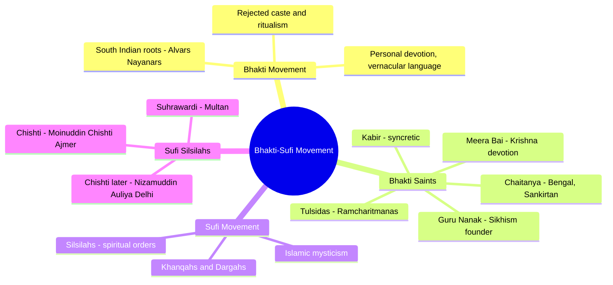

# NOTE — BHAKTI-SUFI MOVEMENT
**Section:** GK | **Category:** History | **Topic:** Bhakti-Sufi Movement | **Slug:** `hist-bhakti-sufi-movement`
**Source:** 🔧 GENERAL KNOWLEDGE (standard medieval history reference; not yet cross-checked against PARMAR SSC reference excerpt)
**Status:** 🔧 DRAFT — awaiting AIR-91 verification before publish
**PYQ Frequency:** 🔥 High-frequency Medieval History topic | **High Yield:** ✅

---

## 🎭 THE HOOK

Two religious reform movements, one Hindu and one Muslim, rose across medieval India during roughly the same centuries, and arrived at strikingly similar conclusions through entirely separate traditions: that direct, personal devotion to God mattered more than ritual, priesthood, or caste/sectarian hierarchy. The **Bhakti movement** preached intense personal devotion (Bhakti) to a chosen deity, often in vernacular regional languages rather than Sanskrit; the **Sufi movement**, Islam's mystical strand, preached the same direct-love-of-God philosophy through its own network of saints (Pirs) and shrines (Dargahs). Where the two traditions overlapped most powerfully was in figures like **Kabir**, whose poetry drew on both Hindu and Islamic devotional language simultaneously, refusing to fully belong to either orthodoxy.

---

## 📖 THE CORE

### The Bhakti Movement
- A devotional religious movement emphasizing personal, emotional devotion (**Bhakti**) to a chosen deity, often rejecting caste distinctions, ritualism, and Brahmin priestly intermediation.
- Spread across India in REGIONAL waves, often composing in VERNACULAR languages (not Sanskrit) — making it accessible to common people.
- **South Indian roots**: the Bhakti movement is generally traced to South Indian **Alvars** (Vaishnava saints) and **Nayanars** (Shaivite saints), roughly 6th-9th centuries CE, predating its later North Indian spread.

### Key Bhakti Saints (Frequently Tested)
| Saint | Region/Language | Note |
|---|---|---|
| **Kabir** | North India (Hindi/vernacular) | Syncretic, drew on both Hindu and Islamic ideas; founded no formal sect but inspired the Kabir Panth |
| **Guru Nanak** | Punjab | Founder of Sikhism, emphasized one formless God, rejected caste and ritualism |
| **Chaitanya Mahaprabhu** | Bengal | Krishna-Bhakti, popularized Sankirtan (group devotional singing) |
| **Meera Bai** | Rajasthan | Krishna devotion through poetry/song; a Rajput princess who renounced royal life |
| **Tulsidas** | North India (Awadhi) | Authored the **Ramcharitmanas**, a vernacular retelling of the Ramayana |
| **Surdas** | North India (Braj) | Krishna devotion, authored **Sur Sagar** |
| **Ramananda** | North India | Considered a key bridging figure; teacher associated (by tradition) with Kabir |
| **Namdev** | Maharashtra | Early Bhakti poet-saint |
| **Tukaram** | Maharashtra | Varkari tradition, Vitthal devotion |
| **Ramanuja** | South India | Philosopher, propounded Vishishtadvaita (qualified non-dualism) |
| **Basava** | Karnataka | Founder of the Lingayat/Veerashaiva sect, rejected caste hierarchy |

### The Sufi Movement
- Islam's MYSTICAL tradition, emphasizing direct personal experience/union with God (**Allah**) through love, devotion, and asceticism, rather than strict legalistic ritual observance.
- Organized into **Silsilahs** (orders/chains of spiritual succession from teacher to disciple).
- **Khanqahs**: hospices/centers where Sufi saints (**Pirs**) lived and taught disciples (**Murids**).
- **Dargahs**: shrines built over the graves of Sufi saints, becoming major pilgrimage sites for people of multiple faiths.

### Major Sufi Silsilahs (Frequently Tested)
| Silsilah | Notable Figure | Region |
|---|---|---|
| **Chishti** | **Moinuddin Chishti** | Ajmer, Rajasthan (Dargah Sharif, one of India's most visited shrines, across faiths) |
| **Chishti (later)** | **Nizamuddin Auliya** | Delhi |
| **Suhrawardi** | Bahauddin Zakariya | Multan (now Pakistan) |
| **Qadiriya** | — | Spread in India during the Mughal period |
| **Naqshbandi** | Khwaja Baqi Billah | Emphasized stricter adherence to Islamic law alongside mysticism |

### Key Distinguishing Facts
- **The Chishti Silsilah was the most influential and widely followed Sufi order in India**, known for its accommodating, syncretic approach to local culture.
- **Moinuddin Chishti's Dargah at Ajmer** remains one of India's most visited religious sites, drawing pilgrims across religious lines — a frequently tested syncretism fact.
- **Guru Nanak (founder of Sikhism)** is sometimes discussed alongside the Bhakti movement for his shared emphasis on one formless God and rejection of caste, though Sikhism developed into its own distinct, organized religion.

---

## 🧠 THE MIND MAP

---

## 🔑 THE MNEMONIC

**"Bhakti loved a Hindu God, Sufi loved Allah the same way"** — the core parallel between the two movements: personal devotion over ritual.

**"Chishti welcomes all, Ajmer proves it"** — the Chishti Silsilah's syncretic, cross-religious appeal, anchored to Moinuddin Chishti's Ajmer Dargah.

---

## 📌 THE PYQ ANCHOR

🔥 Bhakti-Sufi Movement is a high-frequency Medieval History topic. 🔧 No literal Bhakti-Sufi question confirmed in the 23/46-shift CGL-2025 sample reviewed earlier in this session — saint-to-region matching and the Chishti Silsilah's prominence are textbook-standard SSC CGL History staples; recommend a dedicated archive cross-check.

---

## ⚠️ THE TRAP ALERT

- **The Bhakti movement's ROOTS are in SOUTH India (Alvars and Nayanars, 6th-9th centuries)**, not North India — it spread northward only later; a frequently tested origin-location trap.
- **Kabir is syncretic and not exclusively "Hindu" or "Muslim"** in his teachings — don't categorize him strictly under one religious tradition.
- **Guru Nanak founded Sikhism as a DISTINCT, organized religion**, even though his philosophy shares Bhakti-movement themes (one God, anti-caste) — don't simply list Sikhism as "part of" the Bhakti movement without this nuance.
- **The Chishti Silsilah, not Suhrawardi or Naqshbandi, was the MOST influential and widely followed Sufi order in India** — a frequently tested "which Silsilah was most prominent" fact.

---

## ✅ ACTIVE RECALL

1. What is the core shared philosophy between the Bhakti and Sufi movements?
2. Where did the Bhakti movement originate, and which two groups of South Indian saints are associated with its early roots?
3. Who authored the Ramcharitmanas, and in which language?
4. What is a Silsilah, and name the most influential Sufi Silsilah in India.
5. Which Sufi saint's Dargah at Ajmer remains one of India's most visited religious sites across faiths?

*(Answers: 1–Direct, personal devotion to God, over ritual, priesthood, and caste/sectarian hierarchy | 2–South India; the Alvars (Vaishnava saints) and Nayanars (Shaivite saints) | 3–Tulsidas; in Awadhi (a vernacular dialect, not Sanskrit) | 4–A Silsilah is a Sufi spiritual order/chain of succession from teacher to disciple; the Chishti Silsilah was the most influential in India | 5–Moinuddin Chishti)*
