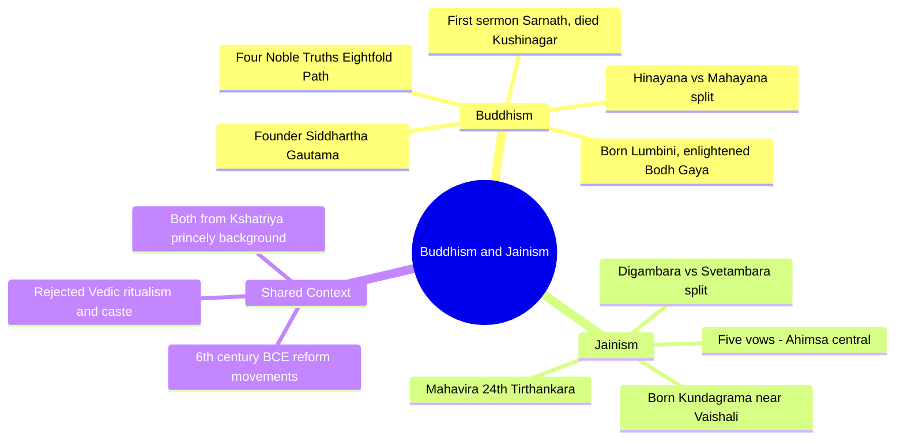

# NOTE — BUDDHISM & JAINISM
**Section:** GK | **Category:** History | **Topic:** Buddhism & Jainism | **Slug:** `hist-buddhism-and-jainism`
**Source:** 🔧 GENERAL KNOWLEDGE (standard ancient history reference; not yet cross-checked against PARMAR SSC reference excerpt)
**Status:** 🔧 DRAFT — awaiting AIR-91 verification before publish
**PYQ Frequency:** 🔥 High-frequency Ancient History topic, connects to [[hist-mauryan-empire]] (Ashoka) and [[misc-national-emblem]] (Sarnath) | **High Yield:** ✅

---

## 🎭 THE HOOK

Around the 6th century BCE, the same region of northeastern India produced two religious reform movements within a generation of each other, both reacting against the same thing: the rigid ritualism and caste-bound priesthood of Later Vedic Brahmanism. Two princes — one from a small republic near the Himalayan foothills, one from a kingdom in Bihar — each walked away from royal comfort, each found a path to liberation that didn't require a Brahmin priest or an elaborate sacrifice, and each founded a religion that would outlast every dynasty that patronized it. Siddhartha Gautama became the **Buddha** ("the enlightened one"); Vardhamana became **Mahavira** ("the great hero"), the last of Jainism's 24 Tirthankaras. Both rejected the Vedas' authority, both rejected the caste system's spiritual relevance, and both built religions around personal discipline rather than priestly intermediation.

---

## 📖 THE CORE

### Buddhism
- Founded by **Siddhartha Gautama** (the **Buddha**, "the enlightened one"), born in **Lumbini** (Nepal) c. **563 BCE** (dates debated, c. 6th-5th century BCE), to the Shakya clan, at Kapilavastu.
- **Four Sights** that prompted his renunciation: an old man, a sick man, a corpse, and an ascetic — leading him to leave his palace life (the "Great Renunciation," Mahabhinishkramana).
- Attained **enlightenment (Nirvana)** under a Bodhi tree at **Bodh Gaya**.
- Delivered his **first sermon** at **Sarnath**, near Varanasi (Dhammacakkappavattana — "Turning the Wheel of Law"), see [[misc-national-emblem]].
- Died (**Mahaparinirvana**) at **Kushinagar**.
- **Four Noble Truths**: life involves suffering (Dukkha); suffering has a cause (Samudaya, desire/craving); suffering can end (Nirodha); there is a path to end suffering (Magga).
- **Eightfold Path** (Magga): the practical path to end suffering — right view, right intention, right speech, right action, right livelihood, right effort, right mindfulness, right concentration.
- **Major sects**: **Hinayana** (Theravada) — the "lesser vehicle," older, more conservative, focused on individual enlightenment; **Mahayana** — the "greater vehicle," later development, introduces Bodhisattva concept (one who delays own Nirvana to help others) and Buddha worship/iconography.
- **Buddhist Councils**: 1st Council (Rajgir, soon after Buddha's death, under Ajatashatru); 4th Council (Kashmir, under Kanishka, formalized the Mahayana-Hinayana split).

### Jainism
- Jainism's 24th and LAST **Tirthankara** ("ford-maker," one who has crossed the ocean of rebirth) was **Vardhamana Mahavira**, born c. **599 BCE** at **Kundagrama** (near Vaishali, Bihar), to a Kshatriya family.
- Jainism itself is considered MUCH older than Mahavira — he is regarded as a reformer/systematizer of an existing tradition, not the founder; the FIRST Tirthankara, **Rishabhanatha (Adinatha)**, is traditionally placed in a much earlier, semi-legendary era.
- Attained **Kevala Jnana** (omniscience) after years of severe asceticism.
- **Three Jewels (Triratna) of Jainism**: Right Faith (Samyak Darshana), Right Knowledge (Samyak Jnana), Right Conduct (Samyak Charitra) — the path to liberation (Moksha).
- **Five Vows (Mahavrata)**: Ahimsa (non-violence — the central, most emphasized Jain principle), Satya (truth), Asteya (non-stealing), Brahmacharya (chastity), Aparigraha (non-possession/non-attachment).
- **Two major sects**: **Digambara** ("sky-clad") — monks traditionally practice complete nudity as a sign of total renunciation; **Svetambara** ("white-clad") — monks wear simple white robes. The split formalized over centuries after Mahavira.
- **Jain Councils**: held at Pataliputra and later Vallabhi, where the Jain canon (Agamas) was compiled/standardized.

### Comparing Buddhism and Jainism (Frequently Tested)
| Feature | Buddhism | Jainism |
|---|---|---|
| Founder/Last Teacher | Siddhartha Gautama (Buddha) | Vardhamana Mahavira (24th Tirthankara) |
| Core Principle | Middle Path (avoid extremes); Four Noble Truths | Ahimsa (non-violence) as the supreme virtue |
| View on Vedas | Rejected Vedic authority | Rejected Vedic authority |
| View on God | Largely silent/non-theistic on a creator god | Does not posit a creator god; emphasizes self-effort |
| Royal Patron | Ashoka (Mauryan) | Chandragupta Maurya (per later Jain tradition, became a Jain ascetic) |
| Major Split | Hinayana vs. Mahayana | Digambara vs. Svetambara |

---

## 🧠 THE MIND MAP

---

## 🔑 THE MNEMONIC

**"Lumbini born, Bodh Gaya enlightened, Sarnath taught, Kushinagar died"** — the four key places of the Buddha's life, in chronological order.

**"Ahimsa, Satya, Asteya, Brahmacharya, Aparigraha — AASBA, Jainism's five vows"** — quick recall acronym for the Mahavratas.

---

## 📌 THE PYQ ANCHOR

🔥 Buddhism & Jainism is a high-frequency Ancient History topic, connecting to the official priority topics [[hist-mauryan-empire]] (Ashoka's patronage) and [[misc-national-emblem]] (Sarnath's Lion Capital). 🔧 No literal Buddhism/Jainism question confirmed in the 23/46-shift CGL-2025 sample reviewed in this session — the Four Noble Truths, key places in Buddha's life, and Jain sect names are textbook-standard SSC CGL History staples; recommend archive cross-check.

---

## ⚠️ THE TRAP ALERT

- **Mahavira was the 24th and LAST Tirthankara, NOT the founder of Jainism** — Jainism is considered a much older tradition; Mahavira is a reformer/systematizer, a frequently tested distinction.
- **The four key places of Buddha's life are each DIFFERENT** — Lumbini (birth), Bodh Gaya (enlightenment), Sarnath (first sermon), Kushinagar (death) — don't mix these up; each has a dedicated "which place is associated with which event" question type.
- **Digambara monks practice nudity ("sky-clad"); Svetambara monks wear white robes ("white-clad")** — a frequently tested sect-identification pair.
- **Ahimsa (non-violence) is Jainism's most emphasized principle**, while Buddhism's central framework is the **Four Noble Truths/Middle Path** — don't conflate the two religions' core organizing principles.

---

## ✅ ACTIVE RECALL

1. Where was the Buddha born, where did he attain enlightenment, and where did he deliver his first sermon?
2. What are the Four Noble Truths of Buddhism?
3. Was Mahavira the founder of Jainism? If not, what was his actual role?
4. Name the Five Vows (Mahavratas) of Jainism.
5. What are the two major sects of Jainism, and how do they differ?

*(Answers: 1–Born in Lumbini; enlightenment at Bodh Gaya; first sermon at Sarnath | 2–Life involves suffering (Dukkha); suffering has a cause (Samudaya); suffering can end (Nirodha); there is a path to end it (Magga) | 3–No; Mahavira was the 24th and last Tirthankara, a reformer/systematizer of an already-existing tradition, not its founder | 4–Ahimsa (non-violence), Satya (truth), Asteya (non-stealing), Brahmacharya (chastity), Aparigraha (non-possession) | 5–Digambara ("sky-clad," monks practice nudity) and Svetambara ("white-clad," monks wear white robes))*
