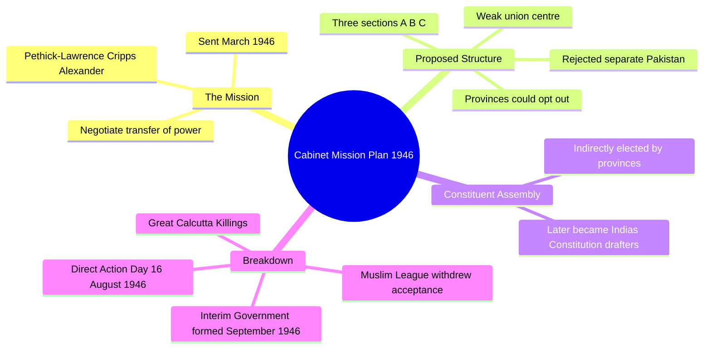

# NOTE — CABINET MISSION PLAN, 1946
**Section:** GK | **Category:** History | **Topic:** Cabinet Mission Plan, 1946 | **Slug:** `hist-cabinet-mission-plan-1946`
**Source:** 🔧 GENERAL KNOWLEDGE (standard modern history reference; not yet cross-checked against PARMAR SSC reference excerpt)
**Status:** 🔧 DRAFT — awaiting AIR-91 verification before publish
**PYQ Frequency:** 🔥 High-frequency Modern History topic, connects to [[hist-partition-and-integration-of-princely-states]] | **High Yield:** ✅

---

## 🎭 THE HOOK

In early 1946, with World War II over and Indian independence now clearly a matter of "when" rather than "if," the British government sent a high-powered three-member team — the **Cabinet Mission** — to negotiate the actual mechanics of the transfer of power. Their proposal was genuinely creative: a way to keep India UNITED through a loose, three-tier federal structure with significant group autonomy, specifically designed to avoid Partition. It was the LAST serious British-led attempt to prevent India from splitting in two — and its failure, when the Muslim League rejected the final implementation, set the country on the path toward Partition just over a year later.

---

## 📖 THE CORE

### The Cabinet Mission (1946)
- Sent by the British government (Prime Minister **Clement Attlee**'s post-war Labour government) to India in **March 1946**.
- Comprised THREE members: **Lord Pethick-Lawrence** (Secretary of State for India, mission head), **Sir Stafford Cripps**, and **A.V. Alexander** — a frequently tested three-name list.
- Aimed to negotiate the transfer of power and devise a constitutional framework BEFORE full independence, working with both the Congress and the Muslim League.

### The Cabinet Mission Plan — Proposed Structure
- Proposed a THREE-TIER federal structure for a UNITED India:
  1. A weak UNION government at the Centre, handling only **defence, foreign affairs, and communications**.
  2. States/provinces grouped into THREE SECTIONS (Section A: Hindu-majority provinces; Section B and C: Muslim-majority provinces in the northwest and northeast respectively) with significant AUTONOMY.
  3. Individual provinces retaining residual powers, with the OPTION to opt out of their assigned section after an initial period.
- Explicitly REJECTED the Muslim League's demand for a FULLY SEPARATE Pakistan, proposing instead this looser federal/grouping structure as a unity-preserving ALTERNATIVE.
- Recommended the formation of a **Constituent Assembly** to draft India's new constitution — INDIRECTLY elected by the provincial assemblies — this Constituent Assembly is the SAME body that LATER became independent India's Constitution-drafting body (see [[polity-preamble]] and related Polity notes) after Partition altered its final composition.

### Acceptance, Rejection & Breakdown
- INITIALLY, BOTH the Congress and the Muslim League gave QUALIFIED/conditional acceptance to parts of the Plan.
- The Muslim League later WITHDREW its acceptance, particularly over disagreements regarding the Interim Government's formation and the compulsory grouping provisions — leading **Muhammad Ali Jinnah** to call for **"Direct Action Day"** (16 August 1946), which triggered widespread COMMUNAL VIOLENCE, particularly in Calcutta ("the Great Calcutta Killings") — a major escalation point on the path to Partition.
- An **Interim Government** was nonetheless formed in September 1946, led by **Jawaharlal Nehru** as Vice-President of the Viceroy's Executive Council (functioning effectively as Prime Minister), with the Muslim League JOINING later (October 1946) under continued tension.

### Key Distinguishing Facts
- **The Cabinet Mission Plan EXPLICITLY REJECTED a separate Pakistan**, proposing instead a unity-preserving grouped-federal alternative — its ultimate FAILURE (not its original design) is what led toward Partition, a frequently tested nuance.
- **The Constituent Assembly recommended by the Cabinet Mission Plan is the SAME body** that eventually drafted independent India's Constitution — a frequently tested direct institutional through-line from this 1946 negotiation to India's eventual founding document.
- **Direct Action Day (16 August 1946)**, called by Jinnah after the Plan's breakdown, triggered major communal violence and is frequently cited as a critical turning point making Partition increasingly inevitable.

---

## 🧠 THE MIND MAP

---

## 🔑 THE MNEMONIC

**"Pethick-Lawrence, Cripps, Alexander — the three names of the Cabinet Mission"** — quick recall for the three-member team.

**"Designed to keep India one, ended up pushing it toward two"** — the Cabinet Mission Plan's intended unity-preserving goal versus its ultimate failure outcome.

---

## 📌 THE PYQ ANCHOR

🔥 Cabinet Mission Plan, 1946 is a high-frequency Modern History topic, directly connecting to [[hist-partition-and-integration-of-princely-states]]. 🔧 No literal Cabinet Mission question confirmed in the 23/46-shift CGL-2025 sample reviewed earlier in this session — the three-member team, the three-tier structure, and Direct Action Day are textbook-standard SSC CGL History staples; recommend a dedicated archive cross-check.

---

## ⚠️ THE TRAP ALERT

- **The Cabinet Mission Plan EXPLICITLY REJECTED a separate Pakistan** — its goal was to PRESERVE Indian unity through a loose federal structure; don't assume it proposed or endorsed Partition.
- **The Constituent Assembly recommended by this Plan is the SAME body that eventually drafted India's Constitution** — a frequently tested institutional continuity fact, even though Partition later changed its membership.
- **Direct Action Day (16 August 1946) was called by Jinnah AFTER the Plan's breakdown**, not as part of the original Plan itself — a frequently tested causal sequence.
- **The Interim Government (formed September 1946) was led by Nehru**, with the Muslim League joining LATER (October 1946), under continued tension — don't assume both parties joined simultaneously.

---

## ✅ ACTIVE RECALL

1. When was the Cabinet Mission sent to India, and who were its three members?
2. What three-tier federal structure did the Cabinet Mission Plan propose?
3. Did the Cabinet Mission Plan propose or reject a separate Pakistan?
4. What body did the Plan recommend forming, and what did it eventually become?
5. What event did Jinnah call after the Plan's breakdown, and what did it trigger?

*(Answers: 1–March 1946; Lord Pethick-Lawrence, Sir Stafford Cripps, and A.V. Alexander | 2–A weak union centre (defence, foreign affairs, communications), provinces grouped into three sections (A, B, C) with autonomy, and individual provinces retaining residual powers with an opt-out option | 3–It explicitly rejected a separate Pakistan, proposing instead a unity-preserving grouped-federal structure | 4–A Constituent Assembly, indirectly elected by provincial assemblies; it eventually became the same body that drafted independent India's Constitution | 5–Direct Action Day (16 August 1946); it triggered widespread communal violence, notably the Great Calcutta Killings)*
