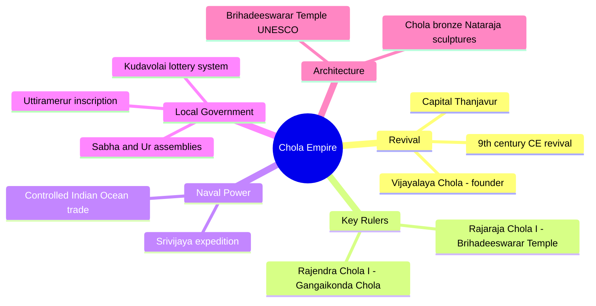

# NOTE — CHOLA EMPIRE
**Section:** GK | **Category:** History | **Topic:** Chola Empire | **Slug:** `hist-chola-empire`
**Source:** 🔧 GENERAL KNOWLEDGE (standard medieval history reference; not yet cross-checked against PARMAR SSC reference excerpt)
**Status:** 🔧 DRAFT — awaiting AIR-91 verification before publish
**PYQ Frequency:** 🔥 High-frequency Medieval History topic, follows [[hist-sangam-age]] | **High Yield:** ✅

---

## 🎭 THE HOOK

Most ancient and medieval Indian empires expanded by land — armies marching across plains and mountain passes. The medieval Chola Empire did something almost no other Indian power attempted at scale: it built a genuine NAVY, and used it to project Indian power overseas, launching a naval expedition that conquered territory across the Bay of Bengal in present-day Indonesia and Malaysia. The Cholas also pioneered something closer to home with even longer-lasting consequences: a sophisticated system of LOCAL SELF-GOVERNMENT through village assemblies, documented in startling administrative detail on temple inscriptions — arguably the most detailed surviving record of grassroots democracy anywhere in the pre-modern world.

---

## 📖 THE CORE

### Revival of the Cholas
- The medieval (Imperial) Chola Empire emerged as a major power starting in the 9th century CE, a REVIVAL of the earlier Sangam-era Chola kingdom (see [[hist-sangam-age]]) after centuries of decline, under King **Vijayalaya Chola** (founder of the medieval Chola line, capital at **Thanjavur**).

### Key Rulers (Frequently Tested)
| Ruler | Reign (approx.) | Known For |
|---|---|---|
| **Rajaraja Chola I** | 985-1014 CE | Greatest early Chola ruler; built the **Brihadeeswarar Temple** at Thanjavur (a UNESCO World Heritage Site); conquered parts of Sri Lanka and the Maldives; strengthened the navy |
| **Rajendra Chola I** | 1014-1044 CE | Rajaraja's son; led a famous naval expedition AGAINST the **Srivijaya Empire** (Sumatra, Indonesia/Malaysia region); also led a northern campaign reaching the **Ganga River**, earning him the title **"Gangaikonda Chola"** ("the Chola who brought the Ganga"); founded a new capital, **Gangaikonda Cholapuram** |

### Naval Power & Overseas Expansion
- The Cholas built one of the most powerful NAVIES in Indian history, used to control Indian Ocean and Bay of Bengal trade routes.
- **Rajendra Chola I's expedition against Srivijaya** (a major Southeast Asian maritime empire) is among the most striking instances of Indian naval power projection overseas in pre-modern history — undertaken partly to secure/control trade routes to China.

### Administration — Local Self-Government
- The Cholas are CELEBRATED for an unusually well-documented system of VILLAGE-LEVEL self-government, recorded in detail through inscriptions, particularly the **Uttiramerur inscription** (Tamil Nadu).
- **Sabha** (or Mahasabha): village assemblies, primarily in Brahmin-settlement villages, managing local administration, including land, irrigation, and temple affairs.
- **Ur**: a more general village assembly, found in non-Brahmin villages.
- Members were often selected through a process involving **lot-drawing (Kudavolai system)** from eligible candidates — described in inscriptions as an early, structured method of selecting local representatives, frequently cited as a sophisticated early form of representative local governance.

### Architecture & Culture
- **Brihadeeswarar Temple** (Thanjavur), built by Rajaraja Chola I — a massive Dravidian-style temple, part of the "Great Living Chola Temples" UNESCO World Heritage Site grouping (along with later Chola temples at Gangaikonda Cholapuram and Darasuram).
- Patronized **Bharatanatyam** and Tamil literature; significant temple-based bronze sculpture tradition (the iconic Chola bronze **Nataraja** sculptures are a celebrated artistic legacy).

### Key Distinguishing Facts
- **Rajendra Chola I, NOT Rajaraja Chola I, earned the title "Gangaikonda Chola"** for his northern campaign reaching the Ganga — a frequently tested father-son title confusion.
- **The Cholas' naval campaign targeted the Srivijaya Empire** (in present-day Indonesia/Malaysia), NOT a mainland Indian rival — a frequently tested target-identification fact.
- **The Uttiramerur inscription is the single most-cited piece of evidence** for Chola village self-government and the Kudavolai lottery-selection system.

---

## 🧠 THE MIND MAP

---

## 🔑 THE MNEMONIC

**"Rajaraja built the temple, Rajendra brought the Ganga and crossed the sea"** — father-son Chola achievements, kept distinct.

**"Uttiramerur proves democracy is older than you think"** — the inscription anchoring the Chola village self-government legacy.

---

## 📌 THE PYQ ANCHOR

🔥 Chola Empire is a high-frequency Medieval History topic, following [[hist-sangam-age]] chronologically. 🔧 No literal Chola Empire question confirmed in the 23/46-shift CGL-2025 sample reviewed earlier in this session — Rajaraja/Rajendra Chola's achievements and the Uttiramerur inscription are textbook-standard SSC CGL History staples; recommend a dedicated archive cross-check.

---

## ⚠️ THE TRAP ALERT

- **Rajendra Chola I earned the title "Gangaikonda Chola"**, NOT Rajaraja Chola I (his father) — a frequently tested title-attribution mix-up between the two most famous Chola rulers.
- **Rajaraja Chola I built the Brihadeeswarar Temple**; Rajendra Chola I built a NEW capital, **Gangaikonda Cholapuram** — don't conflate which ruler is associated with which major construction project.
- **The Chola naval expedition targeted Srivijaya (Southeast Asia)**, a maritime trading empire, NOT a rival Indian kingdom — a frequently tested target confusion.
- **The Kudavolai system involved LOT-DRAWING from eligible candidates** for village assembly membership — a specific selection METHOD, not simple direct election in the modern sense.

---

## ✅ ACTIVE RECALL

1. Who founded the medieval Chola Empire, and where was its capital?
2. What is Rajaraja Chola I most famous for building?
3. What title did Rajendra Chola I earn, and why?
4. Against which overseas empire did Rajendra Chola I lead a famous naval expedition?
5. What is the Uttiramerur inscription evidence of?

*(Answers: 1–Vijayalaya Chola; capital at Thanjavur | 2–The Brihadeeswarar Temple at Thanjavur | 3–"Gangaikonda Chola" ("the Chola who brought the Ganga"), for his northern military campaign reaching the Ganga River | 4–The Srivijaya Empire (in present-day Indonesia/Malaysia) | 5–Chola village self-government, particularly the Kudavolai lottery-based system for selecting village assembly (Sabha) members)*
