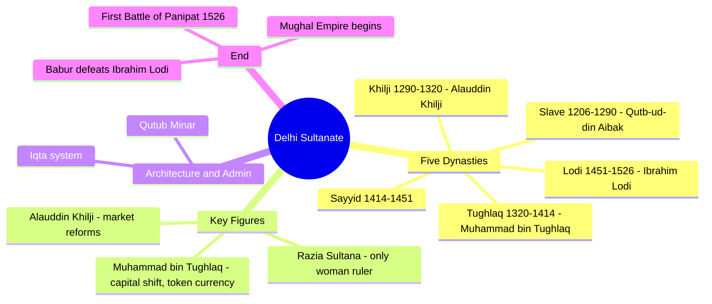

# NOTE — DELHI SULTANATE
**Section:** GK | **Category:** History | **Topic:** Delhi Sultanate | **Slug:** `hist-delhi-sultanate`
**Source:** 🔧 GENERAL KNOWLEDGE (standard medieval history reference; not yet cross-checked against PARMAR SSC reference excerpt)
**Status:** 🔧 DRAFT — awaiting AIR-91 verification before publish
**PYQ Frequency:** 🔥 High-frequency Medieval History topic, precedes [[hist-mughal-empire]] | **High Yield:** ✅

---

## 🎭 THE HOOK

Five dynasties, over three centuries, one throne in Delhi — and the founder of the very FIRST dynasty started his career as a slave. **Qutb-ud-din Aibak**, a former Turkic slave who rose through military ranks to become a general, established the **Slave (Mamluk) Dynasty** in **1206 CE**, beginning the **Delhi Sultanate**. What followed was a 320-year rotation of five dynasties — Slave, Khilji, Tughlaq, Sayyid, Lodi — each rising and falling through conquest, palace intrigue, and occasionally sheer administrative chaos (one Tughlaq ruler infamously tried to relocate his ENTIRE capital 1,100 km south, then changed his mind). The period reshaped North Indian architecture, introduced new administrative and military systems, and set the stage for the Mughal Empire that would eventually replace it.

---

## 📖 THE CORE

### The Five Dynasties (Chronological Sequence)
| Dynasty | Approx. Period | Founder | Notable Ruler(s) |
|---|---|---|---|
| **Slave (Mamluk)** | 1206-1290 CE | **Qutb-ud-din Aibak** | Iltutmish (consolidated the Sultanate); **Razia Sultana** (first and only woman to rule the Delhi Sultanate) |
| **Khilji** | 1290-1320 CE | Jalal-ud-din Khilji | **Alauddin Khilji** (most powerful Khilji ruler; market control reforms; repelled Mongol invasions) |
| **Tughlaq** | 1320-1414 CE | Ghiyas-ud-din Tughlaq | **Muhammad bin Tughlaq** (infamous for shifting the capital from Delhi to Daulatabad and back; introduced token currency); Firoz Shah Tughlaq |
| **Sayyid** | 1414-1451 CE | Khizr Khan | Weak, short-lived dynasty |
| **Lodi** | 1451-1526 CE | Bahlul Lodi | **Ibrahim Lodi** (last Sultan, defeated and killed at the **First Battle of Panipat, 1526**, by Babur — ending the Sultanate and beginning the Mughal Empire) |

### Key Administrative & Architectural Contributions
- **Qutub Minar**: Construction began under Qutb-ud-din Aibak, completed by Iltutmish — tallest brick minaret in the world, in Delhi.
- **Iqta System**: Land revenue assignment system where nobles (Iqtadars) were granted revenue rights over land in exchange for military/administrative service — a key administrative innovation of the Sultanate period.
- **Razia Sultana** (r. 1236-1240) — daughter of Iltutmish, the first and only woman to rule the Delhi Sultanate; her short reign faced significant opposition from nobles resistant to female rule.
- **Alauddin Khilji's market reforms**: fixed prices for essential goods, state-controlled markets — an early and unusually direct state intervention in economic life, aimed partly at sustaining a large standing army affordably.
- **Muhammad bin Tughlaq's two famous (and largely failed) experiments**: (1) shifting the capital from Delhi to **Daulatabad** (in the Deccan) and back, causing immense hardship and population displacement; (2) introducing **token currency** (copper/bronze coins valued as silver) — failed due to widespread counterfeiting, leading to economic chaos.

### End of the Sultanate
- The Delhi Sultanate ended in **1526 CE**, when **Babur** defeated **Ibrahim Lodi** at the **First Battle of Panipat**, founding the **Mughal Empire**.

---

## 🧠 THE MIND MAP

---

## 🔑 THE MNEMONIC

**"Slave, Khilji, Tughlaq, Sayyid, Lodi — SKTSL, five dynasties in a row"** — the sequence of Delhi Sultanate dynasties.

**"Tughlaq tried twice and failed twice"** — Muhammad bin Tughlaq's capital-shift and token-currency experiments, both famous failures.

---

## 📌 THE PYQ ANCHOR

🔥 Delhi Sultanate is a high-frequency Medieval History topic, directly preceding [[hist-mughal-empire]]. 🔧 No literal Delhi Sultanate question confirmed in the 23/46-shift CGL-2025 sample reviewed in this session — dynasty sequence, Razia Sultana, and the First Battle of Panipat are textbook-standard SSC CGL History staples; recommend archive cross-check.

---

## ⚠️ THE TRAP ALERT

- **Razia Sultana was the FIRST AND ONLY woman to rule the Delhi Sultanate** — a frequently tested standalone fact; don't confuse her with any later female ruler from a different dynasty/era.
- **Muhammad bin Tughlaq's capital shift was TO Daulatabad (Deccan) and back to Delhi** — not a permanent relocation; a commonly tested "what happened and was it permanent" trap.
- **The First Battle of Panipat (1526)** ended the Delhi Sultanate (Lodi dynasty) and began the Mughal Empire — don't confuse with the SECOND (1556, Akbar vs. Hemu) or THIRD (1761, Marathas vs. Ahmad Shah Abdali) Battles of Panipat, which are separate, later events at the same historically significant battlefield.
- **Qutub Minar's construction SPANNED two rulers** — begun by Qutb-ud-din Aibak, completed by Iltutmish — don't credit its full construction to either ruler alone.

---

## ✅ ACTIVE RECALL

1. Name the five dynasties of the Delhi Sultanate, in chronological order.
2. Who was the first and only woman to rule the Delhi Sultanate?
3. What two famous (and largely failed) experiments is Muhammad bin Tughlaq known for?
4. What was the Iqta system?
5. How did the Delhi Sultanate come to an end, and in which year?

*(Answers: 1–Slave (Mamluk), Khilji, Tughlaq, Sayyid, Lodi | 2–Razia Sultana | 3–Shifting the capital from Delhi to Daulatabad and back; introducing token currency | 4–A land revenue assignment system where nobles (Iqtadars) received revenue rights over land in exchange for military/administrative service | 5–Babur defeated Ibrahim Lodi (the last Lodi Sultan) at the First Battle of Panipat in 1526, founding the Mughal Empire)*
