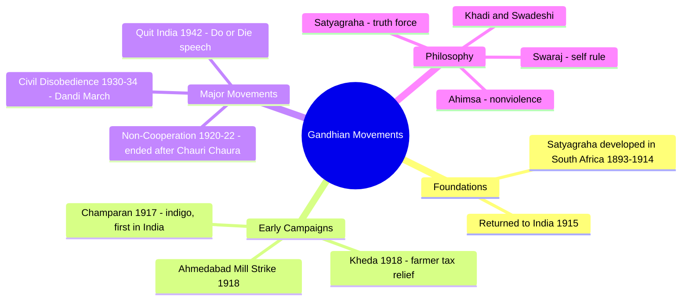

# NOTE — GANDHIAN MOVEMENTS
**Section:** GK | **Category:** History | **Topic:** Gandhian Movements | **Slug:** `hist-gandhian-movements`
**Source:** 🔧 GENERAL KNOWLEDGE (standard modern history reference; not yet cross-checked against PARMAR SSC reference excerpt)
**Status:** 🔧 DRAFT — awaiting AIR-91 verification before publish
**PYQ Frequency:** 🔥 Phase-2 backlog topic (from original CHANAKYA Smart Notes system doc) | **High Yield:** ✅

---

## 🎭 THE HOOK

Before he became the face of India's freedom struggle, Mohandas Karamchand Gandhi spent over two decades testing his methods on a different continent entirely. In South Africa, fighting discriminatory laws against the Indian community, he developed and refined **Satyagraha** — literally "truth-force" — a philosophy of nonviolent resistance that treated noncooperation with injustice as a form of active, disciplined struggle, not passive surrender. He returned to India in **1915**, and over the next three decades, launched a sequence of mass movements that each escalated the stakes of British rule's legitimacy — starting local and small (a single district's farmers, a single town's textile workers), and ending with a demand so total that Britain could no longer pretend otherwise: **"Quit India."**

---

## 📖 THE CORE

### Pre-Movement: South Africa & Return
- Gandhi developed **Satyagraha** in **South Africa (1893-1914)**, fighting discriminatory laws against Indians.
- Returned to India in **1915**; first major Indian campaigns were localized, building credibility before national-scale movements.

### Early Localized Campaigns (1917-1918)
| Campaign | Year | Location | Issue |
|---|---|---|---|
| **Champaran Satyagraha** | 1917 | Bihar | Indigo planters forced into exploitative "Tinkathia" system; Gandhi's FIRST Satyagraha in India |
| **Kheda Satyagraha** | 1918 | Gujarat | Farmers sought tax relief after crop failure |
| **Ahmedabad Mill Strike** | 1918 | Gujarat | Labour dispute between mill owners and workers; Gandhi's first hunger strike |

### Major National Movements
| Movement | Years | Trigger | Outcome |
|---|---|---|---|
| **Non-Cooperation Movement** | 1920-1922 | Response to the Rowlatt Act (1919) and Jallianwala Bagh massacre (1919); launched with Khilafat Movement support | Called off after the **Chauri Chaura incident** (Feb 1922), where a mob killed policemen — Gandhi withdrew the movement, citing the need for strict nonviolence |
| **Civil Disobedience Movement** | 1930-1934 | Launched via the **Dandi March/Salt March** (12 March - 6 April 1930) — Gandhi walked ~240 miles from Sabarmati Ashram to Dandi to break the British salt monopoly | Led to the **Gandhi-Irwin Pact (1931)**; Gandhi attended the Second Round Table Conference in London |
| **Quit India Movement** | 1942 | Launched 8 August 1942 ("Do or Die" speech) after the failure of the Cripps Mission | Mass arrests of Congress leadership; the movement, though leaderless after arrests, significantly weakened British resolve to continue ruling India |

### Core Philosophy
- **Satyagraha** ("truth-force" / "holding onto truth") — active nonviolent resistance, distinct from passive submission.
- **Ahimsa** (nonviolence) — the foundational ethical principle underlying all Gandhian campaigns.
- **Swaraj** (self-rule) — the political goal driving the movements, evolving from dominion status demands to full independence (**Purna Swaraj**, declared 26 January 1930, later commemorated as India's Republic Day date).
- **Khadi & Swadeshi** — promotion of hand-spun cloth and boycott of British goods as both economic and symbolic resistance tools.

---

## 🧠 THE MIND MAP

---

## 🔑 THE MNEMONIC

**"Champaran first, Chauri Chaura ends it, Dandi marches, Quit India demands it"** — the four landmark turning points of the Gandhian movement era, in sequence.

**"South Africa built it, India tested it, Salt broke it open"** — the geographic/thematic arc: Satyagraha was forged abroad, refined in local Indian campaigns, and went fully national with the Salt March.

---

## 📌 THE PYQ ANCHOR

🔥 Gandhian Movements was explicitly listed as a Phase-2 backlog topic in the original CHANAKYA Smart Notes system document. 🔧 No literal Gandhian-Movements question confirmed in the 23/46-shift CGL-2025 sample reviewed in this session — Champaran (first Satyagraha), Chauri Chaura (why Non-Cooperation ended), and the Dandi March dates are textbook-standard SSC CGL History staples; recommend archive cross-check.

---

## ⚠️ THE TRAP ALERT

- **Champaran Satyagraha (1917) was Gandhi's FIRST Satyagraha campaign IN INDIA** — not his first ever (that was in South Africa); a frequently tested "first in India" vs. "first overall" distinction.
- **The Non-Cooperation Movement was withdrawn due to the Chauri Chaura incident (Feb 1922)**, where a violent mob killed policemen — Gandhi called off the movement specifically because it violated nonviolence, NOT because of British repression alone.
- **The Dandi March (Salt March) lasted from 12 March to 6 April 1930**, covering roughly 240 miles — don't confuse the START of the Civil Disobedience Movement (Salt March) with its broader multi-year span (1930-1934).
- **"Purna Swaraj" (complete independence) was declared on 26 January 1930**, which is why this date was later chosen for India's Republic Day (1950) — a frequently tested date-significance link.

---

## ✅ ACTIVE RECALL

1. What is Satyagraha, and where did Gandhi first develop and practice it?
2. Which was Gandhi's first Satyagraha campaign in India, and what issue did it address?
3. Why was the Non-Cooperation Movement called off in 1922?
4. What event marked the start of the Civil Disobedience Movement, and when did it occur?
5. When was the Quit India Movement launched, and what slogan is associated with it?

*(Answers: 1–Satyagraha is "truth-force," a philosophy of active nonviolent resistance; Gandhi first developed it in South Africa (1893-1914) | 2–The Champaran Satyagraha (1917, Bihar), addressing the exploitative "Tinkathia" indigo-planting system | 3–Due to the Chauri Chaura incident (February 1922), where a violent mob killed policemen, violating Gandhi's principle of strict nonviolence | 4–The Dandi March (Salt March), 12 March - 6 April 1930 | 5–Launched 8 August 1942; associated with the "Do or Die" slogan)*
