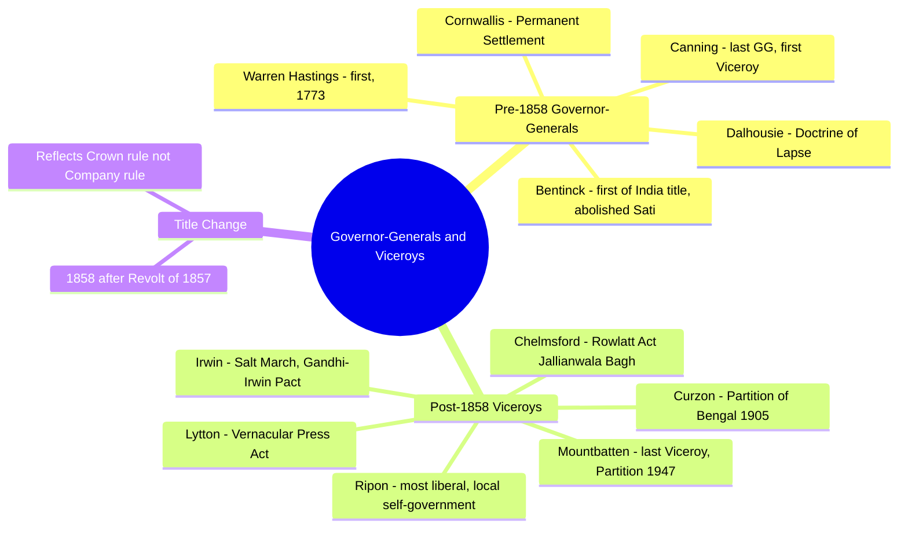

# NOTE — GOVERNOR-GENERALS & VICEROYS OF INDIA
**Section:** GK | **Category:** History | **Topic:** Governor-Generals & Viceroys of India | **Slug:** `hist-governor-generals-and-viceroys`
**Source:** 🔧 GENERAL KNOWLEDGE (standard modern history reference; not yet cross-checked against PARMAR SSC reference excerpt)
**Status:** 🔧 DRAFT — awaiting AIR-91 verification before publish
**PYQ Frequency:** 🔥 Very high-frequency Modern History topic, connects to [[hist-revolt-of-1857]] | **High Yield:** ✅

---

## 🎭 THE HOOK

The British administrator's TITLE in India changed exactly once, and the year it changed tells you everything about why: in 1858, immediately after the Revolt of 1857 forced the transfer of power from the East India Company to the British Crown, the post of "**Governor-General of India**" became "**Viceroy of India**" — a title shift reflecting that the office-holder now represented the QUEEN personally (Vice-Roy = "in place of the king/queen"), not merely a trading company's board. Tracking WHICH title applied to which administrator, and WHAT major reform/event happened under each one's tenure, is one of SSC's most reliable "name-to-policy" matching categories.

---

## 📖 THE CORE

### Governor-Generals of Bengal/India (Pre-1858)
| Office-Holder | Period | Known For |
|---|---|---|
| **Warren Hastings** | 1773-1785 | FIRST Governor-General of Bengal (under the Regulating Act, 1773); established the foundations of British administrative/judicial systems |
| **Lord Cornwallis** | 1786-1793 | Introduced the **Permanent Settlement** (1793) land revenue system in Bengal; civil service reforms |
| **Lord Wellesley** | 1798-1805 | Introduced the **Subsidiary Alliance** system, expanding British influence over princely states |
| **Lord William Bentinck** | 1828-1835 | FIRST Governor-General of INDIA (title upgraded by the Charter Act, 1833, from "Governor-General of Bengal"); abolished **Sati** (1829); suppressed Thuggee |
| **Lord Dalhousie** | 1848-1856 | Introduced the **Doctrine of Lapse** (annexation policy, see [[hist-partition-and-integration-of-princely-states]]); expanded railways and telegraph |
| **Lord Canning** | 1856-1862 | LAST Governor-General of India AND the FIRST Viceroy of India (title changed in 1858, during his tenure) — presided over the Revolt of 1857 |

### Viceroys of India (Post-1858)
| Office-Holder | Period | Known For |
|---|---|---|
| **Lord Canning** | 1858-1862 | First Viceroy (continuing from Governor-General); Government of India Act, 1858 implementation |
| **Lord Lytton** | 1876-1880 | Vernacular Press Act (1878), restricting Indian press freedom; Arms Act (1878) |
| **Lord Ripon** | 1880-1884 | Often called the most LIBERAL Viceroy; repealed the Vernacular Press Act; introduced LOCAL SELF-GOVERNMENT reforms (Ripon's Resolution, 1882, a precursor to later Panchayati Raj concepts) |
| **Lord Curzon** | 1899-1905 | Partition of Bengal (1905, see [[hist-inc-formation-and-early-nationalism]]); known for administrative efficiency but deeply unpopular for the Bengal partition |
| **Lord Hardinge II** | 1910-1916 | Capital shifted from Calcutta to Delhi (1911) |
| **Lord Chelmsford** | 1916-1921 | Government of India Act, 1919 (Montagu-Chelmsford Reforms); Rowlatt Act (1919) and Jallianwala Bagh Massacre occurred during this tenure (see [[hist-inc-formation-and-early-nationalism]]) |
| **Lord Irwin** | 1926-1931 | Salt March/Civil Disobedience Movement (1930, see [[hist-gandhian-movements]]); Gandhi-Irwin Pact (1931) |
| **Lord Wavell** | 1943-1947 | Wavell Plan, Shimla Conference (1945); preceded the final transfer of power |
| **Lord Mountbatten** | 1947 | LAST Viceroy of India; oversaw Partition and Independence (1947); briefly continued as independent India's first Governor-General after August 1947 |

### Key Distinguishing Facts
- **Lord William Bentinck was the FIRST "Governor-General of INDIA"** (the title was previously "Governor-General of Bengal") — a frequently tested title-upgrade fact, tied to the Charter Act, 1833.
- **Lord Canning is UNIQUE** — he was BOTH the last Governor-General AND the first Viceroy, since the title changed mid-tenure in 1858.
- **Lord Mountbatten was the LAST Viceroy of India**, and also briefly served as independent India's FIRST Governor-General (a different, post-independence role) — don't conflate his colonial-era and post-independence titles.

---

## 🧠 THE MIND MAP

---

## 🔑 THE MNEMONIC

**"Hastings began it, Canning transformed it, Mountbatten ended it"** — the three bookend administrators of the Governor-General/Viceroy system.

**"1858: Company's man becomes the Queen's man"** — the title-change logic, tied directly to the post-1857 transfer of power.

---

## 📌 THE PYQ ANCHOR

🔥 Governor-Generals & Viceroys of India is a very high-frequency Modern History topic, connecting to [[hist-revolt-of-1857]] (the 1858 title transition) and [[hist-gandhian-movements]] (Irwin's Salt March-era tenure). 🔧 No literal Governor-General/Viceroy question confirmed in the 23/46-shift CGL-2025 sample reviewed earlier in this session — name-to-policy matching is one of the most consistently tested SSC CGL History categories; recommend a dedicated archive cross-check.

---

## ⚠️ THE TRAP ALERT

- **Lord William Bentinck, NOT Warren Hastings, was the first "Governor-General of INDIA"** — Hastings was the first Governor-General of BENGAL (a narrower title); the "of India" upgrade came later, via the Charter Act, 1833.
- **Lord Canning is the unique bridge figure** — last Governor-General AND first Viceroy, due to the 1858 title change occurring mid-tenure.
- **Lord Curzon (Partition of Bengal, 1905) and Lord Chelmsford (Rowlatt Act/Jallianwala Bagh, 1919) are frequently mixed up** — both presided over major repressive/controversial colonial actions, but in different decades; don't conflate the two events or their respective Viceroys.
- **Lord Mountbatten served TWO distinct roles**: last colonial Viceroy (until August 1947) AND briefly independent India's first Governor-General (a ceremonial, India-government-appointed role, NOT a continuation of British colonial authority).

---

## ✅ ACTIVE RECALL

1. Who was the first Governor-General of Bengal, and who was the first Governor-General "of India"?
2. Which Governor-General/Viceroy presided over the title change from "Governor-General" to "Viceroy," and in which year?
3. Which Viceroy is associated with the Partition of Bengal (1905)?
4. Which Viceroy presided over the Rowlatt Act and the Jallianwala Bagh Massacre?
5. Who was the last Viceroy of India, and what major event occurred during his tenure?

*(Answers: 1–Warren Hastings was the first Governor-General of Bengal (1773); Lord William Bentinck was the first Governor-General "of India" (1833 onward) | 2–Lord Canning, in 1858 | 3–Lord Curzon | 4–Lord Chelmsford | 5–Lord Mountbatten; oversaw the Partition of India and Independence (1947))*
