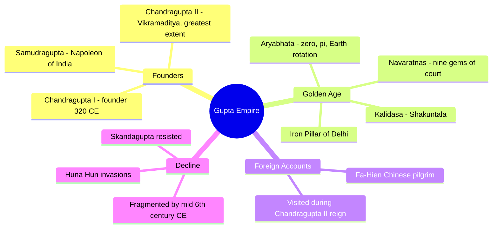

# NOTE — GUPTA EMPIRE
**Section:** GK | **Category:** History | **Topic:** Gupta Empire | **Slug:** `hist-gupta-empire`
**Source:** 🔧 GENERAL KNOWLEDGE (standard ancient history reference; not yet cross-checked against PARMAR SSC reference excerpt)
**Status:** 🔧 DRAFT — awaiting AIR-91 verification before publish
**PYQ Frequency:** 🔥 High-frequency Ancient History topic — "Golden Age of India" | **High Yield:** ✅

---

## 🎭 THE HOOK

Historians needed a name for a 200-year stretch when Indian mathematics invented the concept of zero, an astronomer calculated the Earth's circumference with startling accuracy, and a single playwright produced work still studied today — so they called it the **Golden Age of India**. The Gupta Empire, founded around **319-320 CE** by **Chandragupta I**, didn't just rule a large chunk of northern India; it presided over an explosion of achievement in mathematics, astronomy, literature, and art that punches far above the empire's actual military footprint. The irony is that almost nobody outside specialist circles knows the Gupta rulers' names as well as they know Ashoka's — despite the Gupta era arguably producing MORE lasting intellectual achievement than any other period in ancient Indian history.

---

## 📖 THE CORE

### Founders & Key Rulers
| Ruler | Reign (approx.) | Known For |
|---|---|---|
| **Chandragupta I** | c. 319-335 CE | Founder; took the title "Maharajadhiraja" |
| **Samudragupta** | c. 335-375 CE | Greatest military conqueror of the dynasty; called the "**Napoleon of India**" by historian V.A. Smith; extensive conquests recorded in the **Allahabad Prashasti** (Prayag Prashasti), composed by his court poet **Harisena** |
| **Chandragupta II (Vikramaditya)** | c. 375-415 CE | Empire reached its greatest extent; patron of the "**Navaratnas**" (Nine Gems) including Kalidasa; the Chinese pilgrim **Fa-Hien** visited India during his reign |

### Administration
- Decentralized administration compared to the Mauryas — significant local autonomy granted to provincial governors and feudatory rulers.
- Capital: **Pataliputra** (continuing from Mauryan times).
- Gold coins (**Dinaras**) were extensively issued, reflecting strong trade and economic prosperity.

### The "Golden Age" Achievements
- **Mathematics**: **Aryabhata** — composed the *Aryabhatiya*; credited with conceptualizing **zero** as a placeholder/digit and calculating an early, remarkably accurate value of **pi**; also proposed that the Earth rotates on its axis (a radical idea for the time).
- **Astronomy**: Aryabhata's work also addressed planetary motion and eclipses scientifically, ahead of much of the contemporary world.
- **Literature**: **Kalidasa** — the greatest Sanskrit poet/dramatist, author of *Abhijnanasakuntalam* (Shakuntala), *Meghaduta*, *Raghuvamsha*.
- **The Navaratnas (Nine Gems)** of Chandragupta II's court: traditionally said to include Kalidasa, Amarasimha (lexicographer), Dhanvantari (physician/medicine), Varahamihira (astronomer/astrologer — though some date him slightly later, to a subsequent era — a point of historical debate), among others.
- **Architecture**: Rock-cut cave temples (early phase of Ajanta caves), Dashavatara Temple at Deogarh — among the earliest Hindu temple architecture.
- **Metallurgy**: The **Iron Pillar of Delhi** (Mehrauli), inscribed with Chandragupta II's name, famous for its rust-resistance — a celebrated example of advanced Gupta-era metallurgical skill.

### Foreign Accounts
- **Fa-Hien** (Faxian), a Chinese Buddhist monk/pilgrim, visited India during Chandragupta II's reign, leaving valuable eyewitness accounts of Gupta-era society, administration, and Buddhist institutions.

### Decline
- Gradual decline beginning in the late 5th century CE, significantly accelerated by repeated invasions of the **Hunas (Huns)**, particularly under ruler **Skandagupta**, who fought them off temporarily but at great cost; the empire fragmented by the mid-6th century CE.

---

## 🧠 THE MIND MAP

---

## 🔑 THE MNEMONIC

**"Samudragupta conquered, Chandragupta II flourished, Aryabhata calculated, Kalidasa wrote"** — four names, four defining contributions of the Golden Age.

**"Aryabhata gave the world a zero before the world asked for one"** — anchors Aryabhata as the mathematics/astronomy figure of this era.

---

## 📌 THE PYQ ANCHOR

🔥 Gupta Empire is a high-frequency Ancient History topic, often tested as "Golden Age of India." 🔧 No literal Gupta Empire question confirmed in the 23/46-shift CGL-2025 sample reviewed in this session — Aryabhata's contributions, Kalidasa's works, and the Iron Pillar of Delhi are textbook-standard SSC CGL History staples; recommend archive cross-check.

---

## ⚠️ THE TRAP ALERT

- **Samudragupta is called the "Napoleon of India"** for his military conquests — NOT Chandragupta II, who is instead known for the empire's greatest territorial EXTENT and cultural flourishing (a frequently swapped pairing).
- **Aryabhata, not Varahamihira or Brahmagupta, is credited with the earliest Gupta-era conceptualization of zero and pi** — though all are notable Indian mathematicians/astronomers from related eras, examiners specifically test Aryabhata for these Gupta-period achievements.
- **Fa-Hien (Chinese pilgrim) visited during Chandragupta II's reign** — don't confuse with **Hiuen Tsang (Xuanzang)**, a LATER Chinese pilgrim who visited during Harsha's reign (a different, post-Gupta era).
- **The Iron Pillar of Delhi is inscribed with Chandragupta II's name** and is celebrated for its rust-resistant metallurgy — a frequently tested "which Gupta ruler" fact.

---

## ✅ ACTIVE RECALL

1. Who founded the Gupta Empire, and approximately when?
2. Which Gupta ruler is called the "Napoleon of India," and why?
3. What mathematical/astronomical contributions is Aryabhata credited with?
4. Which Chinese pilgrim visited India during Chandragupta II's reign?
5. What ultimately caused the decline of the Gupta Empire?

*(Answers: 1–Chandragupta I, around 319-320 CE | 2–Samudragupta, for his extensive military conquests, recorded in the Allahabad Prashasti | 3–Conceptualizing zero, calculating an accurate value of pi, and proposing that the Earth rotates on its axis | 4–Fa-Hien (Faxian) | 5–Repeated invasions by the Hunas (Huns), particularly during Skandagupta's reign, leading to fragmentation by the mid-6th century CE)*
