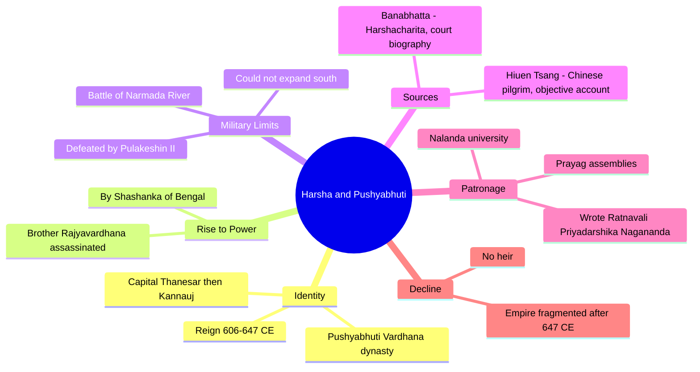

# NOTE — HARSHA & THE PUSHYABHUTI DYNASTY
**Section:** GK | **Category:** History | **Topic:** Harsha & Pushyabhuti Dynasty | **Slug:** `hist-harsha-and-pushyabhuti-dynasty`
**Source:** 🔧 GENERAL KNOWLEDGE (standard ancient history reference; not yet cross-checked against PARMAR SSC reference excerpt)
**Status:** 🔧 DRAFT — awaiting AIR-91 verification before publish
**PYQ Frequency:** 🔥 High-frequency Ancient History topic, follows [[hist-gupta-empire]] | **High Yield:** ✅

---

## 🎭 THE HOOK

After the Gupta Empire fragmented under repeated Huna invasions, North India splintered into competing regional kingdoms for nearly a century — until one young king, taking the throne after his brother's assassination, briefly reassembled a large chunk of it. **Harshavardhana** (r. 606-647 CE) ruled an empire we know about in unusually rich detail, thanks to TWO independent eyewitness sources: his own court poet, who wrote a flattering royal biography, and a foreign Buddhist pilgrim who had no reason to flatter anyone and left a far more balanced, observational account.

---

## 📖 THE CORE

### Harsha & the Pushyabhuti (Vardhana) Dynasty
- **Harshavardhana** belonged to the **Pushyabhuti dynasty** (also called the Vardhana dynasty), ruling from the capital **Thanesar** (later shifted to **Kannauj**), in present-day Haryana/Uttar Pradesh.
- Came to the throne in **606 CE**, after his elder brother **Rajyavardhana** was assassinated by **Shashanka**, the king of Gangetic Bengal — Harsha's reign began amid a succession crisis and a war of revenge.
- United much of NORTHERN India under his rule (though NOT all of India — the Deccan/South remained largely outside his control).
- His southward expansion was decisively HALTED by **Pulakeshin II** of the **Chalukya dynasty** (see [[hist-pallava-chalukya-rashtrakuta]]) at the **Battle of the Narmada River** (c. 618-619 CE) — a frequently tested defeat that defined the southern limit of Harsha's empire.

### Two Key Eyewitness Sources
- **Banabhatta** (Harsha's own court poet): authored **Harshacharita**, a biographical work praising Harsha's reign — a primary but inherently favourable/court-flattering source.
- **Hiuen Tsang (Xuanzang)**: a CHINESE Buddhist pilgrim who traveled through India during Harsha's reign, leaving a detailed, more OBJECTIVE travel account of Indian society, Harsha's court, and Buddhist institutions of the period — a frequently tested contrast to Banabhatta's court-biography perspective.
- 🔧 Don't confuse Hiuen Tsang (visited during HARSHA's reign, 7th century CE) with **Fa-Hien** (visited during CHANDRAGUPTA II's Gupta-era reign, 5th century CE — see [[hist-gupta-empire]]) — two DIFFERENT Chinese pilgrims, two different eras.

### Harsha's Patronage & Religious Policy
- Initially a Shaivite (Hindu, follower of Shiva), Harsha later showed strong patronage toward **Buddhism**, influenced partly by his association with Hiuen Tsang and the broader Buddhist intellectual environment of the time.
- Patronized the famous Buddhist learning center **Nalanda** (a major monastic university).
- Held large religious assemblies, including a notable gathering at **Kannauj** and a charitable distribution event at **Prayag (Allahabad)**, reportedly held periodically (described in Hiuen Tsang's accounts) — these "Prayag assemblies" became a famous symbol of Harsha's wealth and religious patronage.
- Was himself a playwright/author, credited with Sanskrit dramas including **Ratnavali**, **Priyadarshika**, and **Nagananda**.

### Decline
- Harsha had NO surviving heir, and his empire FRAGMENTED rapidly after his death (647 CE) — no single successor state inherited his territory, and North India returned to a period of regional fragmentation until later dynasties (e.g., the Rajput kingdoms, the Pratiharas) rose in subsequent centuries.

---

## 🧠 THE MIND MAP

---

## 🔑 THE MNEMONIC

**"Banabhatta flattered, Hiuen Tsang observed"** — the two-source contrast for Harsha's reign.

**"Pulakeshin stopped Harsha at the Narmada"** — the southern limit of Harsha's empire, in one line.

---

## 📌 THE PYQ ANCHOR

🔥 Harsha & Pushyabhuti Dynasty is a high-frequency Ancient History topic, following [[hist-gupta-empire]] chronologically. 🔧 No literal Harsha question confirmed in the 23/46-shift CGL-2025 sample reviewed earlier in this session — Hiuen Tsang's visit, the Battle of the Narmada, and Harsha's literary works are textbook-standard SSC CGL History staples; recommend a dedicated archive cross-check.

---

## ⚠️ THE TRAP ALERT

- **Hiuen Tsang visited during HARSHA's reign (7th century)**; **Fa-Hien visited during CHANDRAGUPTA II's Gupta-era reign (5th century)** — two DIFFERENT Chinese pilgrims, two different centuries; a very frequently tested mix-up.
- **Harsha was DEFEATED by Pulakeshin II at the Battle of the Narmada** — don't assume Harsha's empire extended across all of India; his southward expansion was specifically halted here.
- **Banabhatta's Harshacharita is a COURT-COMMISSIONED biography**, inherently favourable — distinct in reliability from Hiuen Tsang's more independent, observational travel account.
- **Harsha's empire FRAGMENTED immediately after his death** (no heir) — don't assume the Pushyabhuti dynasty continued ruling North India afterward; it ended with him.

---

## ✅ ACTIVE RECALL

1. To which dynasty did Harshavardhana belong, and what were his capitals?
2. How did Harsha come to the throne?
3. Who defeated Harsha and halted his southward expansion, and at which battle?
4. Name Harsha's two key eyewitness sources, and explain the key difference between them.
5. What happened to Harsha's empire after his death?

*(Answers: 1–The Pushyabhuti (Vardhana) dynasty; capitals were Thanesar, later Kannauj | 2–His elder brother Rajyavardhana was assassinated by Shashanka of Bengal, and Harsha took the throne amid the resulting succession crisis | 3–Pulakeshin II of the Chalukya dynasty, at the Battle of the Narmada River (c. 618-619 CE) | 4–Banabhatta (court poet, author of Harshacharita, a flattering biography) and Hiuen Tsang (Chinese Buddhist pilgrim, a more objective travel account) | 5–It fragmented rapidly, since Harsha had no surviving heir; North India returned to regional fragmentation)*
