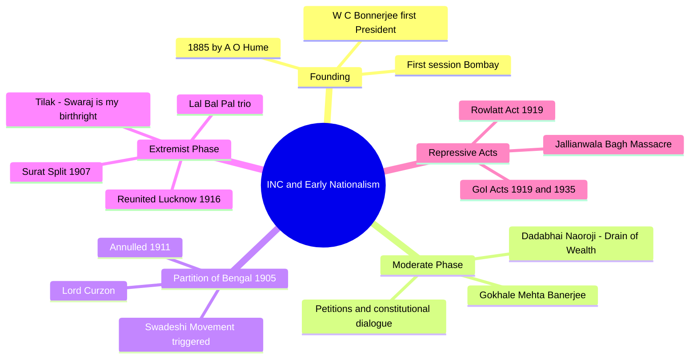

# NOTE — INC FORMATION & EARLY NATIONALISM
**Section:** GK | **Category:** History | **Topic:** INC Formation & Early Nationalism | **Slug:** `hist-inc-formation-and-early-nationalism`
**Source:** 🔧 GENERAL KNOWLEDGE (standard modern history reference; not yet cross-checked against PARMAR SSC reference excerpt)
**Status:** 🔧 DRAFT — awaiting AIR-91 verification before publish
**PYQ Frequency:** 🔥 Very high-frequency Modern History topic, connects to [[hist-gandhian-movements]] | **High Yield:** ✅

---

## 🎭 THE HOOK

The organization that would eventually lead India to independence was founded in 1885 by a RETIRED BRITISH CIVIL SERVANT — **Allan Octavian Hume** — with the encouragement (and likely tacit approval) of the British administration itself, partly conceived as a "safety valve" to channel rising educated-Indian discontent into controlled, constitutional debate rather than revolutionary unrest. The irony writes itself: the **Indian National Congress**, born from a colonial official's initiative, would spend the next six decades growing from a polite annual debating society into the single organization that ended British rule in India. Its early history splits cleanly into two contrasting phases — Moderates who believed in petition and dialogue, and Extremists who didn't.

---

## 📖 THE CORE

### Founding
- **Indian National Congress (INC)** founded in **1885** by **Allan Octavian Hume** (a retired British civil servant), with support from figures like **Dadabhai Naoroji** and **W.C. Bonnerjee**.
- **First session**: Bombay, **December 1885**, presided over by **W.C. Bonnerjee** as the first President; **72 delegates** attended.
- Early INC sessions were largely moderate in tone, focused on constitutional reform, greater Indian representation in administration, and economic critiques of British rule — NOT yet demanding full independence.

### The Moderate Phase (1885-1905)
- Leaders: **Dadabhai Naoroji** (author of *Poverty and Un-British Rule in India*, propounded the **"Drain of Wealth" theory** — that British rule systematically drained India's wealth to Britain), **Gopal Krishna Gokhale**, **Pherozeshah Mehta**, **Surendranath Banerjee**.
- Methods: petitions, resolutions, constitutional dialogue with the British government — earning the (sometimes critical) label "Political Mendicancy" from later, more radical critics.
- Dadabhai Naoroji also became the **first Indian elected to the British House of Commons** (1892) — a frequently tested standalone fact.

### Partition of Bengal (1905) & the Swadeshi Movement
- **Lord Curzon** partitioned Bengal in **1905**, ostensibly for administrative convenience, but widely seen as a deliberate "divide and rule" tactic exploiting Hindu-Muslim divisions.
- Triggered the **Swadeshi Movement** — boycott of British goods, promotion of indigenously made (Swadeshi) products, and a surge in nationalist sentiment.
- Bengal's partition was eventually ANNULLED in **1911**, partly in response to sustained protest.

### The Extremist Phase (1905-1918)
- Leaders: the **"Lal-Bal-Pal" trio** — **Lala Lajpat Rai** (Punjab), **Bal Gangadhar Tilak** (Maharashtra), **Bipin Chandra Pal** (Bengal) — pushed for more assertive, direct-action methods and the demand for **Swaraj (self-rule)**.
- **Bal Gangadhar Tilak** famously declared: **"Swaraj is my birthright, and I shall have it"** — a defining slogan of the Extremist phase.
- Tilak also popularized **Ganesh Chaturthi** and **Shivaji Jayanti** as PUBLIC festivals, deliberately using them to build mass nationalist sentiment beyond elite circles.

### The Surat Split (1907)
- The INC formally **SPLIT** at its 1907 session in **Surat**, dividing into the **Moderate** faction and the **Extremist** faction over differing strategies and ideological direction — a frequently tested organizational-rupture event.
- The two factions later REUNITED at the **Lucknow Session (1916)**, the same session that also produced the **Lucknow Pact** between the INC and the **Muslim League** (a rare moment of Hindu-Muslim political cooperation in the independence movement).

### Key Repressive Legislation (Frequently Tested)
- **Rowlatt Act (1919)**: allowed detention without trial; triggered widespread protest, including the **Jallianwala Bagh Massacre** (13 April 1919, Amritsar, ordered by General Dyer) — a pivotal radicalizing event that directly preceded Gandhi's Non-Cooperation Movement (see [[hist-gandhian-movements]]).
- **Government of India Act, 1919** (Montagu-Chelmsford Reforms): introduced limited "dyarchy" (dual governance) in provinces.
- **Government of India Act, 1935**: provided for greater provincial autonomy, later formed much of the structural basis for India's own Constitution.

---

## 🧠 THE MIND MAP

---

## 🔑 THE MNEMONIC

**"Hume founded it, Naoroji drained the theory, Tilak demanded the birthright, Surat split it, Lucknow reunited it"** — the five-beat arc of early INC/nationalism history.

**"Lal-Bal-Pal: Lajpat Rai, Bal Gangadhar Tilak, Bipin Chandra Pal"** — the Extremist trio, by region: Punjab, Maharashtra, Bengal.

---

## 📌 THE PYQ ANCHOR

🔥 INC Formation & Early Nationalism is a very high-frequency Modern History topic, directly preceding [[hist-gandhian-movements]]. 🔧 No literal INC-formation question confirmed in the 23/46-shift CGL-2025 sample reviewed earlier in this session — the founding year, Lal-Bal-Pal trio, and the Surat Split are textbook-standard SSC CGL History staples; recommend a dedicated archive cross-check.

---

## ⚠️ THE TRAP ALERT

- **A.O. Hume, the INC's founder, was a RETIRED BRITISH civil servant**, not an Indian — a frequently tested, counterintuitive founding fact.
- **The INC SPLIT at Surat in 1907** and REUNITED at Lucknow in 1916 — don't confuse the location/year of the split with the location/year of reunification.
- **The Rowlatt Act (1919) and the Jallianwala Bagh Massacre (1919) are CONNECTED but DISTINCT events** — the Act triggered the protests that led to the massacre; don't treat them as the same event.
- **Bengal's 1905 partition was ANNULLED in 1911**, not permanently maintained — a frequently tested reversal fact.

---

## ✅ ACTIVE RECALL

1. Who founded the Indian National Congress, and in which year?
2. What is the "Drain of Wealth" theory, and who propounded it?
3. Name the three leaders of the Extremist "Lal-Bal-Pal" trio, with their respective regions.
4. What event split the INC in 1907, and where did the two factions reunite, and when?
5. What was the Rowlatt Act (1919), and what major event did it directly trigger?

*(Answers: 1–Allan Octavian Hume, a retired British civil servant, in 1885 | 2–The theory that British rule systematically drained India's wealth to Britain; propounded by Dadabhai Naoroji | 3–Lala Lajpat Rai (Punjab), Bal Gangadhar Tilak (Maharashtra), Bipin Chandra Pal (Bengal) | 4–The Surat Split (1907); the factions reunited at the Lucknow Session in 1916 | 5–A law allowing detention without trial; it triggered protests that led to the Jallianwala Bagh Massacre (13 April 1919))*
