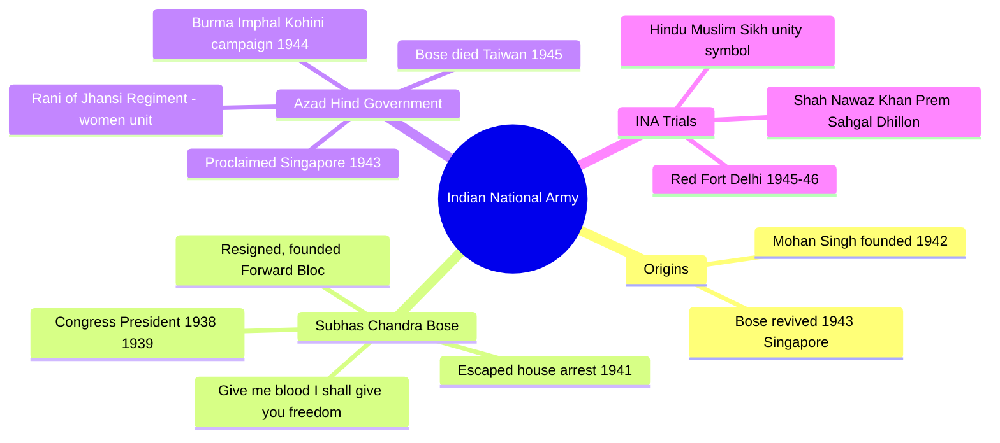

# NOTE — INDIAN NATIONAL ARMY (SUBHAS CHANDRA BOSE)
**Section:** GK | **Category:** History | **Topic:** Indian National Army | **Slug:** `hist-indian-national-army`
**Source:** 🔧 GENERAL KNOWLEDGE (standard modern history reference; not yet cross-checked against PARMAR SSC reference excerpt)
**Status:** 🔧 DRAFT — awaiting AIR-91 verification before publish
**PYQ Frequency:** 🔥 High-frequency Modern History topic, connects to [[hist-gandhian-movements]] | **High Yield:** ✅

---

## 🎭 THE HOOK

While Gandhi pursued nonviolent resistance from within India, **Subhas Chandra Bose** — a former Congress President who broke decisively with Gandhi over strategy — pursued an entirely different path from OUTSIDE the country: building an armed force to fight the British militarily, with Axis-power backing during World War II. Escaping house arrest in Calcutta in 1941, traveling secretly through Afghanistan and the Soviet Union to Nazi Germany, then making a perilous submarine journey to Japanese-controlled Southeast Asia, Bose took command of the **Indian National Army (Azad Hind Fauj)** and declared a provisional Indian government-in-exile — a wartime gamble that ultimately failed militarily but had an unexpected afterlife: the postwar INA trials became one of the most galvanizing nationalist moments of the entire independence movement.

---

## 📖 THE CORE

### Origins of the INA
- The **Indian National Army (INA)**, also called **Azad Hind Fauj**, was ORIGINALLY founded by **Mohan Singh** in **1942**, formed from Indian prisoners of war captured by Japan in Southeast Asia (Singapore/Malaya campaign) — this first INA later dissolved due to internal disagreements.
- **Subhas Chandra Bose** REVIVED and reorganized the INA in **1943**, after arriving in Singapore (via Germany and a submarine journey), taking full command.

### Subhas Chandra Bose's Path
- Elected **Congress President** twice (1938, 1939), but resigned in 1939 after ideological clashes with Gandhi and the Congress leadership over strategy (Bose favored more aggressive, internationally-allied resistance).
- Founded the **Forward Bloc** (1939) as a separate political platform after leaving Congress.
- Escaped house arrest in Calcutta in **January 1941**, traveling through Afghanistan and the Soviet Union to **Nazi Germany**.
- Famously addressed his troops with the slogan: **"Give me blood, and I shall give you freedom" ("Tum mujhe khoon do, main tumhe azadi dunga")**.
- Adopted the title **"Netaji"** ("respected leader").

### Azad Hind Government & the INA's Campaign
- Bose proclaimed the **"Azad Hind" (Provisional Government of Free India)** in **Singapore, 1943** — a government-in-exile recognized by Axis powers (Japan, Germany, Italy, and a few others).
- The **Rani of Jhansi Regiment**, an all-WOMEN combat unit of the INA, was a notable feature — among the first organized all-women combat units in Asian military history, led by **Captain Lakshmi Sahgal**.
- The INA, alongside Japanese forces, fought in the **Burma/Imphal-Kohima campaigns (1944)** against British forces, attempting to push into northeastern India — ultimately defeated due to logistical failures, monsoon conditions, and Allied counter-offensives.
- Bose died in an aircraft crash in **Taiwan (Formosa)**, **18 August 1945** — though the circumstances remain a subject of historical debate and occasional conspiracy theories (see also the Bharat Ratna controversy noted in [[misc-bharat-ratna-awardees]]).

### The INA Trials (1945-46) — Aftermath & Significance
- After Japan's surrender, captured INA officers were put on trial by the British at the **Red Fort, Delhi** (the "**Red Fort Trials**") for treason against the British Crown.
- The trials of three officers — **General Shah Nawaz Khan, Colonel Prem Sahgal, Colonel Gurbaksh Singh Dhillon** — representing Hindu, Muslim, and Sikh communities respectively, became a MASSIVE unifying nationalist cause across India.
- Widespread public protests and pressure forced the British to commute the sentences, and the trials are widely seen as a significant contributing factor in eroding British confidence in maintaining control over Indian forces — feeding directly into the post-WWII momentum toward independence.

---

## 🧠 THE MIND MAP

---

## 🔑 THE MNEMONIC

**"Mohan founded it, Bose revived it, Imphal tested it, Red Fort immortalized it"** — the four-act arc of the INA's history.

**"Shah Nawaz Khan, Prem Sahgal, Dhillon — one Hindu, one Muslim, one Sikh"** — the three INA Trial defendants, symbolizing unified nationalism.

---

## 📌 THE PYQ ANCHOR

🔥 Indian National Army is a high-frequency Modern History topic, connecting to [[hist-gandhian-movements]] and the broader independence-movement timeline. 🔧 No literal INA question confirmed in the 23/46-shift CGL-2025 sample reviewed earlier in this session — Bose's slogan, the Rani of Jhansi Regiment, and the Red Fort Trials are textbook-standard SSC CGL History staples; recommend a dedicated archive cross-check.

---

## ⚠️ THE TRAP ALERT

- **Mohan Singh FOUNDED the original INA (1942); Subhas Chandra Bose REVIVED and reorganized it (1943)** — don't credit Bose as the sole founder; he took command of a re-formed second INA.
- **The Rani of Jhansi Regiment was an ALL-WOMEN combat unit**, led by Captain Lakshmi Sahgal — a frequently tested standalone fact about gender representation in the INA.
- **Bose's famous slogan is "Give me blood, and I shall give you freedom"** — don't confuse with other independence-movement slogans (e.g., Tilak's "Swaraj is my birthright").
- **The INA Trials were held at the Red Fort, Delhi**, NOT in Britain or elsewhere — and the three defendants represented Hindu, Muslim, and Sikh communities deliberately, fueling cross-community nationalist solidarity.

---

## ✅ ACTIVE RECALL

1. Who originally founded the Indian National Army, and who later revived/reorganized it?
2. What was Subhas Chandra Bose's famous slogan to his troops?
3. What was the "Rani of Jhansi Regiment," and who led it?
4. Where and when did Bose proclaim the Azad Hind (Provisional Government of Free India)?
5. Where were the post-war INA trials held, and what was significant about the three defendants?

*(Answers: 1–Mohan Singh founded it in 1942; Subhas Chandra Bose revived and reorganized it in 1943 | 2–"Give me blood, and I shall give you freedom" | 3–An all-women combat unit of the INA, led by Captain Lakshmi Sahgal | 4–Singapore, 1943 | 5–The Red Fort, Delhi; the three defendants — Shah Nawaz Khan, Prem Sahgal, Gurbaksh Singh Dhillon — represented Hindu, Muslim, and Sikh communities respectively, symbolizing unified nationalism)*
