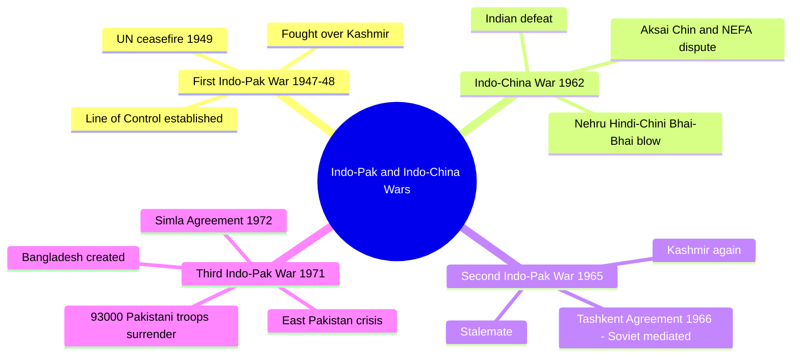

# NOTE — INDO-PAK WARS & INDO-CHINA WAR
**Section:** GK | **Category:** History | **Topic:** Indo-Pak Wars & Indo-China War | **Slug:** `hist-indo-pak-wars-and-indo-china-war`
**Source:** 🔧 GENERAL KNOWLEDGE (standard post-independence history reference; not yet cross-checked against PARMAR SSC reference excerpt)
**Status:** 🔧 DRAFT — awaiting AIR-91 verification before publish
**PYQ Frequency:** 🔥 Very high-frequency Post-Independence History topic, connects to [[hist-partition-and-integration-of-princely-states]] | **High Yield:** ✅

---

## 🎭 THE HOOK

In the first 25 years after independence, India fought four major wars — three against Pakistan, one against China — and the outcomes of these four conflicts shaped the subcontinent's map and politics for decades afterward. The most consequential single result: the **1971 war**, which didn't just end in an Indian victory but literally CREATED A NEW COUNTRY, when East Pakistan broke away to become **Bangladesh** — making it one of the few wars in modern history to redraw a national border by splitting an existing state in two.

---

## 📖 THE CORE

### First Indo-Pak War (1947-48)
- Fought over **Jammu & Kashmir**, immediately following Maharaja Hari Singh's accession to India (26 October 1947, see [[hist-partition-and-integration-of-princely-states]]) amid a Pakistani-backed tribal invasion.
- Ended with UN-mediated **ceasefire (1 January 1949)**, establishing the **Line of Control (LoC)** — informally dividing Kashmir between Indian- and Pakistani-administered portions, a division that persists to this day.

### Indo-China War (1962)
- Fought over disputed Himalayan border territory — primarily **Aksai Chin** (claimed by India, controlled by China) and the **North-East Frontier Agency/NEFA** (now Arunachal Pradesh).
- China launched a SURPRISE offensive in October 1962; India was MILITARILY UNPREPARED and suffered a significant DEFEAT, leading to a unilateral Chinese ceasefire in November 1962.
- Exposed serious gaps in India's military preparedness and border infrastructure; a major catalyst for subsequent Indian defence modernization.
- Indian Prime Minister at the time: **Jawaharlal Nehru** — the defeat is frequently cited as a significant blow to his "Hindi-Chini Bhai-Bhai" (India-China brotherhood) diplomatic approach.

### Second Indo-Pak War (1965)
- Fought primarily over **Kashmir** again, triggered by Pakistani infiltration (Operation Gibraltar) attempting to incite an uprising in Indian-administered Kashmir.
- Ended in a STALEMATE/inconclusive military outcome; resolved diplomatically via the **Tashkent Agreement (1966)**, mediated by the **Soviet Union**, under which both sides agreed to withdraw to pre-war positions.
- Indian PM **Lal Bahadur Shastri** died in Tashkent shortly after signing the agreement (under circumstances that remain a subject of some historical speculation).

### Third Indo-Pak War / Bangladesh Liberation War (1971)
- Triggered by a humanitarian/political crisis in **East Pakistan** (mass displacement, repression by the Pakistani military against the Bengali population, following Pakistan's refusal to honor the 1970 election results favouring the Bengali Awami League).
- India intervened militarily in support of Bengali independence (Mukti Bahini forces); decisive Indian victory, resulting in the **surrender of approximately 93,000 Pakistani troops** — among the LARGEST military surrenders since World War II, a frequently tested specific figure.
- Resulted in the creation of **Bangladesh** as an independent nation from former East Pakistan.
- Concluded with the **Simla Agreement (1972)**, between Indian PM **Indira Gandhi** and Pakistani PM **Zulfikar Ali Bhutto**, converting the ceasefire line in Kashmir into the **Line of Control (LoC)** in its current form, and committing both countries to resolve disputes BILATERALLY rather than through international mediation.

### Key Distinguishing Facts
- **The 1962 Indo-China War was a DEFEAT for India**, unlike the three Indo-Pak wars, where outcomes ranged from stalemate (1965) to clear victory (1971) — don't assume uniform Indian success across all four conflicts.
- **The 1971 war's most distinctive outcome is the CREATION OF BANGLADESH** — a frequently tested unique consequence, unlike the 1947-48 and 1965 wars, which primarily affected the Kashmir border without creating a new country.
- **The Tashkent Agreement (1966) resolved the 1965 war**; the **Simla Agreement (1972)** resolved the 1971 war — two DIFFERENT agreements, frequently confused, mediated/negotiated under different circumstances (Soviet mediation vs. direct bilateral negotiation).

---

## 🧠 THE MIND MAP

---

## 🔑 THE MNEMONIC

**"47 drew the line, 62 lost the border, 65 ended at Tashkent, 71 made Bangladesh"** — four wars, four distinct one-line outcomes.

**"Tashkent for '65, Simla for '71"** — the two peace agreements, kept distinct by year and war.

---

## 📌 THE PYQ ANCHOR

🔥 Indo-Pak Wars & Indo-China War is a very high-frequency Post-Independence History topic, connecting to [[hist-partition-and-integration-of-princely-states]] (Kashmir's accession). 🔧 No literal Indo-Pak/Indo-China War question confirmed in the 23/46-shift CGL-2025 sample reviewed earlier in this session — the 1971 war's 93,000-troop surrender, Bangladesh's creation, and the Tashkent/Simla agreement distinction are textbook-standard SSC CGL History/Current Affairs staples; recommend a dedicated archive cross-check.

---

## ⚠️ THE TRAP ALERT

- **India LOST the 1962 Indo-China War** — don't assume Indian military success across all four conflicts in this era; 1962 was a clear defeat.
- **The Tashkent Agreement (1966) resolved the 1965 war; the Simla Agreement (1972) resolved the 1971 war** — these are frequently confused, despite being separate agreements for separate wars.
- **The 1971 war's surrender of approximately 93,000 Pakistani troops** is a frequently tested specific numerical fact, among the largest military surrenders since World War II.
- **The Line of Control (LoC) was first established after the 1947-48 war (1949 ceasefire line)**, and later FORMALIZED into its current shape by the 1972 Simla Agreement — don't assume it originated entirely from the 1971 war alone.

---

## ✅ ACTIVE RECALL

1. What border dispute triggered the 1962 Indo-China War, and what was the outcome for India?
2. What agreement ended the Second Indo-Pak War (1965), and who mediated it?
3. What triggered the Third Indo-Pak War (1971), and what was its most distinctive outcome?
4. Approximately how many Pakistani troops surrendered in the 1971 war?
5. What agreement followed the 1971 war, and between which two leaders was it signed?

*(Answers: 1–Disputed Himalayan border territory (Aksai Chin and NEFA); India suffered a significant military defeat | 2–The Tashkent Agreement (1966), mediated by the Soviet Union | 3–A humanitarian/political crisis in East Pakistan, with India intervening in support of Bengali independence; its most distinctive outcome was the creation of Bangladesh as an independent nation | 4–Approximately 93,000 Pakistani troops | 5–The Simla Agreement (1972), signed between Indian PM Indira Gandhi and Pakistani PM Zulfikar Ali Bhutto)*
