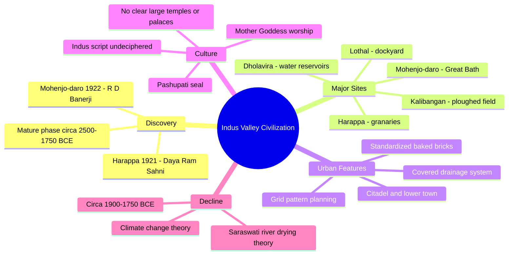

# NOTE — INDUS VALLEY CIVILIZATION
**Section:** GK | **Category:** History | **Topic:** Indus Valley Civilization | **Slug:** `hist-indus-valley-civilization`
**Source:** 🔧 GENERAL KNOWLEDGE (standard ancient history reference; not yet cross-checked against PARMAR SSC reference excerpt)
**Status:** 🔧 DRAFT — awaiting AIR-91 verification before publish
**PYQ Frequency:** 🔥 Phase-2 backlog topic (from original CHANAKYA Smart Notes system doc) | **High Yield:** ✅

---

## 🎭 THE HOOK

In 1920s Punjab, archaeologists digging at a site called Harappa found something that quietly rewrote Indian history: a civilization older than anyone had given India credit for, with cities laid out on a precise grid, covered drains running beneath every street, and a script nobody has ever been able to read — not one word of it, not in over a century of trying. The Indus Valley Civilization (also called the Harappan Civilization, after the first site discovered) flourished roughly **2500-1750 BCE**, built cities with sewage systems more advanced than many towns had thousands of years later, traded with Mesopotamia, and then vanished — its cities abandoned, its script silent, its end still debated by historians today.

---

## 📖 THE CORE

### Discovery & Chronology
- First site discovered: **Harappa** (Punjab, now in Pakistan), excavated by **Daya Ram Sahni** in **1921**.
- Second major site: **Mohenjo-daro** ("Mound of the Dead"), Sindh, excavated by **R.D. Banerji** in **1922**.
- Mature/urban phase: roughly **2500-1750 BCE** (also dated 2600-1900 BCE in some sources — periodization varies).
- Part of the **Bronze Age**; contemporary with Mesopotamian and Egyptian civilizations, with confirmed trade links to Mesopotamia (referred to as "Meluhha" in Mesopotamian records).

### Major Sites (Frequently Tested)
| Site | Location | Known For |
|---|---|---|
| **Harappa** | Punjab (Pakistan) | First site discovered; granaries, workmen's quarters |
| **Mohenjo-daro** | Sindh (Pakistan) | Great Bath, Great Granary, largest IVC city |
| **Lothal** | Gujarat, India | Dockyard — evidence of maritime trade |
| **Dholavira** | Gujarat, India | Water conservation/reservoir system, unique 3-part city division |
| **Kalibangan** | Rajasthan, India | Evidence of ploughed field, fire altars |
| **Rakhigarhi** | Haryana, India | Among the largest IVC sites by area (some claims call it the largest) |
| **Chanhudaro** | Sindh (Pakistan) | Only major site without a citadel; bead-making industry |

### Urban Planning & Society
- **Grid pattern town planning** — streets crossing at right angles, dividing cities into blocks.
- Cities typically had two parts: a **raised "Citadel"** (administrative/religious structures) and a **lower town** (residential).
- Advanced **drainage system** — covered drains running along streets, connected to individual houses — among the most advanced in the ancient world.
- Houses built of **standardized baked bricks**, often with private wells and bathrooms.
- **Great Bath** at Mohenjo-daro — a large, watertight public bathing structure, likely used for ritual purification.
- No clear evidence of large temples or palaces (unlike Mesopotamia/Egypt) — suggesting a possibly more egalitarian or differently organized social structure; this remains debated.

### Economy & Culture
- Primarily an **agrarian and trading economy** — evidence of trade with Mesopotamia (seals found in both regions).
- **Indus Script** — a pictographic writing system found on seals; remains **UNDECIPHERED** to this day, despite over a century of attempts.
- **Seals** — characteristic steatite seals, often depicting animals (notably the "Unicorn" motif, and the famous "Pashupati Seal" depicting a seated figure surrounded by animals, often interpreted as a proto-Shiva figure).
- Worship likely included a **Mother Goddess** (based on terracotta figurines) and possibly a proto-Shiva deity (Pashupati Seal interpretation).
- No evidence of large-scale warfare artifacts (few weapons found) — suggesting a relatively peaceful civilization, though this too is debated.

### Decline
- Decline around **1900-1750 BCE** — causes debated; theories include **climate change/drying of the Saraswati-Ghaggar-Hakra river system**, **Aryan migration/invasion (older, now largely discredited as a sole cause)**, **tectonic activity**, and **shifts in river courses (especially the Indus and the seasonal monsoon pattern)**.
- No single confirmed cause; modern scholarship leans toward a combination of climatic and ecological factors rather than a singular invasion event.

---

## 🧠 THE MIND MAP

---

## 🔑 THE MNEMONIC

**"Harappa first, Mohenjo biggest, Lothal floats, Dholavira holds water"** — quick site-to-feature pairing for the most-tested IVC sites.

**"Script unread, bath well-laid, no king's palace ever made"** — three defining IVC mysteries: undeciphered script, the Great Bath, and the absence of confirmed palaces/temples.

---

## 📌 THE PYQ ANCHOR

🔥 Indus Valley Civilization was explicitly listed as a Phase-2 backlog topic in the original CHANAKYA Smart Notes system document (alongside Mauryan Empire and Gandhian Movements). 🔧 No literal IVC question confirmed in the 23/46-shift CGL-2025 sample reviewed in this session — site-feature matching (Lothal=dockyard, Dholavira=water system) and the undeciphered script fact are textbook-standard SSC CGL History staples; recommend archive cross-check.

---

## ⚠️ THE TRAP ALERT

- **The Indus Script remains UNDECIPHERED** — don't assume historians have "read" Harappan writing; despite seals being found, no confirmed translation exists.
- **Lothal (dockyard/maritime trade) and Dholavira (water reservoirs) are frequently swapped** in matching questions — Lothal = Gujarat, port/dock; Dholavira = Gujarat, unique water conservation system and 3-part city division.
- **Harappa was discovered FIRST (1921, Daya Ram Sahni)**; Mohenjo-daro was discovered SECOND (1922, R.D. Banerji) — but Mohenjo-daro is generally considered the LARGER/more prominent site — don't assume "first discovered" means "largest."
- **No definitive cause for IVC's decline has been proven** — avoid stating the old "Aryan invasion" theory as a settled fact; modern scholarship favors climatic/ecological explanations.

---

## ✅ ACTIVE RECALL

1. Who discovered Harappa, and in which year? Who discovered Mohenjo-daro, and when?
2. Which Indus Valley site is known for its dockyard, evidencing maritime trade?
3. Which Indus Valley site is famous for its advanced water conservation/reservoir system?
4. Has the Indus Script been deciphered?
5. What are the leading theories for the decline of the Indus Valley Civilization?

*(Answers: 1–Harappa: Daya Ram Sahni, 1921; Mohenjo-daro: R.D. Banerji, 1922 | 2–Lothal (Gujarat) | 3–Dholavira (Gujarat) | 4–No, it remains undeciphered to this day | 5–Climate change/drying of the Saraswati-Ghaggar-Hakra river system, shifts in river courses, and ecological factors — the old "Aryan invasion" theory is largely discredited as a sole cause)*
