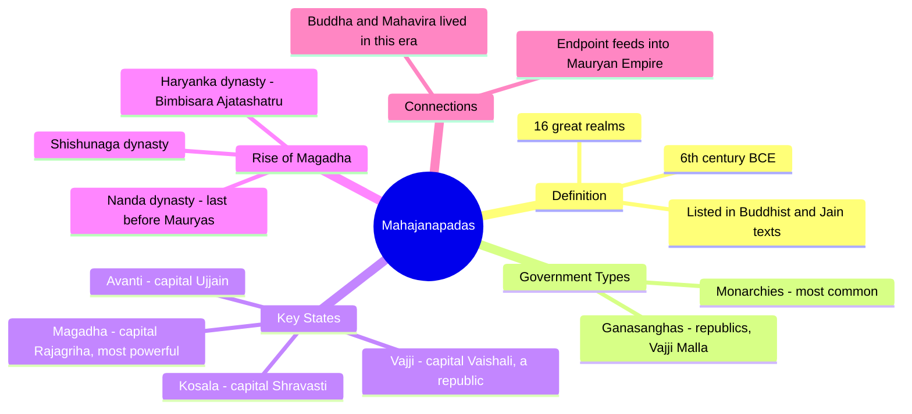

# NOTE — MAHAJANAPADAS
**Section:** GK | **Category:** History | **Topic:** Mahajanapadas | **Slug:** `hist-mahajanapadas`
**Source:** 🔧 GENERAL KNOWLEDGE (standard ancient history reference; not yet cross-checked against PARMAR SSC reference excerpt)
**Status:** 🔧 DRAFT — awaiting AIR-91 verification before publish
**PYQ Frequency:** 🔥 High-frequency Ancient History topic, bridges [[hist-vedic-period]] and [[hist-mauryan-empire]] | **High Yield:** ✅

---

## 🎭 THE HOOK

By the 6th century BCE, the small tribal territories of the Later Vedic period had consolidated into 16 major political powers spread across northern India — Buddhist and Jain texts both independently list these same **16 Mahajanapadas** ("great realms"), confirming their historical reality from two separate religious traditions. It was a politically experimental era: some Mahajanapadas were monarchies (ruled by hereditary kings), others were **Ganasanghas** — republics or oligarchies governed by assemblies of clan leaders, a genuinely democratic-ish experiment more than two thousand years before democracy became India's modern system of government. One Mahajanapada, **Magadha**, would eventually swallow all the others and become the launching pad for the Mauryan Empire.

---

## 📖 THE CORE

### What Are the Mahajanapadas?
- 16 major territorial states that existed in northern India around the **6th century BCE**, during the transition from the Later Vedic tribal system to organized territorial kingdoms.
- Listed in early Buddhist texts (the **Anguttara Nikaya**) and Jain texts (the **Bhagavati Sutra**) — independent confirmation from two different religious traditions.
- Bridges [[hist-vedic-period]]'s tribal political structure and the rise of large empires like [[hist-mauryan-empire]].

### Government Types
- **Monarchies**: ruled by a hereditary king (most Mahajanapadas, including Magadha, Kosala, Avanti).
- **Ganasanghas** (Republics/Oligarchies): governed by an ASSEMBLY of clan chiefs/elders rather than a single monarch — examples include the **Vajji** (or Vrijji) confederacy (capital Vaishali) and the **Malla** Mahajanapada — frequently cited as ancient India's closest approximation to republican governance.

### Key Mahajanapadas (Frequently Tested)
| Mahajanapada | Capital | Modern Region |
|---|---|---|
| **Magadha** | Rajagriha (later Pataliputra) | Bihar — eventually the MOST POWERFUL, base for Mauryan/Gupta empires |
| **Kosala** | Shravasti/Ayodhya | Uttar Pradesh |
| **Vajji (Vrijji)** | Vaishali | Bihar — a Ganasangha (republic) |
| **Avanti** | Ujjain | Madhya Pradesh |
| **Kuru** | Indraprastha | Delhi/Haryana region |
| **Panchala** | Ahichhatra/Kampilya | Western UP |
| **Gandhara** | Taxila | Northwest (modern Pakistan/Afghanistan border) |
| **Kashi** | Varanasi | Uttar Pradesh |

### Rise of Magadha
- **Magadha** emerged as the most powerful Mahajanapada, eventually absorbing/conquering most of its rivals, through successive dynasties: **Haryanka dynasty** (notable king: **Bimbisara**, who expanded Magadha through alliances and conquest; and his son **Ajatashatru**, who continued aggressive expansion, notably defeating the Vajji confederacy), followed by the **Shishunaga** and **Nanda dynasties**.
- Magadha's geographic advantages (fertile Gangetic plains, access to iron ore deposits, control of river trade routes) contributed significantly to its rise.
- The **Nanda dynasty** was the LAST dynasty to rule Magadha before **Chandragupta Maurya** overthrew it to found the Mauryan Empire (see [[hist-mauryan-empire]]) — making the Mahajanapada era's endpoint the Mauryan Empire's starting point.

### Key Distinguishing Facts
- **Both Buddhism and Jainism arose DURING the Mahajanapada period** — the Buddha and Mahavira both lived and taught across several of these states, particularly Magadha and Kosala (see [[hist-buddhism-and-jainism]]).
- **The Vajji confederacy (capital Vaishali) is the most-cited example of a Ganasangha/republic** — eventually conquered by Magadha's King Ajatashatru, ending one of ancient India's most prominent non-monarchical experiments.
- **Magadha was the LAST surviving and most powerful Mahajanapada**, directly feeding into the Nanda and then Mauryan dynastic sequence.

---

## 🧠 THE MIND MAP

---

## 🔑 THE MNEMONIC

**"16 realms, two government styles — kings ruled most, assemblies ruled a few"** — the core Mahajanapada political-structure split.

**"Magadha ate them all, then the Mauryas ate Magadha"** — the consolidation arc from 16 states to one empire.

---

## 📌 THE PYQ ANCHOR

🔥 Mahajanapadas is a high-frequency Ancient History topic, bridging [[hist-vedic-period]] and [[hist-mauryan-empire]]. 🔧 No literal Mahajanapadas question confirmed in the 23/46-shift CGL-2025 sample reviewed earlier in this session — the 16-state list, Magadha's rise, and the Ganasangha concept are textbook-standard SSC CGL History staples; recommend a dedicated archive cross-check.

---

## ⚠️ THE TRAP ALERT

- **Most Mahajanapadas were MONARCHIES; only a few (like Vajji, Malla) were Ganasanghas (republics)** — don't assume the republic model was the dominant form.
- **Magadha's capital MOVED over time** — initially Rajagriha, later shifted to Pataliputra (which also became the Mauryan capital) — don't assume a single fixed capital throughout Magadha's history.
- **The Nanda dynasty was the LAST dynasty of Magadha BEFORE the Mauryas**, not a Mauryan dynasty itself — Chandragupta Maurya OVERTHREW the Nandas to found his own empire.
- **Both the Buddha and Mahavira lived during the Mahajanapada period**, NOT before or after it — their teachings emerged directly within this politically fragmented, intellectually fertile era.

---

## ✅ ACTIVE RECALL

1. What are the Mahajanapadas, and which two religious texts confirm the list of 16?
2. What are the two types of government found among the Mahajanapadas?
3. Which Mahajanapada became the most powerful, and what was its capital?
4. Name the dynasty that ruled Magadha immediately before the Mauryan Empire.
5. Which Mahajanapada is the most-cited example of a Ganasangha (republic), and what happened to it?

*(Answers: 1–16 major territorial states in northern India around the 6th century BCE; confirmed by the Buddhist Anguttara Nikaya and the Jain Bhagavati Sutra | 2–Monarchies (hereditary kings) and Ganasanghas (republics/oligarchies governed by assemblies) | 3–Magadha; capital initially Rajagriha, later Pataliputra | 4–The Nanda dynasty | 5–The Vajji (Vrijji) confederacy, capital Vaishali; it was eventually conquered by Magadha under King Ajatashatru)*
