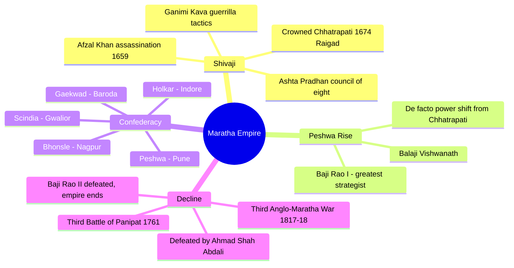

# NOTE — MARATHA EMPIRE
**Section:** GK | **Category:** History | **Topic:** Maratha Empire | **Slug:** `hist-maratha-empire`
**Source:** 🔧 GENERAL KNOWLEDGE (standard medieval history reference; not yet cross-checked against PARMAR SSC reference excerpt)
**Status:** 🔧 DRAFT — awaiting AIR-91 verification before publish
**PYQ Frequency:** 🔥 High-frequency Medieval History topic, connects to [[hist-mughal-empire]] | **High Yield:** ✅

---

## 🎭 THE HOOK

While Aurangzeb spent the last 25 years of his reign bogged down in the Deccan, exhausting the Mughal treasury chasing an enemy he could never quite eliminate, that enemy was busy building something that would eventually dominate most of India: the **Maratha Empire**, founded by **Shivaji**, crowned **Chhatrapati** (sovereign) in **1674** at Raigad. By the 18th century, after Shivaji's death, the Marathas had grown from a regional Deccan power into a confederacy stretching across most of the subcontinent — administered not by one king, but by a network of largely autonomous chiefs (the famous "Maratha Confederacy") under a nominal Peshwa-led structure, until a catastrophic single battle in 1761 stopped their northward expansion cold.

---

## 📖 THE CORE

### Shivaji & Foundation
- **Shivaji Bhonsle** founded the Maratha kingdom, crowned **Chhatrapati** in **1674** at **Raigad Fort**.
- Developed **guerrilla warfare tactics** ("Ganimi Kava") suited to the hilly Deccan terrain, used effectively against both the Mughals and the Bijapur Sultanate.
- Established a structured administration with **Ashta Pradhan** (Council of Eight Ministers), including the **Peshwa** (Prime Minister) as the senior-most position — initially just one of eight ministers, not yet the dominant office it later became.
- Famous for the assassination of Bijapur general **Afzal Khan** (1659) using concealed "Tiger Claws" (Bagh Nakh) — a frequently cited episode of Shivaji's military cunning.

### Rise of the Peshwas
- After Shivaji's successors, real power increasingly shifted to the **Peshwa** (originally the Prime Minister position), especially under **Balaji Vishwanath** and his son **Baji Rao I** — by the early 18th century, the Peshwa effectively became the de facto ruler, with the Chhatrapati reduced to a largely ceremonial role.
- **Baji Rao I** (Peshwa, 1720-1740) is considered one of the greatest military strategists of the era, expanding Maratha influence deep into North India, never having lost a battle.

### The Maratha Confederacy
- By the mid-18th century, Maratha power was organized as a CONFEDERACY of largely autonomous chiefs/houses, not a single centralized empire:
  - **Peshwa** (Pune) — nominal head of the confederacy.
  - **Scindia/Shinde** (Gwalior).
  - **Holkar** (Indore).
  - **Gaekwad** (Baroda).
  - **Bhonsle** (Nagpur) — descendants of a separate branch.
- This decentralized structure allowed for rapid territorial expansion across India but also created internal coordination weaknesses, later exploited by the British.

### Third Battle of Panipat (1761)
- Fought between the Maratha Confederacy and **Ahmad Shah Abdali** (Durrani Empire, Afghanistan), **14 January 1761**.
- A decisive Maratha DEFEAT — heavy losses, including senior Maratha leadership — that significantly checked (though did not permanently end) Maratha expansion into North India.
- This was the THIRD Battle of Panipat — distinct from the First (1526, Babur vs. Ibrahim Lodi) and Second (1556, Akbar's forces vs. Hemu) — see [[hist-mughal-empire]] and [[hist-delhi-sultanate]].

### Decline & End
- Despite the Talikota-scale shock of Panipat (1761), the Marathas recovered substantially under later Peshwas, but internal rivalries among the confederacy houses progressively weakened unified resistance.
- The Maratha Empire formally ended after the **Third Anglo-Maratha War (1817-1818)**, when the British East India Company decisively defeated the Peshwa, **Baji Rao II**, ending Maratha political power and consolidating British dominance over most of India.

---

## 🧠 THE MIND MAP

---

## 🔑 THE MNEMONIC

**"Shivaji founded, Baji Rao expanded, Panipat checked, the British ended it"** — the four-act arc of Maratha history.

**"Peshwa Pune, Scindia Gwalior, Holkar Indore, Gaekwad Baroda, Bhonsle Nagpur"** — the five houses of the Maratha Confederacy and their seats.

---

## 📌 THE PYQ ANCHOR

🔥 Maratha Empire is a high-frequency Medieval History topic, directly connecting to [[hist-mughal-empire]] (via the Third Battle of Panipat) and the colonial transition. 🔧 No literal Maratha Empire question confirmed in the 23/46-shift CGL-2025 sample reviewed earlier in this session — Shivaji's coronation, the Peshwa system, and the Third Battle of Panipat are textbook-standard SSC CGL History staples; recommend a dedicated archive cross-check.

---

## ⚠️ THE TRAP ALERT

- **The Peshwa was ORIGINALLY just one of Shivaji's eight ministers (Ashta Pradhan), NOT the founding ruler** — real power shifted to the Peshwa office only generations later; don't assume the Peshwa system existed from the empire's founding as the dominant authority.
- **The Third Battle of Panipat (1761) was fought against Ahmad Shah Abdali**, an Afghan ruler — NOT against the Mughals or the British; a frequently tested opponent-identification trap.
- **The Maratha Confederacy had FIVE major houses** (Peshwa/Pune, Scindia/Gwalior, Holkar/Indore, Gaekwad/Baroda, Bhonsle/Nagpur) — a frequently tested house-to-seat matching set.
- **The Maratha Empire formally ended via the Third Anglo-Maratha War (1817-1818)**, not at the Third Battle of Panipat (1761) — Panipat was a major setback, not the empire's end; the Marathas recovered and continued for another 56 years after.

---

## ✅ ACTIVE RECALL

1. Who founded the Maratha kingdom, and when was he crowned Chhatrapati?
2. What was the Ashta Pradhan, and what position did the Peshwa initially hold within it?
3. Name the five major houses of the Maratha Confederacy and their respective seats.
4. Against whom was the Third Battle of Panipat (1761) fought, and what was the outcome?
5. How and when did the Maratha Empire formally come to an end?

*(Answers: 1–Shivaji Bhonsle; crowned Chhatrapati in 1674 at Raigad Fort | 2–A Council of Eight Ministers established by Shivaji; the Peshwa was the senior-most of the eight, initially just one minister among many | 3–Peshwa (Pune), Scindia (Gwalior), Holkar (Indore), Gaekwad (Baroda), Bhonsle (Nagpur) | 4–Ahmad Shah Abdali (Durrani Empire, Afghanistan); a decisive Maratha defeat | 5–Through the Third Anglo-Maratha War (1817-1818), when the British East India Company defeated Peshwa Baji Rao II)*
