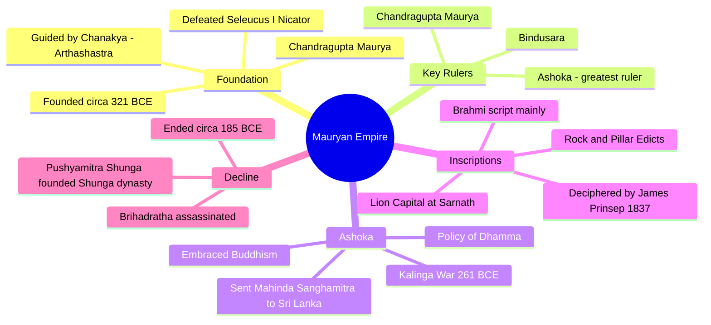

# NOTE — MAURYAN EMPIRE
**Section:** GK | **Category:** History | **Topic:** Mauryan Empire | **Slug:** `hist-mauryan-empire`
**Source:** 🔧 GENERAL KNOWLEDGE (standard ancient history reference; not yet cross-checked against PARMAR SSC reference excerpt)
**Status:** 🔧 DRAFT — awaiting AIR-91 verification before publish
**PYQ Frequency:** 🔥 Phase-2 backlog topic (from original CHANAKYA Smart Notes system doc) | **High Yield:** ✅

---

## 🎭 THE HOOK

A young man with no royal blood, guided by a Brahmin strategist so cunning that his name became a byword for political ruthlessness, overthrew the last Nanda king and built India's first true pan-subcontinental empire. **Chandragupta Maurya**, with the counsel of **Chanakya** (also called Kautilya or Vishnugupta, author of the *Arthashastra*), founded the **Mauryan Empire** around **321 BCE**. Three generations later, his grandson **Ashoka** would conquer the bloodiest battle of his life at Kalinga, look at the devastation he'd caused, and do something almost no ancient conqueror ever did: renounce further warfare entirely, embrace Buddhism, and spend the rest of his reign carving messages of compassion onto rocks and pillars across the empire — messages that still survive, and still get read by SSC aspirants today.

---

## 📖 THE CORE

### Founder & Foundation
- Founded by **Chandragupta Maurya** around **321 BCE**, after overthrowing the **Nanda dynasty**.
- Guided by **Chanakya** (Kautilya/Vishnugupta), author of the **Arthashastra** — a treatise on statecraft, economics, and military strategy.
- Chandragupta later defeated **Seleucus I Nicator** (a general of Alexander the Great, controlling the post-Alexander Greek territories in the region) around **305 BCE**; the resulting treaty gave the Mauryas territory in exchange for **500 war elephants**, and Seleucus's ambassador **Megasthenes** subsequently lived at the Mauryan court, later writing **Indica**, a key Greek account of Mauryan India.
- Capital: **Pataliputra** (modern Patna).

### Key Rulers
| Ruler | Reign (approx.) | Known For |
|---|---|---|
| **Chandragupta Maurya** | c. 321-297 BCE | Founder; later abdicated, became a Jain ascetic (tradition holds he died at Shravanabelagola) |
| **Bindusara** | c. 297-273 BCE | Expanded the empire southward; called "Amitraghata" by Greeks (slayer of enemies) |
| **Ashoka** | c. 268-232 BCE | Greatest Mauryan ruler; expanded empire to its largest extent; Kalinga War; embraced Buddhism |

### Ashoka & The Kalinga War
- The **Kalinga War** (c. **261 BCE**) was Ashoka's bloodiest conquest — the immense suffering caused led him to renounce further military conquest.
- Adopted **Buddhism** and the policy of **Dhamma** (a code of moral/ethical conduct, not identical to formal conversion of the state to Buddhism, but a broader ethical-governance philosophy).
- Sent Buddhist missionaries abroad, notably his son **Mahinda** and daughter **Sanghamitra** to **Sri Lanka**.

### Ashokan Edicts & Inscriptions
- Ashoka's edicts were inscribed on **rocks (Major and Minor Rock Edicts) and pillars (Pillar Edicts)** across the empire, written mainly in **Prakrit** using the **Brahmi script** (with some in Kharosthi, Greek, and Aramaic in the northwest).
- **Lion Capital of Ashoka**, found at **Sarnath**, is India's National Emblem (see [[misc-national-emblem]]).
- First deciphered by **James Prinsep** in **1837**.

### Administration & Economy
- Highly centralized administration; the empire was divided into **provinces**, governed by princes/governors, with elaborate bureaucracy described in the Arthashastra.
- Extensive espionage/intelligence network (per Arthashastra).
- Economy based on agriculture, trade, and a state-controlled mint system.

### Decline
- Began declining after Ashoka's death (232 BCE); weaker successors, administrative overstretch, and possibly the financial burden of a large bureaucracy/standing army contributed.
- Empire formally ended around **185 BCE**, when the last Mauryan ruler, **Brihadratha**, was assassinated by his own military commander, **Pushyamitra Shunga**, who founded the **Shunga dynasty**.

---

## 🧠 THE MIND MAP

---

## 🔑 THE MNEMONIC

**"Chandragupta founded, Bindusara expanded, Ashoka transformed"** — the three-generation arc of Mauryan greatness.

**"Kalinga bled, Ashoka changed, Dhamma reigned"** — the Kalinga War's direct causal link to Ashoka's adoption of Buddhism and Dhamma.

---

## 📌 THE PYQ ANCHOR

🔥 Mauryan Empire was explicitly listed as a Phase-2 backlog topic in the original CHANAKYA Smart Notes system document. 🔧 No literal Mauryan Empire question confirmed in the 23/46-shift CGL-2025 sample reviewed in this session — Ashoka's edicts, the Kalinga War, and James Prinsep's decipherment are textbook-standard SSC CGL History staples; recommend archive cross-check.

---

## ⚠️ THE TRAP ALERT

- **Chanakya is also known as Kautilya AND Vishnugupta** — all three names refer to the SAME person, author of the Arthashastra; a frequently tested name-identification trap.
- **Ashoka's edicts were inscribed mainly in PRAKRIT using BRAHMI script**, NOT Sanskrit — a commonly mis-recalled language/script pairing.
- **James Prinsep deciphered the Brahmi script in 1837** — don't confuse this decipherment date with the edicts' original inscription date (3rd century BCE); these are separated by roughly 2,000 years.
- **The Mauryan Empire ended around 185 BCE** when Pushyamitra Shunga assassinated Brihadratha — don't confuse the founder of the SUCCEEDING Shunga dynasty with a Mauryan ruler.

---

## ✅ ACTIVE RECALL

1. Who founded the Mauryan Empire, and with whose guidance?
2. What text did Chanakya/Kautilya author, and what is it about?
3. Which battle led Ashoka to renounce further military conquest, and in which year?
4. Who deciphered the Brahmi script used in Ashoka's edicts, and in which year?
5. How did the Mauryan Empire come to an end, and which dynasty succeeded it?

*(Answers: 1–Chandragupta Maurya, guided by Chanakya (Kautilya/Vishnugupta) | 2–The Arthashastra, a treatise on statecraft, economics, and military strategy | 3–The Kalinga War, c. 261 BCE | 4–James Prinsep, in 1837 | 5–The last ruler Brihadratha was assassinated by his commander Pushyamitra Shunga (c. 185 BCE), who founded the Shunga dynasty)*
