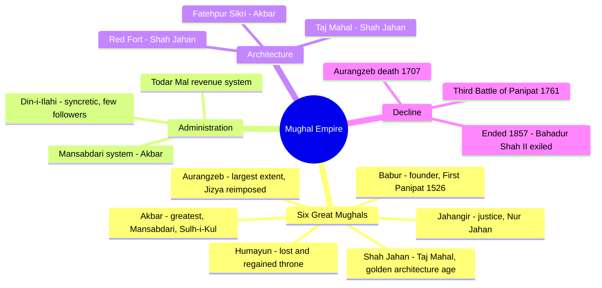

# NOTE — MUGHAL EMPIRE
**Section:** GK | **Category:** History | **Topic:** Mughal Empire | **Slug:** `hist-mughal-empire`
**Source:** 🔧 GENERAL KNOWLEDGE (standard medieval history reference; not yet cross-checked against PARMAR SSC reference excerpt)
**Status:** 🔧 DRAFT — awaiting AIR-91 verification before publish
**PYQ Frequency:** 🔥 Very high-frequency Medieval History topic, follows [[hist-delhi-sultanate]] | **High Yield:** ✅

---

## 🎭 THE HOOK

Six rulers, six radically different personalities, one dynasty — and the gap between the best and worst of them defines almost the entire arc of the Mughal Empire's rise and fall. **Akbar** built religious tolerance and administrative genius into the empire's foundations; **Aurangzeb**, generations later, reversed nearly every one of those policies and over-extended the empire fighting endless wars in the Deccan, leaving behind a treasury and a tolerance for diversity both badly depleted. In between sat **Shah Jahan**, who spent so much on monuments — the Taj Mahal chief among them — that imperial finances never fully recovered. Six names (Babur, Humayun, Akbar, Jahangir, Shah Jahan, Aurangzeb) carry almost the entire weight of Mughal-era SSC GK questions, and getting their sequence and signature achievements straight is worth more exam points than nearly any other single history block.

---

## 📖 THE CORE

### The Six Great Mughals (Chronological Sequence)
| Ruler | Reign (approx.) | Known For |
|---|---|---|
| **Babur** | 1526-1530 | Founder; won the **First Battle of Panipat (1526)** against Ibrahim Lodi; also fought the **Battle of Khanwa (1527)** against Rana Sanga |
| **Humayun** | 1530-1556 (with interruption) | Lost the throne temporarily to **Sher Shah Suri** (an Afghan ruler who founded the short-lived **Suri Empire**, 1540-1555, and introduced the **Rupiya** currency and the **Grand Trunk Road**); Humayun later regained the throne |
| **Akbar** | 1556-1605 | Greatest Mughal ruler; won the **Second Battle of Panipat (1556)** against Hemu; administrative reforms (**Mansabdari system**, land revenue via **Todar Mal**); religious policy of **Sulh-i-Kul** ("peace with all"); founded **Din-i-Ilahi** (a syncretic faith, not widely adopted); built **Fatehpur Sikri** |
| **Jahangir** | 1605-1627 | Known for justice (the "Chain of Justice" legend) and patronage of Mughal painting; married **Nur Jahan**, who wielded significant political influence |
| **Shah Jahan** | 1627-1658 | "Golden Age" of Mughal architecture — built the **Taj Mahal** (for Mumtaz Mahal), Red Fort, Jama Masjid; deposed and imprisoned by his son Aurangzeb |
| **Aurangzeb** | 1658-1707 | Empire's largest territorial extent, but over-extended by prolonged Deccan wars; reversed Akbar's religious tolerance policies (reimposed **Jizya tax** on non-Muslims); last of the "Great Mughals" — decline accelerated after his death |

### Key Administrative Systems
- **Mansabdari System** (Akbar): A military-administrative ranking system assigning nobles a "Mansab" (rank) determining their salary, troop obligations, and status — the backbone of Mughal bureaucracy and military organization.
- **Zabt/Todar Mal's Revenue System**: Land revenue assessment based on actual measured land and average crop yields/prices over several years, administered under **Raja Todar Mal**, Akbar's finance minister — a far more systematic approach than earlier ad hoc collection.
- **Din-i-Ilahi**: Akbar's syncretic religious order, blending elements of various faiths; had very few followers and largely died out after Akbar's reign — NOT a widely adopted state religion.

### Architecture
- **Taj Mahal** (Agra) — built by Shah Jahan as a mausoleum for his wife **Mumtaz Mahal**; widely regarded as the pinnacle of Mughal architecture, a UNESCO World Heritage Site.
- **Fatehpur Sikri** — built by Akbar as a new capital city, later abandoned (likely due to water scarcity).
- **Red Fort** (Delhi) — built by Shah Jahan.

### Decline
- Began accelerating after **Aurangzeb's death (1707)** — a succession of weak rulers, rising regional powers (Marathas, Sikhs, Jats, and later the British East India Company), and financial exhaustion from Aurangzeb's prolonged wars all contributed.
- The **Third Battle of Panipat (1761)**, fought between the Marathas and Ahmad Shah Abdali (an external Afghan power, not a Mughal-vs-outsider battle in the traditional sense, but fought on Mughal-adjacent soil amid the empire's decline), further weakened any remaining centralized power in North India.
- The Mughal Empire formally ended in **1857**, when the last Mughal emperor, **Bahadur Shah II (Bahadur Shah Zafar)**, was exiled by the British following the **Revolt of 1857** (see [[hist-revolt-of-1857]]).

---

## 🧠 THE MIND MAP

---

## 🔑 THE MNEMONIC

**"Babur fought, Humayun lost, Akbar built, Jahangir judged, Shah Jahan adorned, Aurangzeb over-reached"** — six rulers, six one-word defining legacies, in chronological order.

**"Panipat hosted three: Babur in '26, Akbar's general in '56, Marathas in '61"** — the three Battles of Panipat, their rough dates, and who was involved.

---

## 📌 THE PYQ ANCHOR

🔥 Mughal Empire is a very high-frequency Medieval History topic, directly following [[hist-delhi-sultanate]] and connecting to [[hist-revolt-of-1857]]. 🔧 No literal Mughal Empire question confirmed in the 23/46-shift CGL-2025 sample reviewed in this session — ruler sequence, the Mansabdari system, and Taj Mahal facts are textbook-standard SSC CGL History staples; recommend archive cross-check.

---

## ⚠️ THE TRAP ALERT

- **Humayun temporarily LOST the throne to Sher Shah Suri**, an Afghan ruler who founded the separate, short-lived Suri Empire — don't treat Sher Shah Suri as a Mughal ruler; he interrupted Mughal rule, he wasn't part of the dynasty.
- **Akbar's Din-i-Ilahi had very few followers and was NOT a state religion imposed on the empire** — a frequently overstated fact; don't assume it was widely adopted.
- **Aurangzeb REVERSED Akbar's religious tolerance**, reimposing the Jizya tax — a direct policy contrast between the two rulers that examiners frequently test as opposites.
- **The Mughal Empire formally ended in 1857**, not with Aurangzeb's death in 1707 — Aurangzeb's death marked the START of serious decline, not the empire's actual end; weak titular Mughal emperors continued for another 150 years.

---

## ✅ ACTIVE RECALL

1. Name the six "Great Mughals" in chronological order.
2. Who interrupted Mughal rule between Humayun's first and second reigns, and what currency/road system is he credited with?
3. What was the Mansabdari system, and which ruler introduced it?
4. Who built the Taj Mahal, and for whom?
5. When did the Mughal Empire formally end, and what event caused it?

*(Answers: 1–Babur, Humayun, Akbar, Jahangir, Shah Jahan, Aurangzeb | 2–Sher Shah Suri; credited with introducing the Rupiya currency and the Grand Trunk Road | 3–A military-administrative ranking system assigning nobles a rank determining salary and troop obligations; introduced by Akbar | 4–Shah Jahan; built for his wife, Mumtaz Mahal | 5–1857; the last Mughal emperor, Bahadur Shah II (Bahadur Shah Zafar), was exiled by the British following the Revolt of 1857)*
