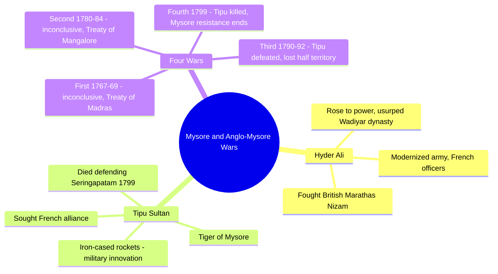

# NOTE — MYSORE: HYDER ALI, TIPU SULTAN & THE ANGLO-MYSORE WARS
**Section:** GK | **Category:** History | **Topic:** Mysore & Anglo-Mysore Wars | **Slug:** `hist-mysore-anglo-mysore-wars`
**Source:** 🔧 GENERAL KNOWLEDGE (standard modern history reference; not yet cross-checked against PARMAR SSC reference excerpt)
**Status:** 🔧 DRAFT — awaiting AIR-91 verification before publish
**PYQ Frequency:** 🔥 High-frequency Modern History topic, connects to [[hist-maratha-empire]] | **High Yield:** ✅

---

## 🎭 THE HOOK

Of all the regional Indian powers that resisted British expansion in the late 18th century, none fought more persistently or more innovatively than the Kingdom of Mysore under father-and-son rulers **Hyder Ali** and **Tipu Sultan**. Tipu Sultan in particular earns a specific, frequently-tested superlative: he was among the FIRST rulers anywhere in the world to deploy **iron-cased rocket artillery** in battle against the British — technology so effective that captured Mysorean rockets were later studied by the British and directly influenced early European military rocket development. Four wars over roughly four decades (the Anglo-Mysore Wars) finally broke Mysore's resistance, ending with Tipu's death defending his capital.

---

## 📖 THE CORE

### Hyder Ali (r. 1761-1782)
- Rose from a military commander to become the de facto ruler of **Mysore**, having usurped power from the nominal Wadiyar dynasty rulers.
- Built a modernized army, incorporating French-trained officers and artillery, making Mysore a formidable regional power in South India.
- Fought against the British, the Marathas (see [[hist-maratha-empire]]), and the Nizam of Hyderabad in various shifting alliances across his reign.

### Tipu Sultan (r. 1782-1799) — "The Tiger of Mysore"
- Hyder Ali's son, succeeded him in 1782; continued and intensified resistance against British expansion.
- Pioneered the use of **iron-cased rockets** (Mysorean rockets) in warfare — among the earliest military use of such rocket technology anywhere in the world; captured examples were studied by the British, influencing the later development of the **Congreve rocket**.
- Introduced administrative and economic reforms; attempted modernization of Mysore's military and state apparatus.
- Sought (largely unsuccessfully) diplomatic/military alliances with France against the British, reflecting the broader Anglo-French rivalry playing out across India during this period.
- Died defending his capital, **Seringapatam (Srirangapatna)**, in the Fourth Anglo-Mysore War (1799) — killed in battle rather than captured, a frequently emphasized detail of his "died fighting" legacy.

### The Four Anglo-Mysore Wars
| War | Years | Outcome |
|---|---|---|
| **First Anglo-Mysore War** | 1767-1769 | Ended largely INCONCLUSIVELY, with the **Treaty of Madras** — a rare instance of an Indian power negotiating from a position of relative strength against the British at the time |
| **Second Anglo-Mysore War** | 1780-1784 | Ended with the **Treaty of Mangalore** — another largely INCONCLUSIVE outcome, with mutual restoration of conquered territories |
| **Third Anglo-Mysore War** | 1790-1792 | Tipu Sultan DEFEATED; **Treaty of Seringapatam** forced him to cede roughly HALF his territory to the British and allied powers (Marathas, Nizam of Hyderabad), and pay a large war indemnity |
| **Fourth Anglo-Mysore War** | 1799 | Tipu Sultan KILLED defending Seringapatam; Mysore's independent resistance effectively ENDED, with British-aligned Wadiyar dynasty restored as a subordinate/princely state |

### Key Distinguishing Facts
- **Tipu Sultan is specifically associated with EARLY MILITARY ROCKET technology** — a frequently tested unique technological-innovation fact, distinguishing him from most contemporary Indian rulers.
- **The first two Anglo-Mysore Wars were largely INCONCLUSIVE**; only the third and fourth wars produced decisive British victories — a frequently tested escalating-outcome pattern across the four wars.
- **Tipu Sultan died IN BATTLE at Seringapatam (1799)**, rather than being captured or exiled — a frequently emphasized detail distinguishing his end from many other defeated Indian rulers of the era.

---

## 🧠 THE MIND MAP

---

## 🔑 THE MNEMONIC

**"First two were a draw, last two were a fall"** — the escalating-outcome pattern of the four Anglo-Mysore Wars.

**"Tipu's rockets became Britain's Congreve rockets"** — the technological legacy linking Mysorean and later European rocket artillery.

---

## 📌 THE PYQ ANCHOR

🔥 Mysore & Anglo-Mysore Wars is a high-frequency Modern History topic, connecting to [[hist-maratha-empire]] (shared rivalries/alliances). 🔧 No literal Anglo-Mysore Wars question confirmed in the 23/46-shift CGL-2025 sample reviewed earlier in this session — Tipu Sultan's rockets, the four wars' sequence, and his death at Seringapatam are textbook-standard SSC CGL History staples; recommend a dedicated archive cross-check.

---

## ⚠️ THE TRAP ALERT

- **Hyder Ali and Tipu Sultan are FATHER and SON**, not brothers or unrelated rulers — Tipu succeeded Hyder Ali in 1782.
- **Tipu Sultan DIED IN BATTLE at Seringapatam (1799)**, during the FOURTH Anglo-Mysore War — he was NOT captured alive or exiled, unlike many other defeated Indian rulers of the colonial era.
- **The FIRST TWO Anglo-Mysore Wars were largely inconclusive**; Mysore's decisive defeats came only in the THIRD (loss of territory) and FOURTH (Tipu's death) wars — don't assume British dominance was total from the start.
- **Tipu Sultan's iron-cased rockets directly influenced the later British "Congreve rocket"** — a frequently tested technology-transfer fact.

---

## ✅ ACTIVE RECALL

1. What was the relationship between Hyder Ali and Tipu Sultan?
2. What military technology is Tipu Sultan particularly known for pioneering?
3. How many Anglo-Mysore Wars were fought, and what was the general outcome pattern across them?
4. How did Tipu Sultan's reign end, and in which war?
5. What treaty ended the Third Anglo-Mysore War, and what did it cost Tipu Sultan?

*(Answers: 1–Father (Hyder Ali) and son (Tipu Sultan) | 2–Iron-cased rocket artillery (Mysorean rockets), which later influenced the British Congreve rocket | 3–Four wars; the first two were largely inconclusive, while the third and fourth resulted in decisive Mysore defeats | 4–He died in battle defending his capital, Seringapatam, during the Fourth Anglo-Mysore War (1799) | 5–The Treaty of Seringapatam (1792); it cost Tipu roughly half his territory and a large war indemnity)*
