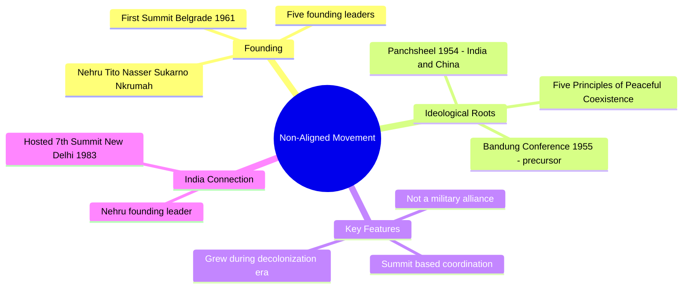

# NOTE — NON-ALIGNED MOVEMENT (NAM)
**Section:** GK | **Category:** History | **Topic:** Non-Aligned Movement | **Slug:** `hist-non-aligned-movement`
**Source:** 🔧 GENERAL KNOWLEDGE (standard post-independence history/international relations reference; not yet cross-checked against PARMAR SSC reference excerpt)
**Status:** 🔧 DRAFT — awaiting AIR-91 verification before publish
**PYQ Frequency:** 🔥 High-frequency Post-Independence History topic, connects to [[misc-international-organisations]] | **High Yield:** ✅

---

## 🎭 THE HOOK

During the Cold War, the world's major powers expected every newly-independent nation to PICK A SIDE — align with the American-led capitalist bloc, or the Soviet-led communist bloc. A small group of leaders, India's **Jawaharlal Nehru** prominent among them, refused that binary entirely, arguing that recently-decolonized nations had every reason to stay independent of BOTH Cold War blocs and chart their own course. That refusal crystallized into the **Non-Aligned Movement (NAM)**, formally launched in 1961 — not a military alliance or trading bloc, but a deliberate STANCE of strategic independence, eventually growing to include well over 100 member states, making it one of the largest international groupings outside the UN itself.

---

## 📖 THE CORE

### Origins & Founding Conference
- Formally founded at the **First NAM Summit, Belgrade, Yugoslavia, 1961**.
- **Five Founding Leaders** (frequently tested as a group):
  1. **Jawaharlal Nehru** (India)
  2. **Josip Broz Tito** (Yugoslavia)
  3. **Gamal Abdel Nasser** (Egypt)
  4. **Sukarno** (Indonesia)
  5. **Kwame Nkrumah** (Ghana)
- Core principle: member states would NOT formally align with either the US-led NATO/Western bloc OR the Soviet-led communist bloc during the Cold War.

### Ideological Roots — Panchsheel
- NAM's foundational philosophy drew heavily on the **Panchsheel** ("Five Principles of Peaceful Coexistence"), jointly articulated by India and China in **1954** (in the context of the Sino-Indian agreement on Tibet):
  1. Mutual respect for territorial integrity and sovereignty.
  2. Mutual non-aggression.
  3. Mutual non-interference in internal affairs.
  4. Equality and mutual benefit.
  5. Peaceful coexistence.
- The **Bandung Conference (1955, Indonesia)** — an earlier Asian-African solidarity conference, sometimes considered a direct PRECURSOR to NAM's formal founding — further developed these principles among newly-independent Asian and African nations.

### Key Features & Evolution
- NAM is NOT a formal military alliance or international organization with binding treaty obligations — it functions more as a loose, periodic SUMMIT-based coordination forum.
- Grew significantly during the post-WWII DECOLONIZATION era, as newly independent African and Asian nations joined.
- India has hosted NAM Summits (e.g., the **7th NAM Summit, New Delhi, 1983**).
- NAM's relevance and cohesion have been DEBATED in the post-Cold-War era (since the original bipolar US-USSR framework that justified "non-alignment" no longer exists in the same form), though the organization continues to exist and meet.

### Key Distinguishing Facts
- **NAM was founded by FIVE key leaders**, with Nehru as India's representative — a frequently tested complete list.
- **Panchsheel (1954) and the Bandung Conference (1955) PRECEDED NAM's formal 1961 founding** — both are foundational/precursor influences, not the founding event itself.
- **NAM is explicitly NOT a military alliance** — distinguishing it from Cold War-era blocs like NATO or the Warsaw Pact, which DID involve binding military commitments.

---

## 🧠 THE MIND MAP

---

## 🔑 THE MNEMONIC

**"Nehru, Tito, Nasser, Sukarno, Nkrumah — the five founders of non-alignment"** — the founding-leader list, in one line.

**"Panchsheel in '54, Bandung in '55, Belgrade in '61"** — the three chronological building blocks leading to NAM's formal founding.

---

## 📌 THE PYQ ANCHOR

🔥 Non-Aligned Movement is a high-frequency Post-Independence History topic, connecting to [[misc-international-organisations]]. 🔧 No literal NAM question confirmed in the 23/46-shift CGL-2025 sample reviewed earlier in this session — the five founding leaders, Panchsheel's five principles, and the Belgrade founding summit are textbook-standard SSC CGL History/Current Affairs staples; recommend a dedicated archive cross-check.

---

## ⚠️ THE TRAP ALERT

- **NAM was founded by FIVE leaders**, not just Nehru alone — Tito (Yugoslavia), Nasser (Egypt), Sukarno (Indonesia), and Nkrumah (Ghana) are equally credited co-founders; a frequently tested complete-list requirement.
- **Panchsheel (1954) and Bandung (1955) PRECEDED NAM's formal founding (1961)** — don't confuse these precursor events with the founding summit itself.
- **NAM is NOT a military alliance** — a frequently tested distinguishing feature from Cold War blocs like NATO; don't assume NAM members had binding mutual-defence commitments.
- **The First NAM Summit was held in BELGRADE, Yugoslavia**, NOT in India or any other founding member's capital — a frequently tested location fact.

---

## ✅ ACTIVE RECALL

1. When and where was the Non-Aligned Movement formally founded?
2. Name the five founding leaders of NAM.
3. What is Panchsheel, and when was it articulated?
4. Is NAM a military alliance like NATO?
5. Which conference is considered a direct precursor to NAM's founding, and when was it held?

*(Answers: 1–1961, at the First NAM Summit in Belgrade, Yugoslavia | 2–Jawaharlal Nehru (India), Josip Broz Tito (Yugoslavia), Gamal Abdel Nasser (Egypt), Sukarno (Indonesia), Kwame Nkrumah (Ghana) | 3–The "Five Principles of Peaceful Coexistence," jointly articulated by India and China in 1954 | 4–No, NAM is not a formal military alliance; it functions as a loose, summit-based coordination forum | 5–The Bandung Conference, held in Indonesia in 1955)*
