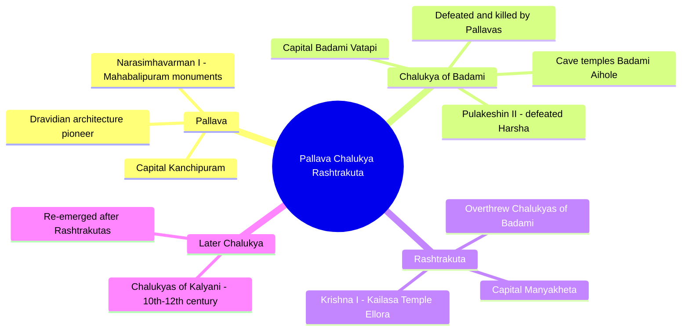

# NOTE — PALLAVA, CHALUKYA & RASHTRAKUTA DYNASTIES
**Section:** GK | **Category:** History | **Topic:** Pallava, Chalukya & Rashtrakuta Dynasties | **Slug:** `hist-pallava-chalukya-rashtrakuta`
**Source:** 🔧 GENERAL KNOWLEDGE (standard medieval history reference; not yet cross-checked against PARMAR SSC reference excerpt)
**Status:** 🔧 DRAFT — awaiting AIR-91 verification before publish
**PYQ Frequency:** 🔥 High-frequency Medieval History topic, connects to [[hist-harsha-and-pushyabhuti-dynasty]] and [[hist-chola-empire]] | **High Yield:** ✅

---

## 🎭 THE HOOK

While the Cholas were busy turning South India into a naval power, three OTHER regional dynasties were locked in a centuries-long, three-way rivalry over the Deccan plateau and southern Tamil regions — the **Pallavas** (around Kanchipuram), the **Chalukyas** (around the Deccan, with multiple branches), and the **Rashtrakutas** (who eventually displaced the Chalukyas as the dominant Deccan power). Their wars left behind some of India's most spectacular rock-cut and structural temple architecture, each dynasty essentially competing to outbuild the others — culminating in the Rashtrakutas' Kailasa Temple at Ellora, a temple CARVED out of a single massive rock, top-down, rather than built up brick by brick.

---

## 📖 THE CORE

### The Pallava Dynasty
- Ruled from **Kanchipuram** (Tamil Nadu), roughly **4th-9th century CE**.
- Most famous ruler: **Narasimhavarman I (Mamalla)**, who built the rock-cut monuments at **Mahabalipuram (Mamallapuram)** — including the famous **Shore Temple** and the Pancha Rathas ("Five Chariots") — a UNESCO World Heritage Site (see [[misc-unesco-world-heritage-sites-india]]).
- Pioneered **Dravidian temple architecture**, an influential South Indian architectural style that later Chola and other South Indian dynasties built upon.
- Engaged in prolonged conflict with the **Chalukyas** of Badami over Deccan territory.

### The Chalukya Dynasty (Multiple Branches)
- **Chalukyas of Badami (Vatapi)** — the earliest/main branch, ruling roughly **6th-8th century CE**, capital at **Badami (Vatapi)**, Karnataka.
- Most famous ruler: **Pulakeshin II**, who FAMOUSLY DEFEATED **Harshavardhana** at the Battle of the Narmada (see [[hist-harsha-and-pushyabhuti-dynasty]]) — confirmed in Chinese pilgrim Hiuen Tsang's accounts; Pulakeshin II was eventually defeated and killed by the Pallava king Narasimhavarman I, in a continuation of the Pallava-Chalukya rivalry.
- Famous for rock-cut cave temples at **Badami** and **Aihole** (sometimes called the "cradle of Indian temple architecture" for its experimental variety of early temple styles).
- Later succeeded in the Deccan by the **Rashtrakutas** (who overthrew the Chalukyas of Badami in the mid-8th century).
- A LATER branch, the **Chalukyas of Kalyani (Western Chalukyas)**, re-emerged in the 10th-12th centuries, after the Rashtrakuta period.

### The Rashtrakuta Dynasty
- Rose to power in the **Deccan**, roughly **8th-10th century CE**, after overthrowing the Chalukyas of Badami; capital at **Manyakheta (Malkhed)**.
- Most famous ruler: **Krishna I**, credited with building the spectacular **Kailasa Temple at Ellora** — a MASSIVE monolithic temple carved DOWNWARD out of a single rock face, rather than constructed from stacked stone — among the most celebrated achievements in world rock-cut architecture.
- Maintained extensive diplomatic/trade contacts, noted favourably by several contemporary Arab travelers as one of the four great contemporary world empires of the era.
- Eventually declined and were succeeded by the Chalukyas of Kalyani and the rising Chola Empire.

### Key Distinguishing Facts
- **Pulakeshin II (Chalukya) defeated Harsha; Narasimhavarman I (Pallava) later defeated and killed Pulakeshin II** — a chain of three interconnected ancient/medieval rivalries across three different dynasties.
- **The Kailasa Temple at Ellora was carved TOP-DOWN out of a single rock**, NOT built up using separate stone blocks — a frequently tested, distinctive architectural method.
- **The Chalukya dynasty had MULTIPLE branches across different centuries** (Badami, then later Kalyani) — don't assume "Chalukya" refers to a single continuous unbroken dynasty; there was a Rashtrakuta interruption in between.

---

## 🧠 THE MIND MAP

---

## 🔑 THE MNEMONIC

**"Pulakeshin beat Harsha, then got beaten by the Pallavas"** — the three-dynasty rivalry chain in one line.

**"Kailasa was carved DOWN, not built UP"** — the Rashtrakuta Ellora temple's distinctive construction method.

---

## 📌 THE PYQ ANCHOR

🔥 Pallava, Chalukya & Rashtrakuta Dynasties is a high-frequency Medieval History topic, connecting to [[hist-harsha-and-pushyabhuti-dynasty]] and [[hist-chola-empire]]. 🔧 No literal Pallava/Chalukya/Rashtrakuta question confirmed in the 23/46-shift CGL-2025 sample reviewed earlier in this session — Pulakeshin II's battles, the Kailasa Temple, and Mahabalipuram monuments are textbook-standard SSC CGL History staples; recommend a dedicated archive cross-check.

---

## ⚠️ THE TRAP ALERT

- **Pulakeshin II (Chalukya) defeated HARSHA; he was LATER defeated/killed by Narasimhavarman I (Pallava)** — don't confuse the direction of these two separate victories.
- **The Kailasa Temple at Ellora was built by the RASHTRAKUTAS (Krishna I), NOT the Chalukyas or Pallavas** — a frequently tested dynasty-monument mix-up.
- **The Rashtrakutas overthrew the Chalukyas of Badami**, but the Chalukya line LATER re-emerged as the Chalukyas of Kalyani — don't assume the Chalukya dynasty simply vanished forever after the Rashtrakuta takeover.
- **Mahabalipuram's monuments are PALLAVA constructions**, built by Narasimhavarman I — distinct from the Chola-built Brihadeeswarar Temple at Thanjavur (see [[hist-chola-empire]]).

---

## ✅ ACTIVE RECALL

1. Which dynasty built the rock-cut monuments at Mahabalipuram, and under which ruler?
2. Which Chalukya ruler famously defeated Harshavardhana, and who later defeated him?
3. Which dynasty overthrew the Chalukyas of Badami, and what was its capital?
4. Who built the Kailasa Temple at Ellora, and what is distinctive about its construction method?
5. Did the Chalukya dynasty end permanently after the Rashtrakuta takeover?

*(Answers: 1–The Pallava dynasty, under Narasimhavarman I (Mamalla) | 2–Pulakeshin II; he was later defeated and killed by the Pallava king Narasimhavarman I | 3–The Rashtrakuta dynasty; capital at Manyakheta (Malkhed) | 4–Krishna I of the Rashtrakuta dynasty; it was carved top-down out of a single massive rock, rather than built up from separate stone blocks | 5–No; the Chalukya line later re-emerged as the Chalukyas of Kalyani (Western Chalukyas) in the 10th-12th centuries)*
