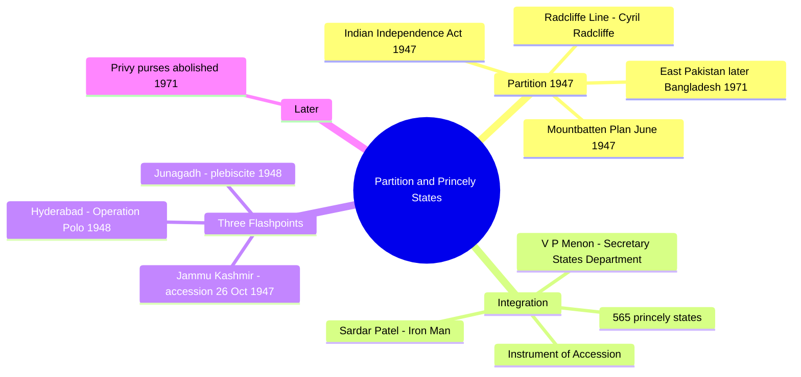

# NOTE — PARTITION OF INDIA & INTEGRATION OF PRINCELY STATES
**Section:** GK | **Category:** History | **Topic:** Partition & Integration of Princely States | **Slug:** `hist-partition-and-integration-of-princely-states`
**Source:** 🔧 GENERAL KNOWLEDGE (standard modern history reference; not yet cross-checked against PARMAR SSC reference excerpt)
**Status:** 🔧 DRAFT — awaiting AIR-91 verification before publish
**PYQ Frequency:** 🔥 Very high-frequency Modern History topic | **High Yield:** ✅

---

## 🎭 THE HOOK

When India became independent on 15 August 1947, the new country wasn't actually one unified territory yet — it was a patchwork of roughly **565 separate princely states**, each technically free to choose independence, accession to India, or accession to Pakistan. The man who turned that patchwork into a single nation, almost entirely through negotiation rather than war, was Home Minister **Sardar Vallabhbhai Patel**, working with civil servant **V.P. Menon** — earning Patel the enduring title **"Iron Man of India."** Most states acceded peacefully; three (Junagadh, Hyderabad, Jammu & Kashmir) became major flashpoints requiring military or diplomatic intervention, each resolved through a completely different method.

---

## 📖 THE CORE

### Partition of India (1947)
- The **Indian Independence Act, 1947** (British Parliament) partitioned British India into two independent dominions: **India** and **Pakistan**, effective **15 August 1947**.
- **Radcliffe Line**: the border between India and Pakistan, drawn by British lawyer **Sir Cyril Radcliffe**, who had never visited India before and completed the boundary demarcation in roughly 5 weeks.
- **Mountbatten Plan (June 1947)**: the immediate administrative plan for partition, proposed by the last Viceroy, **Lord Mountbatten**.
- Partition triggered one of the largest mass migrations in human history, accompanied by widespread communal violence — estimates of deaths and displaced persons vary widely across sources.
- **Pakistan** itself was initially formed in two wings (West and East Pakistan), separated by Indian territory; **East Pakistan later became Bangladesh** after the 1971 Indo-Pak War (a separate, later historical event).

### Integration of Princely States
- At independence, roughly **565 princely states** existed, each with the legal option to remain independent, join India, or join Pakistan.
- **Sardar Vallabhbhai Patel** (India's first Home Minister and Deputy PM) led the integration effort, assisted by civil servant **V.P. Menon** (Secretary of the States Department).
- Most states acceded peacefully via the **Instrument of Accession**, in exchange for privy purses (financial compensation, later abolished in 1971) and assurances of continued personal status/property for rulers.
- Patel's diplomatic-yet-firm approach earned him the title **"Iron Man of India" (Sardar)**, and a major modern monument, the **Statue of Unity** (Gujarat), commemorates him.

### Three Major Flashpoint States
| State | Issue | Resolution |
|---|---|---|
| **Junagadh** | Muslim ruler (Nawab) wanted to accede to Pakistan, despite a Hindu-majority population | Resolved via a **plebiscite** (1948) in which the population overwhelmingly favored India; Nawab fled to Pakistan |
| **Hyderabad** | Muslim ruler (Nizam) wanted independence, refused accession to either dominion | Resolved via **military action — "Operation Polo"** (September 1948), India's army intervened and annexed the state |
| **Jammu & Kashmir** | Hindu ruler (Maharaja Hari Singh), Muslim-majority population; faced a Pakistani-backed tribal invasion in October 1947 | Maharaja signed the **Instrument of Accession to India** (26 October 1947) in exchange for Indian military assistance against the invasion; the dispute over J&K's final status remains historically and politically significant, eventually tied to (now-revoked) Article 370 |

### Key Distinguishing Facts
- **Junagadh's resolution method (plebiscite) was DIFFERENT from Hyderabad's (military action) and J&K's (instrument of accession under invasion pressure)** — each of the three flashpoint states followed a distinct resolution path, a frequently tested differentiation.
- **V.P. Menon, a civil servant, played a crucial DRAFTING/NEGOTIATING role alongside Patel** — often under-credited relative to Patel, but a frequently tested name in detailed questions.
- **Privy purses** (payments to former rulers in exchange for accession) were constitutionally ABOLISHED in **1971** by the 26th Constitutional Amendment — a frequently tested later-date fact connected to this topic.

---

## 🧠 THE MIND MAP

---

## 🔑 THE MNEMONIC

**"Junagadh voted, Hyderabad fought, Kashmir signed under fire"** — the three distinct resolution methods for the three flashpoint princely states.

**"Patel persuaded, Menon drafted, 565 states united"** — the integration effort's two key figures and the scale of the task.

---

## 📌 THE PYQ ANCHOR

🔥 Partition & Integration of Princely States is a very high-frequency Modern History topic. 🔧 No literal Partition/Integration question confirmed in the 23/46-shift CGL-2025 sample reviewed earlier in this session — Sardar Patel's role, the three flashpoint states, and the Radcliffe Line are textbook-standard SSC CGL History staples; recommend a dedicated archive cross-check.

---

## ⚠️ THE TRAP ALERT

- **The three flashpoint states (Junagadh, Hyderabad, J&K) were resolved via THREE DIFFERENT methods** — plebiscite, military action, and accession-under-invasion respectively; don't apply one resolution method to all three.
- **Sir Cyril Radcliffe, who drew the India-Pakistan border, had NEVER visited India before** and completed the demarcation in roughly 5 weeks — a frequently tested, striking fact about the partition's hasty execution.
- **East Pakistan became Bangladesh only in 1971**, NOT at the time of original 1947 partition — a separate, later historical event (Indo-Pak War, 1971).
- **Privy purses were abolished in 1971**, not at the time of original accession in 1947-48 — rulers continued receiving them for over two decades before constitutional abolition.

---

## ✅ ACTIVE RECALL

1. Approximately how many princely states existed at India's independence, and who led their integration?
2. Who drew the India-Pakistan border, and what is it called?
3. How was the Junagadh issue resolved? How was Hyderabad's resolved?
4. How and when did Jammu & Kashmir accede to India?
5. When were privy purses abolished, and by which constitutional amendment?

*(Answers: 1–Roughly 565 princely states; led by Sardar Vallabhbhai Patel, assisted by V.P. Menon | 2–Sir Cyril Radcliffe; called the Radcliffe Line | 3–Junagadh: resolved via a plebiscite (1948) favoring India; Hyderabad: resolved via military action ("Operation Polo," September 1948) | 4–Maharaja Hari Singh signed the Instrument of Accession on 26 October 1947, in exchange for Indian military assistance against a Pakistani-backed tribal invasion | 5–1971, by the 26th Constitutional Amendment)*
