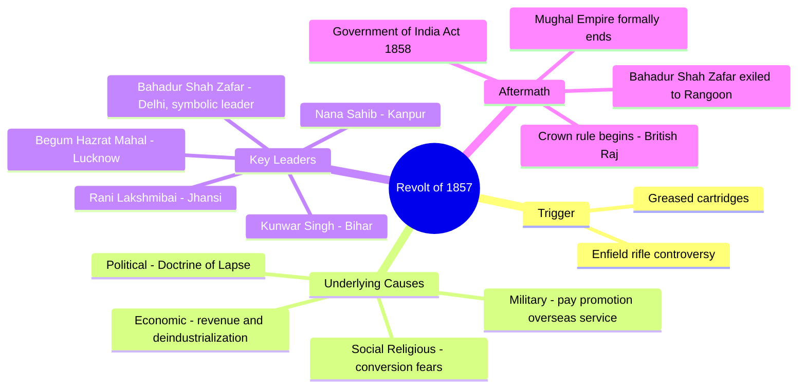

# NOTE — REVOLT OF 1857
**Section:** GK | **Category:** History | **Topic:** Revolt of 1857 | **Slug:** `hist-revolt-of-1857`
**Source:** 🔧 GENERAL KNOWLEDGE (standard modern history reference; not yet cross-checked against PARMAR SSC reference excerpt)
**Status:** 🔧 DRAFT — awaiting AIR-91 verification before publish
**PYQ Frequency:** 🔥 Very high-frequency Modern History topic, connects to [[hist-mughal-empire]] and [[hist-gandhian-movements]] | **High Yield:** ✅

---

## 🎭 THE HOOK

The spark that lit a rebellion spanning much of North India came from something almost absurdly small: a rumour about grease. In 1857, Indian soldiers (**sepoys**) in the British East India Company's army were issued a new rifle cartridge — the **Enfield rifle** — that had to be bitten open before loading. Word spread that the cartridges were greased with **cow and pig fat**, an offense to Hindu and Muslim religious sensibilities simultaneously. That single rumour, landing on top of decades of accumulated economic, political, and social grievances against Company rule, triggered the **Revolt of 1857** — alternately remembered as the "Sepoy Mutiny," the "First War of Indian Independence," or simply "1857," depending on whose history you're reading. It began in **Meerut** on **10 May 1857**, and within weeks had drawn in soldiers, deposed rulers, peasants, and a startling cross-section of North Indian society into open rebellion against the East India Company.

---

## 📖 THE CORE

### Immediate Trigger
- The **greased cartridge controversy** (Enfield rifle, alleged cow/pig fat grease) acted as the IMMEDIATE spark, but underlying causes had been building for decades.

### Underlying Causes (Frequently Tested Categories)
- **Political**: The **Doctrine of Lapse** (Lord Dalhousie's policy, annexing princely states without a natural male heir) angered rulers like the Rani of Jhansi and the Nawab of Awadh, whose state (Awadh/Oudh) was annexed in 1856 on grounds of "misgovernance."
- **Economic**: Heavy land revenue demands, destruction of traditional Indian industries (especially textiles) favouring British manufactured goods, and economic exploitation of peasants and artisans.
- **Social/Religious**: Fear that the British intended to forcibly convert Indians to Christianity; resentment of social reform legislation (e.g., abolition of Sati, widow remarriage laws) perceived by conservative sections as interference in religious/social customs.
- **Military**: Discontent among sepoys over pay, promotion limits (Indian soldiers couldn't rise above certain ranks), and the General Service Enlistment Act (1856), requiring sepoys to serve overseas if ordered — a violation of caste/religious norms for many.

### Timeline & Key Centres
| Date/Place | Event |
|---|---|
| **10 May 1857, Meerut** | Revolt begins; sepoys mutiny, march to Delhi |
| **Delhi** | Rebels declare the aged Mughal emperor **Bahadur Shah Zafar** the symbolic leader of the revolt |
| **Kanpur** | Led by **Nana Sahib** (adopted heir of the last Peshwa, denied his pension under the Doctrine of Lapse) |
| **Jhansi** | Led by **Rani Lakshmibai**, who died fighting British forces in 1858 |
| **Lucknow/Awadh** | Led by **Begum Hazrat Mahal** |
| **Bihar (Arrah/Jagdishpur)** | Led by **Kunwar Singh**, an elderly zamindar |

### Suppression & Aftermath
- British forces gradually suppressed the revolt through 1858, with Delhi recaptured by September 1857 and the last major resistance crushed by mid-1858.
- **Bahadur Shah Zafar** was captured, tried, and **exiled to Rangoon (Burma)**, where he died in 1862 — marking the FORMAL END of the Mughal Empire (see [[hist-mughal-empire]]).
- The **Government of India Act, 1858** transferred power from the **British East India Company** directly to the **British Crown** — ending Company rule in India and beginning direct British colonial administration (the "British Raj").
- A **Secretary of State for India** was created in the British Cabinet, with a **Viceroy** (the first being Lord Canning) representing the Crown in India.

---

## 🧠 THE MIND MAP

---

## 🔑 THE MNEMONIC

**"Meerut sparked it, Delhi symbolized it, Jhansi-Kanpur-Lucknow-Bihar fought it, Rangoon ended it"** — the geographic arc of the revolt from trigger to aftermath.

**"1858: Company out, Crown in"** — the Government of India Act, 1858's core effect, the single most-tested aftermath fact.

---

## 📌 THE PYQ ANCHOR

🔥 Revolt of 1857 is a very high-frequency Modern History topic, connecting [[hist-mughal-empire]]'s end to the start of direct British Crown rule and eventually [[hist-gandhian-movements]]. 🔧 No literal Revolt of 1857 question confirmed in the 23/46-shift CGL-2025 sample reviewed in this session — leader-to-region matching and the Government of India Act, 1858 are textbook-standard SSC CGL History staples; recommend archive cross-check.

---

## ⚠️ THE TRAP ALERT

- **Each regional leader is tied to a SPECIFIC location** — Nana Sahib (Kanpur), Rani Lakshmibai (Jhansi), Begum Hazrat Mahal (Lucknow/Awadh), Kunwar Singh (Bihar) — a frequently tested leader-to-place matching trap.
- **Bahadur Shah Zafar was the SYMBOLIC leader, not the strategic/military leader** — he was an aged, largely powerless Mughal emperor whom rebels rallied around for legitimacy, not someone who personally directed military operations.
- **The Revolt of 1857 ended COMPANY rule, NOT British rule in India** — power transferred to the British CROWN via the Government of India Act, 1858, beginning the formal "British Raj," not Indian independence (which came 90 years later, in 1947).
- **The revolt is known by multiple names** (Sepoy Mutiny, First War of Indian Independence, Revolt/Rebellion of 1857) — different historiographical traditions use different terms; examiners may test recognition of any of these names referring to the same event.

---

## ✅ ACTIVE RECALL

1. What immediate event triggered the Revolt of 1857?
2. Name the regional leaders of the revolt at Kanpur, Jhansi, Lucknow, and Bihar.
3. What happened to Bahadur Shah Zafar after the revolt's suppression?
4. What major administrative change did the Government of India Act, 1858 bring about?
5. Name at least two underlying (non-immediate) causes of the revolt.

*(Answers: 1–The greased cartridge controversy involving the new Enfield rifle, rumoured to be coated in cow and pig fat | 2–Kanpur: Nana Sahib; Jhansi: Rani Lakshmibai; Lucknow: Begum Hazrat Mahal; Bihar: Kunwar Singh | 3–He was captured, tried, and exiled to Rangoon (Burma), where he died in 1862, formally ending the Mughal Empire | 4–It transferred power from the British East India Company directly to the British Crown, ending Company rule and beginning the British Raj | 5–Any two of: the Doctrine of Lapse (political), heavy land revenue/deindustrialization (economic), fear of forced religious conversion (social), restricted promotion and overseas service requirements for sepoys (military))*
