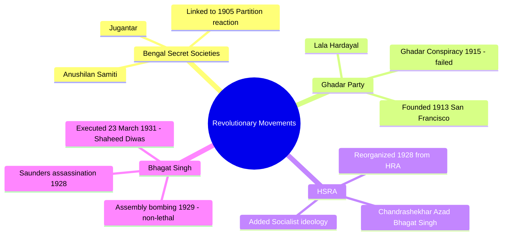

# NOTE — REVOLUTIONARY MOVEMENTS
**Section:** GK | **Category:** History | **Topic:** Revolutionary Movements | **Slug:** `hist-revolutionary-movements`
**Source:** 🔧 GENERAL KNOWLEDGE (standard modern history reference; not yet cross-checked against PARMAR SSC reference excerpt)
**Status:** 🔧 DRAFT — awaiting AIR-91 verification before publish
**PYQ Frequency:** 🔥 Very high-frequency Modern History topic, connects to [[hist-gandhian-movements]] and [[hist-indian-national-army]] | **High Yield:** ✅

---

## 🎭 THE HOOK

Not every Indian freedom fighter believed in Gandhi's nonviolent path — running parallel to the Congress-led mainstream movement was an entire underground tradition of armed revolutionary resistance, stretching from secret societies in Bengal to a transnational network of Indian immigrants on the American West Coast. **Bhagat Singh**, executed at just **23 years old** in 1931, remains the most iconic figure of this tradition — not for the bomb he threw (which deliberately injured no one), but for the trial that followed, where he used the courtroom itself as a stage to articulate revolutionary ideology to the entire nation.

---

## 📖 THE CORE

### Early Revolutionary Secret Societies (Bengal, early 20th century)
- **Anushilan Samiti**: a Bengal-based revolutionary secret society, founded in the early 1900s, associated with figures like **Aurobindo Ghosh** (in his early revolutionary phase, before his later turn to spiritual philosophy) and **Barindra Kumar Ghosh**.
- **Jugantar**: a related/offshoot Bengal revolutionary group, also active in the early 20th century.
- Both groups were associated with bombings and assassination attempts targeting British officials, part of the broader EXTREMIST reaction following the 1905 Partition of Bengal (see [[hist-inc-formation-and-early-nationalism]]).

### Ghadar Party
- Founded in **1913**, in **San Francisco, USA**, by Indian immigrants (largely Punjabi, many Sikh) — key founder: **Lala Hardayal**.
- Aimed to organize an ARMED REVOLT against British rule, using the Indian diaspora abroad as an organizing/funding base, especially leveraging the outbreak of **World War I (1914)** as an opportunity.
- Published the **"Ghadar" ("Mutiny/Revolt") newspaper**, calling for revolutionary uprising.
- The planned uprising (the "Ghadar Conspiracy," 1915) was LARGELY UNSUCCESSFUL — infiltrated by British intelligence, leading to mass arrests/executions of conspirators.

### Hindustan Socialist Republican Association (HSRA)
- Reorganized in **1928** (from the earlier Hindustan Republican Association, HRA, founded 1924) by **Chandrashekhar Azad**, **Bhagat Singh**, and others — added "SOCIALIST" to the name, reflecting growing ideological influence from socialist/Marxist thought among the younger revolutionary generation.
- Aimed at complete independence through ARMED revolutionary struggle, distinct from Congress's mainstream constitutional/nonviolent approach.

### Bhagat Singh — Key Events
- **Assassination of J.P. Saunders (1928)**: Bhagat Singh and associates killed British police officer Saunders, in revenge for the death of **Lala Lajpat Rai** (injured during a protest against the Simon Commission, later dying from his injuries — see [[hist-simon-commission-rtc-poona-pact]]).
- **Central Legislative Assembly Bombing (8 April 1929)**: Bhagat Singh and **Batukeshwar Dutt** threw a (deliberately non-lethal) bomb inside the Central Legislative Assembly in Delhi, to PROTEST the passage of repressive bills (the Public Safety Bill and Trade Disputes Bill) — followed by their DELIBERATE, voluntary surrender and arrest, intending to use the subsequent trial as a public platform.
- **Execution**: Bhagat Singh, along with **Rajguru** and **Sukhdev**, was EXECUTED on **23 March 1931** — a date still commemorated in India as **"Shaheed Diwas"** (Martyrs' Day).

### Key Distinguishing Facts
- **Bhagat Singh's Assembly bomb was DELIBERATELY non-lethal** — designed to make a political statement ("to make the deaf hear"), NOT to kill, distinguishing it from typical assassination-style revolutionary actions.
- **The Ghadar Party operated from OUTSIDE India** (San Francisco, USA), leveraging the global Indian diaspora — a distinguishing geographic/organizational feature from India-based groups like Anushilan Samiti or HSRA.
- **HSRA added "Socialist" to its name in 1928**, reflecting an ideological evolution from earlier purely nationalist-armed-struggle groups (like the original HRA) toward Marxist-influenced revolutionary politics.

---

## 🧠 THE MIND MAP

---

## 🔑 THE MNEMONIC

**"Bengal plotted, San Francisco organized, Lahore tried, 23 March mourned"** — the geographic and chronological arc of India's revolutionary movement.

**"The bomb was meant to be heard, not to kill"** — Bhagat Singh's deliberately non-lethal Assembly bombing strategy.

---

## 📌 THE PYQ ANCHOR

🔥 Revolutionary Movements is a very high-frequency Modern History topic, connecting to [[hist-gandhian-movements]] and [[hist-indian-national-army]] as parallel resistance traditions. 🔧 No literal Revolutionary Movements question confirmed in the 23/46-shift CGL-2025 sample reviewed earlier in this session — Bhagat Singh's timeline, the Ghadar Party's founding, and HSRA's formation are textbook-standard SSC CGL History staples; recommend a dedicated archive cross-check.

---

## ⚠️ THE TRAP ALERT

- **Bhagat Singh's Central Legislative Assembly bomb (1929) was DELIBERATELY designed to be non-lethal** — intended as a political statement, not an assassination; don't confuse it with the Saunders assassination, a different, lethal action.
- **The Ghadar Party was founded in SAN FRANCISCO (USA), NOT in India** — a frequently tested geographic/organizational distinction from India-based revolutionary groups.
- **HSRA is the RENAMED/reorganized version of the earlier HRA (1924)**, with "Socialist" added in 1928 — don't treat HRA and HSRA as entirely separate, unrelated organizations.
- **Bhagat Singh was executed alongside Rajguru and Sukhdev on 23 March 1931** — commemorated as Shaheed Diwas; a frequently tested specific date.

---

## ✅ ACTIVE RECALL

1. Name two Bengal-based revolutionary secret societies of the early 20th century.
2. Where and when was the Ghadar Party founded, and who was its key founder?
3. What did Bhagat Singh and Batukeshwar Dutt do on 8 April 1929, and why?
4. On what date was Bhagat Singh executed, and what is this date commemorated as in India today?
5. What change did HSRA represent relative to the earlier HRA?

*(Answers: 1–Anushilan Samiti and Jugantar | 2–San Francisco, USA, in 1913; founded by Lala Hardayal | 3–They threw a deliberately non-lethal bomb inside the Central Legislative Assembly, to protest repressive bills, then voluntarily surrendered to use their trial as a political platform | 4–23 March 1931; commemorated as "Shaheed Diwas" (Martyrs' Day) | 5–HSRA (1928) added "Socialist" to the name, reflecting growing Marxist-influenced ideology among the younger revolutionary generation, reorganizing from the earlier Hindustan Republican Association (HRA, 1924))*
