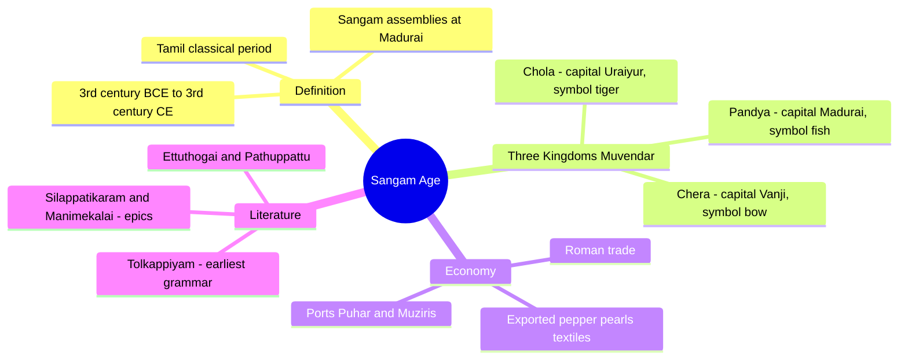

# NOTE — SANGAM AGE
**Section:** GK | **Category:** History | **Topic:** Sangam Age | **Slug:** `hist-sangam-age`
**Source:** 🔧 GENERAL KNOWLEDGE (standard ancient history reference; not yet cross-checked against PARMAR SSC reference excerpt)
**Status:** 🔧 DRAFT — awaiting AIR-91 verification before publish
**PYQ Frequency:** 🔥 High-frequency Ancient History topic, connects to [[hist-chola-empire]] | **High Yield:** ✅

---

## 🎭 THE HOOK

While North India cycled through the Mauryan and Gupta empires, far South India was developing an entirely separate civilization, recorded in a body of classical TAMIL literature so significant it gave an entire historical era its name: the **Sangam Age**, roughly 3rd century BCE to 3rd century CE. "Sangam" means literally "an assembly/academy" — referring to legendary gatherings of Tamil poets/scholars, said to have been convened under royal patronage in the city of Madurai, that produced this body of poetry. Unlike most ancient Indian history, reconstructed largely from religious texts or foreign travelers' accounts, the Sangam Age is documented in SECULAR poetry — love poems, war poems, descriptions of everyday life — giving historians an unusually intimate window into early Tamil society.

---

## 📖 THE CORE

### What Is the Sangam Age?
- Roughly **3rd century BCE to 3rd century CE**, the early historical period of TAMIL civilization in South India.
- Named after **Sangams** — legendary assemblies/academies of Tamil poets, traditionally said to have been held in **Madurai** under the patronage of the **Pandya** kings.
- Documented through **Sangam Literature**: a large body of classical Tamil poetry, covering themes of love (Akam poetry), war/heroism (Puram poetry), governance, trade, and daily life.

### The Three Crowned Kingdoms (Muvendar)
| Kingdom | Capital | Symbol |
|---|---|---|
| **Chera** | Vanji (Karur) | Bow |
| **Chola** | Uraiyur (later Puhar/Kaveripattinam) | Tiger |
| **Pandya** | Madurai | Fish |

- Collectively known as the **"Muvendar"** (the three crowned kings) — the dominant political powers of the Sangam Age.
- The **Pandyas** were the primary patrons of the Sangam assemblies at Madurai.
- The Chera, Chola, and Pandya kingdoms later re-emerge as major dynasties in medieval South Indian history (the medieval Chola Empire is a direct historical successor — see [[hist-chola-empire]]).

### Economy & Trade
- The Sangam Age economy was significantly built on MARITIME TRADE, particularly with the **Roman Empire** — archaeological evidence (Roman coins, amphorae) and literary references confirm active port-based commerce.
- Major ports: **Puhar (Kaveripattinam)** (Chola), **Muziris** (Chera, modern Kerala coast).
- Exported items included spices (especially pepper, giving the Malabar coast its later "Pepper Coast" association), pearls, and textiles; imported Roman gold and wine.

### Key Sangam Literary Works
- **Tolkappiyam**: the earliest known Tamil grammar text, also covering poetics and rhetorical conventions.
- **Ettuthogai** ("Eight Anthologies") and **Pathuppattu** ("Ten Idylls"): major collections of Sangam poetry.
- **Silappatikaram** and **Manimekalai**: considered the two great Tamil epics, though composed slightly LATER than the core Sangam period (post-Sangam era, but closely associated with the broader classical Tamil literary tradition).

### Key Distinguishing Facts
- **The Sangam Age is documented through SECULAR literature**, distinct from the predominantly religious/court-chronicle sources for much of North Indian ancient history — a frequently tested characterization.
- **The three Sangam kingdoms (Chera, Chola, Pandya) are collectively the "Muvendar"** — a frequently tested collective term.
- **Roman trade contact is a defining economic feature** of the Sangam Age, evidenced by archaeological finds of Roman coins along India's southern coast.

---

## 🧠 THE MIND MAP

---

## 🔑 THE MNEMONIC

**"Chera-bow, Chola-tiger, Pandya-fish — the Muvendar's three symbols"** — the three Sangam kingdoms and their emblems.

**"Madurai hosted poets, Rome sent gold"** — the cultural (Sangam assemblies) and economic (Roman trade) pillars of the age.

---

## 📌 THE PYQ ANCHOR

🔥 Sangam Age is a high-frequency Ancient History topic, connecting to [[hist-chola-empire]] as a historical predecessor. 🔧 No literal Sangam Age question confirmed in the 23/46-shift CGL-2025 sample reviewed earlier in this session — the Muvendar kingdoms, Sangam literature, and Roman trade evidence are textbook-standard SSC CGL History staples; recommend a dedicated archive cross-check.

---

## ⚠️ THE TRAP ALERT

- **The Sangam Age is documented primarily through SECULAR poetry**, not religious texts — a distinguishing characteristic from much of contemporary North Indian historical documentation.
- **The Pandyas, not the Cholas or Cheras, were the primary patrons of the Sangam assemblies at Madurai** — a frequently tested patron-association fact.
- **Silappatikaram and Manimekalai are considered POST-Sangam-period epics**, though closely associated with the classical Tamil tradition — don't assume they were composed during the core Sangam Age itself.
- **The three Sangam kingdoms (Chera, Chola, Pandya) are NOT the same as the LATER medieval Chola Empire** — the Sangam-era Chola kingdom is a much earlier, smaller-scale predecessor to the medieval imperial Chola dynasty.

---

## ✅ ACTIVE RECALL

1. What time period does the Sangam Age cover, and what does "Sangam" mean?
2. Name the three Sangam kingdoms (Muvendar), their capitals, and their symbols.
3. Which empire did the Sangam Age have significant maritime trade contact with, and what evidence confirms this?
4. What is the Tolkappiyam?
5. Which Sangam kingdom hosted the legendary Sangam poetic assemblies, and in which city?

*(Answers: 1–Roughly 3rd century BCE to 3rd century CE; "Sangam" means an assembly/academy | 2–Chera (Vanji, bow), Chola (Uraiyur, tiger), Pandya (Madurai, fish) | 3–The Roman Empire; confirmed by archaeological finds of Roman coins and amphorae along India's southern coast | 4–The earliest known Tamil grammar text, also covering poetics and rhetorical conventions | 5–The Pandya kingdom, in the city of Madurai)*
