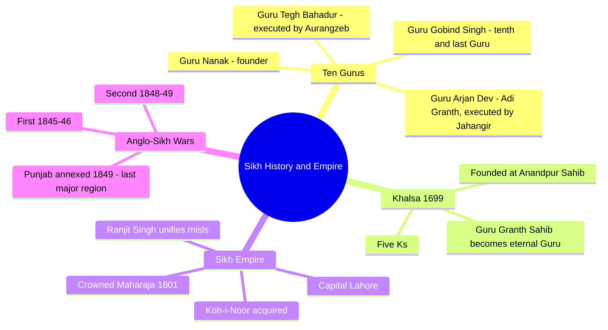

# NOTE — SIKH HISTORY & THE SIKH EMPIRE
**Section:** GK | **Category:** History | **Topic:** Sikh History & Sikh Empire | **Slug:** `hist-sikh-history-and-sikh-empire`
**Source:** 🔧 GENERAL KNOWLEDGE (standard medieval history reference; not yet cross-checked against PARMAR SSC reference excerpt)
**Status:** 🔧 DRAFT — awaiting AIR-91 verification before publish
**PYQ Frequency:** 🔥 High-frequency Medieval History topic, connects to [[hist-bhakti-sufi-movement]] and [[hist-mughal-empire]] | **High Yield:** ✅

---

## 🎭 THE HOOK

Sikhism began as a peaceful Bhakti-tradition spiritual movement under Guru Nanak (see [[hist-bhakti-sufi-movement]]), but over the following two centuries — under escalating Mughal persecution — it transformed into something its founder likely never anticipated: a militarized community capable of fielding armies and eventually building its OWN independent empire. The turning point came under the **Tenth Guru, Guru Gobind Singh**, who in 1699 formally militarized the Sikh community into the **Khalsa** ("the pure") — and a century later, one extraordinarily capable one-eyed general, **Maharaja Ranjit Singh**, turned that militarized community into the only major Indian power that managed to hold off British annexation until the mid-19th century.

---

## 📖 THE CORE

### The Ten Sikh Gurus (Founding Lineage)
- **Guru Nanak** (1469-1539): founder of Sikhism, preached one formless God, rejected caste and ritualism (see [[hist-bhakti-sufi-movement]]).
- The Guru lineage continued through **nine successors**, ending with **Guru Gobind Singh** (the TENTH and LAST human Guru, 1666-1708).
- **Guru Arjan Dev** (5th Guru): compiled the **Adi Granth** (the precursor to the Guru Granth Sahib); executed by Mughal Emperor **Jahangir** — the FIRST Sikh Guru martyred, marking the beginning of escalating Sikh-Mughal tension.
- **Guru Tegh Bahadur** (9th Guru): executed by Mughal Emperor **Aurangzeb** (1675) — a SECOND major martyrdom, directly motivating his son Guru Gobind Singh's subsequent militarization of the Sikh community.

### Guru Gobind Singh & the Khalsa (1699)
- Founded the **Khalsa** ("the pure") in **1699** at Anandpur Sahib — transforming Sikhism into a more organized, militarized community with distinct identity markers (the **Five Ks**: Kesh/uncut hair, Kangha/comb, Kara/bracelet, Kachera/undergarment, Kirpan/dagger).
- Declared that after his death, the **Guru Granth Sahib** (the Sikh holy scripture) would be the ETERNAL/eternal living Guru — ENDING the line of human Gurus (no eleventh human Guru was ever named) — a frequently tested standalone fact.

### Maharaja Ranjit Singh & the Sikh Empire
- **Ranjit Singh** (1780-1839) unified various Sikh misls (confederacies/militias) into a single, powerful **Sikh Empire**, with its capital at **Lahore**.
- Crowned **Maharaja** in **1801**; built a modernized army (the "Khalsa Army"), incorporating European-trained officers and modern artillery.
- Captured the city of **Lahore** and significant Punjab territory; notably acquired the **Koh-i-Noor diamond**.
- Maintained generally PEACEFUL relations with the British East India Company during his lifetime (via the **Treaty of Amritsar, 1809**, which fixed the Sutlej River as a boundary between Sikh and British-controlled territory) — the Sikh Empire's independence largely held until AFTER his death.

### Anglo-Sikh Wars & Annexation
- After Ranjit Singh's death (1839), the empire weakened through succession disputes, leading to TWO **Anglo-Sikh Wars**:
  - **First Anglo-Sikh War (1845-46)**: ended with the Sikh Empire's defeat, loss of territory (Treaty of Lahore).
  - **Second Anglo-Sikh War (1848-49)**: ended with the FULL ANNEXATION of the Sikh Empire/Punjab by the British East India Company in 1849 — Punjab became the LAST major Indian territory annexed by the British before 1857.

### Key Distinguishing Facts
- **Guru Gobind Singh was the LAST human Guru**, after which the Guru Granth Sahib became the eternal Guru — a frequently tested terminating fact in the Sikh Guru lineage.
- **Two Sikh Gurus were specifically EXECUTED by Mughal emperors**: Guru Arjan Dev (by Jahangir) and Guru Tegh Bahadur (by Aurangzeb) — a frequently tested pair, easy to mix up which emperor executed which Guru.
- **Punjab was the LAST major Indian region annexed by the British** (1849, after the Second Anglo-Sikh War) — a frequently tested chronological "last to fall" fact.

---

## 🧠 THE MIND MAP

---

## 🔑 THE MNEMONIC

**"Arjan by Jahangir, Tegh Bahadur by Aurangzeb — two Gurus, two Mughal executioners"** — the two martyred Gurus and their respective Mughal persecutors.

**"1699 made it military, 1801 made it an empire, 1849 ended it"** — three milestone years in the Sikh transition from faith to state.

---

## 📌 THE PYQ ANCHOR

🔥 Sikh History & Sikh Empire is a high-frequency Medieval History topic, connecting to [[hist-bhakti-sufi-movement]] (Guru Nanak) and [[hist-mughal-empire]] (Guru executions). 🔧 No literal Sikh Empire question confirmed in the 23/46-shift CGL-2025 sample reviewed earlier in this session — the Khalsa's founding, Ranjit Singh's empire, and the Anglo-Sikh Wars are textbook-standard SSC CGL History staples; recommend a dedicated archive cross-check.

---

## ⚠️ THE TRAP ALERT

- **Guru Gobind Singh was the TENTH and LAST human Guru** — after him, the Guru Granth Sahib itself became the eternal Guru; no eleventh human Guru exists.
- **Guru Arjan Dev was executed by JAHANGIR; Guru Tegh Bahadur was executed by AURANGZEB** — a frequently swapped Guru-emperor pairing.
- **Maharaja Ranjit Singh maintained PEACEFUL relations with the British during his lifetime** (Treaty of Amritsar, 1809) — the Sikh Empire's conflict with the British only erupted AFTER his death, not during his reign.
- **Punjab was the LAST major Indian territory annexed by the British (1849)**, just before the Revolt of 1857 — don't assume Punjab fell early in the colonial conquest timeline.

---

## ✅ ACTIVE RECALL

1. Who founded Sikhism, and who was the last (tenth) human Guru?
2. What is the Khalsa, when was it founded, and what are the "Five Ks"?
3. Which two Sikh Gurus were executed by Mughal emperors, and by whom?
4. Who unified the Sikh misls into a single empire, and what was its capital?
5. When was the Sikh Empire/Punjab fully annexed by the British, and after which war?

*(Answers: 1–Guru Nanak founded Sikhism; Guru Gobind Singh was the tenth and last human Guru | 2–The militarized Sikh community founded by Guru Gobind Singh in 1699 at Anandpur Sahib; the Five Ks are Kesh, Kangha, Kara, Kachera, Kirpan | 3–Guru Arjan Dev, executed by Jahangir; Guru Tegh Bahadur, executed by Aurangzeb | 4–Maharaja Ranjit Singh; capital at Lahore | 5–1849, after the Second Anglo-Sikh War (1848-49))*
