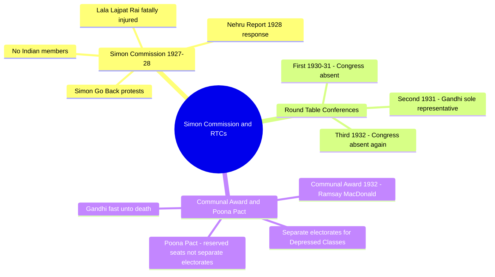

# NOTE — SIMON COMMISSION, ROUND TABLE CONFERENCES & POONA PACT
**Section:** GK | **Category:** History | **Topic:** Simon Commission, RTCs & Poona Pact | **Slug:** `hist-simon-commission-rtc-poona-pact`
**Source:** 🔧 GENERAL KNOWLEDGE (standard modern history reference; not yet cross-checked against PARMAR SSC reference excerpt)
**Status:** 🔧 DRAFT — awaiting AIR-91 verification before publish
**PYQ Frequency:** 🔥 Very high-frequency Modern History topic, connects to [[hist-revolutionary-movements]] and [[hist-gandhian-movements]] | **High Yield:** ✅

---

## 🎭 THE HOOK

A seven-member British commission arrived in India in 1928 to recommend constitutional reforms — and provoked nationwide protest for one simple, glaring reason: it contained **NOT A SINGLE INDIAN MEMBER**. The "Simon, Go Back" protests that followed turned violent in Lahore, where police baton-charges fatally injured veteran nationalist leader Lala Lajpat Rai — a death that directly motivated Bhagat Singh's assassination of police officer Saunders (see [[hist-revolutionary-movements]]). The constitutional negotiations that followed — three Round Table Conferences, and a side-deal called the Poona Pact — collectively tried to work out what an all-Indian Simon Commission had failed to even attempt: actually asking Indians what kind of representation they wanted.

---

## 📖 THE CORE

### Simon Commission (1927-1928)
- Officially the "Indian Statutory Commission," appointed by the British government in **1927**, chaired by **Sir John Simon**, to review the working of the **Government of India Act, 1919** and recommend further constitutional reforms.
- Provoked WIDESPREAD protests across India because it had **NO INDIAN MEMBERS** — entirely British, a deliberate insult to Indian political aspirations for self-representation.
- Protests under the slogan **"Simon, Go Back"**; during a protest in **Lahore**, police LATHI-CHARGED the demonstrators, fatally injuring veteran nationalist **Lala Lajpat Rai**, who died from his injuries weeks later (1928) — a galvanizing event that directly motivated Bhagat Singh's subsequent assassination of police officer J.P. Saunders.
- In RESPONSE to the Simon Commission's exclusion of Indians, the Indian National Congress commissioned the **Nehru Report (1928)**, drafted by **Motilal Nehru**, proposing an Indian-authored constitutional framework (including Dominion Status) — though it was not ultimately adopted by the British.

### The Three Round Table Conferences (London)
| Conference | Year | Key Feature |
|---|---|---|
| **First RTC** | 1930-31 | Congress did NOT participate (Gandhi was in jail amid the Civil Disobedience Movement) |
| **Second RTC** | 1931 | **Gandhi attended, as the SOLE Congress representative**, following the **Gandhi-Irwin Pact** (1931, which suspended the Civil Disobedience Movement); conference largely FAILED to reach agreement, especially over the issue of separate electorates for depressed classes/minorities |
| **Third RTC** | 1932 | Congress did NOT participate again; relatively minor in significance compared to the first two |

### The Communal Award (1932) & Poona Pact (1932)
- British PM **Ramsay MacDonald** announced the **Communal Award** (1932), granting SEPARATE ELECTORATES not just for Muslims (an existing practice) but EXTENDING the principle to the **"Depressed Classes"** (Dalits/Scheduled Castes) as well — a proposal championed by **Dr. B.R. Ambedkar**, who saw separate electorates as essential protection for Dalit political representation.
- **Mahatma Gandhi STRONGLY OPPOSED** separate electorates for the Depressed Classes specifically, fearing it would PERMANENTLY DIVIDE Hindu society; he began a FAST UNTO DEATH in protest (in Yerwada Jail, Poona/Pune) while imprisoned during the Civil Disobedience Movement.
- The resulting negotiation between Gandhi and Ambedkar produced the **Poona Pact (1932)** — Ambedkar AGREED to give up separate electorates for Dalits, in exchange for a SIGNIFICANTLY INCREASED number of RESERVED SEATS for Depressed Classes within the GENERAL (joint) electorate — a compromise that shaped India's reservation system for decades afterward.

### Key Distinguishing Facts
- **Lala Lajpat Rai's death (from Simon Commission protests) directly motivated Bhagat Singh's revolutionary actions** — a frequently tested causal chain linking constitutional-reform politics to the revolutionary movement.
- **Gandhi was the SOLE Congress representative at the Second RTC**, NOT the First or Third — a frequently tested specific-conference attendance fact.
- **The Poona Pact did NOT eliminate separate political representation for Dalits entirely** — it replaced SEPARATE electorates with RESERVED SEATS within a JOINT/general electorate, a frequently tested distinction in the compromise's actual mechanism.

---

## 🧠 THE MIND MAP

---

## 🔑 THE MNEMONIC

**"Simon excluded Indians, Lahore paid in blood, Bhagat Singh answered"** — the causal chain from Simon Commission protests to revolutionary action.

**"Ambedkar wanted separate, Gandhi fasted against it, Poona gave reserved seats instead"** — the Communal Award-to-Poona-Pact resolution in one line.

---

## 📌 THE PYQ ANCHOR

🔥 Simon Commission, RTCs & Poona Pact is a very high-frequency Modern History topic, connecting to [[hist-revolutionary-movements]] (Lajpat Rai's death) and [[hist-gandhian-movements]] (Gandhi-Irwin Pact). 🔧 No literal Simon Commission question confirmed in the 23/46-shift CGL-2025 sample reviewed earlier in this session — the "no Indian members" controversy, Gandhi's Second RTC attendance, and the Poona Pact compromise are textbook-standard SSC CGL History staples; recommend a dedicated archive cross-check.

---

## ⚠️ THE TRAP ALERT

- **The Simon Commission had NO Indian members at all** — not "too few," but entirely British; this exclusivity was the core grievance driving the protests.
- **Gandhi attended ONLY the Second Round Table Conference**, as the sole Congress representative — Congress did NOT participate in the First or Third RTCs.
- **The Poona Pact replaced separate electorates with RESERVED SEATS in a joint electorate** — it did NOT eliminate special political provisions for Dalits entirely; don't conflate "no separate electorate" with "no special representation at all."
- **Lala Lajpat Rai died from injuries sustained during Simon Commission protests**, NOT during a different protest movement — a frequently tested specific causal link.

---

## ✅ ACTIVE RECALL

1. Why did the Simon Commission (1927-28) provoke widespread protest in India?
2. What event during the Simon Commission protests directly motivated Bhagat Singh's assassination of J.P. Saunders?
3. At which Round Table Conference did Gandhi participate, and in what capacity?
4. What was the Communal Award (1932), and who championed separate electorates for the Depressed Classes?
5. What did the Poona Pact (1932) replace separate electorates with, for the Depressed Classes?

*(Answers: 1–Because it had no Indian members at all, despite being tasked with recommending India's constitutional future | 2–The fatal injury and subsequent death of Lala Lajpat Rai during a Lahore protest against the Commission | 3–The Second Round Table Conference (1931); as the sole representative of the Indian National Congress | 4–An announcement by British PM Ramsay MacDonald granting separate electorates to the Depressed Classes (Dalits) as well as Muslims; championed by Dr. B.R. Ambedkar | 5–Reserved seats for the Depressed Classes within a joint/general electorate, in exchange for Ambedkar giving up the demand for separate electorates)*
