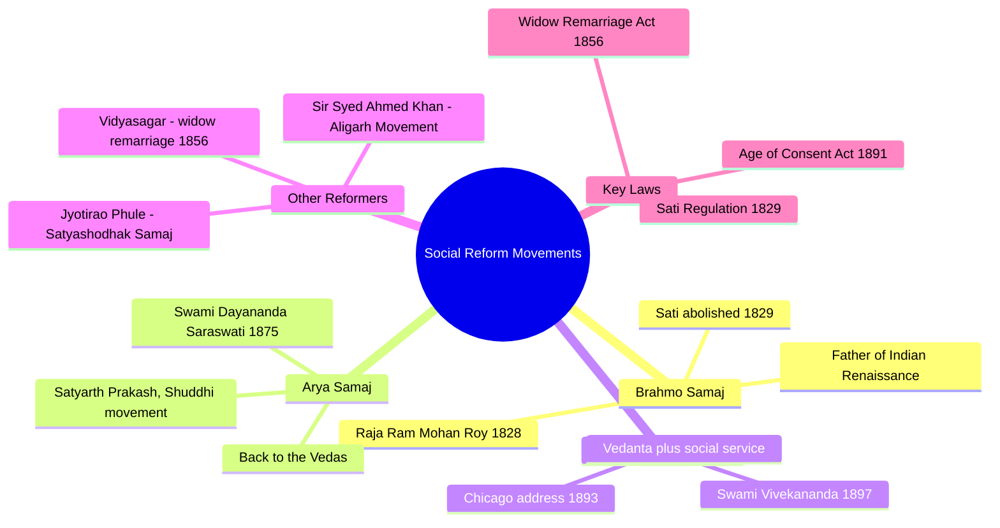

# NOTE — SOCIAL REFORM MOVEMENTS
**Section:** GK | **Category:** History | **Topic:** Social Reform Movements | **Slug:** `hist-social-reform-movements`
**Source:** 🔧 GENERAL KNOWLEDGE (standard modern history reference; not yet cross-checked against PARMAR SSC reference excerpt)
**Status:** 🔧 DRAFT — awaiting AIR-91 verification before publish
**PYQ Frequency:** 🔥 Very high-frequency Modern History topic, connects to [[hist-inc-formation-and-early-nationalism]] | **High Yield:** ✅

---

## 🎭 THE HOOK

Before India fought for political independence, a smaller, quieter battle was already underway — a fight against social practices that reformers themselves considered just as urgent: Sati (widow immolation), child marriage, the ban on widow remarriage, and the rigid caste system. **Raja Ram Mohan Roy**, often called the **"Father of the Indian Renaissance"** (or "Father of Modern India"), led the charge that eventually got Sati legally banned in 1829 — and his organization, the **Brahmo Samaj**, became the template for a wave of reform movements across India, each one tackling a different combination of religious orthodoxy, caste, and gender inequality.

---

## 📖 THE CORE

### Brahmo Samaj
- Founded by **Raja Ram Mohan Roy** in **1828** (Calcutta) — often called the "Father of the Indian Renaissance"/"Father of Modern India."
- Promoted MONOTHEISM, rejected idol worship and rigid ritualism, opposed Sati, child marriage, and the caste system; advocated for women's education.
- Roy's advocacy was instrumental in the LEGAL ABOLITION of Sati in **1829**, under Governor-General **Lord William Bentinck** (see [[hist-governor-generals-and-viceroys]]).
- Later leadership included **Debendranath Tagore** and **Keshab Chandra Sen**.

### Arya Samaj
- Founded by **Swami Dayananda Saraswati** in **1875** (Bombay) — slogan: **"Back to the Vedas"** (advocating a RETURN to what Dayananda considered the pure, original Vedic religion, rejecting LATER accretions like idol worship and caste rigidity).
- Authored **Satyarth Prakash** ("The Light of Truth"), the movement's foundational text.
- Promoted the **Shuddhi movement** (re-conversion of Hindus who had converted to other religions, back to Hinduism).
- Established the **DAV (Dayanand Anglo-Vedic)** school system, blending modern and traditional education.

### Ramakrishna Mission
- Founded by **Swami Vivekananda** in **1897**, inspired by the teachings of his spiritual guru, **Ramakrishna Paramahamsa**.
- Vivekananda gained international fame for his address at the **World's Parliament of Religions, Chicago (1893)**, famously opening with "Sisters and Brothers of America" — a frequently cited landmark moment for India's modern religious/cultural representation abroad.
- Emphasized practical Vedanta philosophy combined with social SERVICE (education, healthcare, disaster relief) — distinguishing it from purely doctrinal reform movements.

### Other Key Reform Movements & Figures
| Reformer/Movement | Focus |
|---|---|
| **Ishwar Chandra Vidyasagar** | Campaigned for WIDOW REMARRIAGE — instrumental in the **Hindu Widows' Remarriage Act, 1856**; also promoted women's education |
| **Jyotirao Phule** (Satyashodhak Samaj, 1873) | Anti-caste movement, focused on the rights of lower castes/Shudras and women's education in Maharashtra |
| **Pandita Ramabai** | Women's education and rights advocate, founded the Sharada Sadan for widows |
| **Sir Syed Ahmed Khan** (Aligarh Movement) | Muslim educational/social reform, founded the Muhammadan Anglo-Oriental College (later Aligarh Muslim University) |
| **Veeresalingam Pantulu** | Social reform in Andhra (widow remarriage, women's education) |
| **Periyar E.V. Ramasamy** (Self-Respect Movement) | Anti-caste, Dravidian movement in Tamil Nadu, somewhat later (1920s onward) |

### Key Legislative Outcomes
- **Bengal Sati Regulation, 1829**: banned Sati (under Lord William Bentinck, driven by Raja Ram Mohan Roy's advocacy).
- **Hindu Widows' Remarriage Act, 1856**: legalized widow remarriage (driven by Ishwar Chandra Vidyasagar's advocacy).
- **Age of Consent Act, 1891**: raised the minimum age for consummation of marriage.
- **Sharda Act (Child Marriage Restraint Act), 1929**: set minimum marriage ages.

### Key Distinguishing Facts
- **Raja Ram Mohan Roy is credited with abolishing Sati**, while **Ishwar Chandra Vidyasagar is credited with legalizing widow remarriage** — two DIFFERENT reformers, two DIFFERENT specific social-reform legacies, frequently confused.
- **Arya Samaj advocated RETURNING to Vedic purity**, REJECTING later practices like idol worship; Brahmo Samaj similarly rejected idol worship but framed itself more as a monotheistic reform movement rather than a "return to the Vedas" specifically — a subtle but frequently tested distinction.
- **Swami Vivekananda's 1893 Chicago address** is one of the most frequently cited specific moments in this entire topic area.

---

## 🧠 THE MIND MAP

---

## 🔑 THE MNEMONIC

**"Roy banned Sati, Vidyasagar enabled remarriage"** — the two most-confused individual reform legacies, kept distinct.

**"Brahmo rejected ritual, Arya returned to Vedas, Ramakrishna added service"** — the three major reform organizations, each with a distinct philosophical anchor.

---

## 📌 THE PYQ ANCHOR

🔥 Social Reform Movements is a very high-frequency Modern History topic, connecting to [[hist-inc-formation-and-early-nationalism]] (the broader era of social/political awakening). 🔧 No literal Social Reform question confirmed in the 23/46-shift CGL-2025 sample reviewed earlier in this session — reformer-to-movement matching and key legislative dates are textbook-standard SSC CGL History staples; recommend a dedicated archive cross-check.

---

## ⚠️ THE TRAP ALERT

- **Raja Ram Mohan Roy is associated with banning SATI (1829)**; **Ishwar Chandra Vidyasagar is associated with legalizing WIDOW REMARRIAGE (1856)** — two distinct reformers, frequently confused due to overlapping eras and causes.
- **Arya Samaj's "Back to the Vedas" slogan means REJECTING later accretions** (idol worship, caste rigidity) while affirming ORIGINAL Vedic religion — don't assume it means embracing all traditional Hindu practices uncritically.
- **Swami Vivekananda founded the Ramakrishna Mission (1897)**, named after his GURU, Ramakrishna Paramahamsa — don't credit Ramakrishna Paramahamsa himself with founding the formal Mission organization; that was Vivekananda's initiative after his guru's death.
- **Jyotirao Phule's Satyashodhak Samaj (1873) focused specifically on CASTE and lower-caste/Shudra rights** in Maharashtra — distinct in focus from the more broadly religious-reform-oriented Brahmo and Arya Samajes.

---

## ✅ ACTIVE RECALL

1. Who founded the Brahmo Samaj, and what major legal reform is he most credited with?
2. Who founded the Arya Samaj, and what was its core slogan/philosophy?
3. Who founded the Ramakrishna Mission, and what 1893 event made him internationally famous?
4. Who campaigned for widow remarriage, and what Act resulted from this advocacy?
5. What was the focus of Jyotirao Phule's Satyashodhak Samaj?

*(Answers: 1–Raja Ram Mohan Roy; credited with the legal abolition of Sati (1829) | 2–Swami Dayananda Saraswati; "Back to the Vedas" — returning to original Vedic religion, rejecting later practices like idol worship | 3–Swami Vivekananda; his address at the World's Parliament of Religions in Chicago, 1893 | 4–Ishwar Chandra Vidyasagar; the Hindu Widows' Remarriage Act, 1856 | 5–Anti-caste reform and the rights of lower castes/Shudras and women's education, in Maharashtra)*
