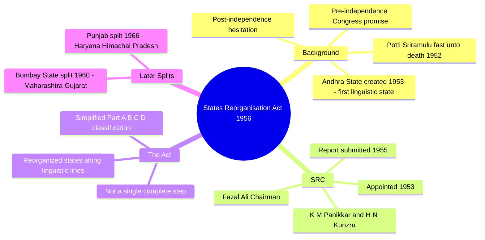

# NOTE — STATES REORGANISATION ACT, 1956
**Section:** GK | **Category:** History | **Topic:** States Reorganisation Act, 1956 | **Slug:** `hist-states-reorganisation-act-1956`
**Source:** 🔧 GENERAL KNOWLEDGE (standard post-independence history/polity reference; not yet cross-checked against PARMAR SSC reference excerpt)
**Status:** 🔧 DRAFT — awaiting AIR-91 verification before publish
**PYQ Frequency:** 🔥 High-frequency Post-Independence History topic | **High Yield:** ✅

---

## 🎭 THE HOOK

When India became independent, its internal state boundaries were a patchwork of old British provinces and former princely states — drawn for administrative or dynastic convenience, with almost no regard for the LANGUAGES people actually spoke. A death finally forced the issue: in 1952, a Telugu activist named **Potti Sriramulu** FASTED TO DEATH demanding a separate Telugu-speaking state, and his death triggered such widespread unrest that the government immediately created **Andhra State** — and then realized this couldn't be a one-off exception. The **States Reorganisation Act, 1956** was the systematic, nationwide response: redraw India's entire internal map along LINGUISTIC lines.

---

## 📖 THE CORE

### Background — The Demand for Linguistic States
- Pre-independence, the Indian National Congress had ITSELF promised linguistic reorganization of provinces as a long-term goal (raised periodically from the 1920s onward), but post-independence, the government initially HESITATED, fearing it might fuel further fragmentation/separatism so soon after Partition.
- **Potti Sriramulu's fast unto death (1952)**, demanding a separate Telugu-speaking state carved out of Madras Presidency, ended in his death — and the resulting unrest forced the government to create **Andhra State** (1953), the FIRST state formed explicitly on linguistic lines post-independence.

### States Reorganisation Commission (SRC)
- Appointed in **1953**, comprising **Fazal Ali** (Chairman), **K.M. Panikkar**, and **H.N. Kunzru** — frequently called the **"Fazal Ali Commission."**
- Tasked with examining the question of reorganizing India's states, primarily along LINGUISTIC lines.
- Submitted its report in **1955**, recommending a major reorganization.

### States Reorganisation Act, 1956
- Based substantially on the SRC's recommendations, reorganized India's states largely along **LINGUISTIC** lines.
- Reduced the number of states/categories from the original four-fold classification (Part A, B, C, D states, used in the original 1950 Constitution) to a simpler structure.
- Created/reorganized several major states along linguistic lines, though NOT a perfectly clean process — several states continued to be REORGANIZED further in subsequent decades (e.g., Bombay State later split into Maharashtra and Gujarat in 1960; Punjab later split further in 1966 to create Haryana and Himachal Pradesh).

### Key Distinguishing Facts
- **Potti Sriramulu's death (1952) is the SPECIFIC triggering event** for the broader linguistic reorganization movement — a frequently tested causal anchor.
- **The States Reorganisation Act, 1956 did NOT complete the entire reorganization process in one step** — further splits (Bombay State in 1960, Punjab in 1966) occurred LATER, showing that linguistic reorganization was an ONGOING process, not a single 1956 event.
- **The SRC is commonly called the "Fazal Ali Commission"**, after its Chairman — a frequently tested name association.

---

## 🧠 THE MIND MAP

---

## 🔑 THE MNEMONIC

**"Sriramulu's fast started it, Fazal Ali's commission systematized it, 1956 legislated it — but the map kept changing after"** — the full causal-to-ongoing arc of linguistic reorganization.

**"Bombay split in '60, Punjab split in '66 — reorganization didn't stop in '56"** — the post-1956 continuation of state splits.

---

## 📌 THE PYQ ANCHOR

🔥 States Reorganisation Act, 1956 is a high-frequency Post-Independence History topic. 🔧 No literal States Reorganisation question confirmed in the 23/46-shift CGL-2025 sample reviewed earlier in this session — Potti Sriramulu's fast, the Fazal Ali Commission, and the later Bombay/Punjab splits are textbook-standard SSC CGL History staples; recommend a dedicated archive cross-check.

---

## ⚠️ THE TRAP ALERT

- **Potti Sriramulu's fast (1952) led to the creation of ANDHRA STATE (1953)**, NOT the full States Reorganisation Act directly — Andhra State's creation was the IMMEDIATE precursor that prompted the broader, systematic SRC process.
- **The States Reorganisation Commission is commonly called the "Fazal Ali Commission"** — don't assume "States Reorganisation Commission" refers to a different, unnamed body; Fazal Ali was its Chairman.
- **The 1956 Act did NOT finish the reorganization process** — Bombay State split into Maharashtra and Gujarat in 1960, and Punjab split further in 1966 — don't assume India's current state map was finalized entirely by 1956.
- **The original Constitution (1950) classified states into Part A, B, C, D categories** — the 1956 Act SIMPLIFIED this classification system as part of the broader reorganization.

---

## ✅ ACTIVE RECALL

1. What event in 1952 triggered the demand for linguistic state reorganization, and what state was created as a result?
2. What was the States Reorganisation Commission (SRC), and who chaired it?
3. When did the SRC submit its report, and when was the resulting Act passed?
4. On what principle did the States Reorganisation Act, 1956 primarily reorganize India's states?
5. Name two states that were created through FURTHER splits after the 1956 Act.

*(Answers: 1–Potti Sriramulu's fast unto death, demanding a Telugu-speaking state; led to the creation of Andhra State (1953) | 2–A commission appointed in 1953 to examine state reorganization, primarily along linguistic lines; chaired by Fazal Ali (commonly called the "Fazal Ali Commission") | 3–The SRC submitted its report in 1955; the States Reorganisation Act was passed in 1956 | 4–Linguistic lines | 5–Maharashtra and Gujarat (from the 1960 split of Bombay State), or Haryana and Himachal Pradesh (from the 1966 split of Punjab))*
