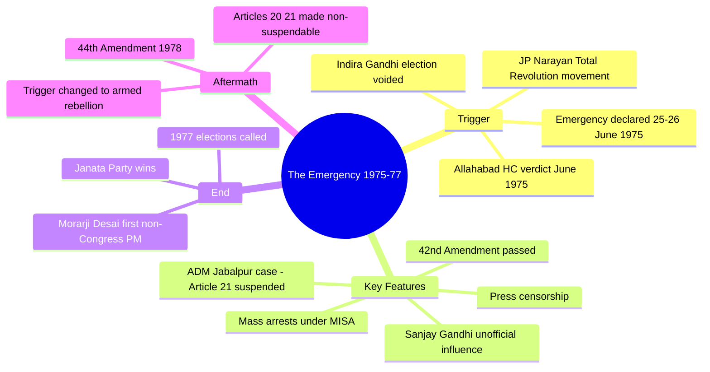

# NOTE — THE EMERGENCY (1975-77)
**Section:** GK | **Category:** History | **Topic:** The Emergency (1975-77) | **Slug:** `hist-the-emergency-1975-77`
**Source:** 🔧 GENERAL KNOWLEDGE (standard post-independence history/polity reference; not yet cross-checked against PARMAR SSC reference excerpt)
**Status:** 🔧 DRAFT — awaiting AIR-91 verification before publish
**PYQ Frequency:** 🔥 Very high-frequency Post-Independence History/Polity crossover topic, connects to [[polity-42nd-amendment]] and [[polity-emergency-provisions]] | **High Yield:** ✅

---

## 🎭 THE HOOK

On the night of 25 June 1975, Indian democracy was effectively suspended for 21 months — not through a coup, but through the Constitution's OWN Emergency provisions, invoked by the very Prime Minister those provisions were meant to keep in check. Indira Gandhi declared a National Emergency hours after the Allahabad High Court found her guilty of electoral malpractice and ordered her to vacate her Lok Sabha seat — and what followed became the single most consequential cautionary tale in Indian constitutional history, directly responsible for the protective amendments (44th Amendment) covered in [[polity-42nd-amendment]] and [[polity-emergency-provisions]].

---

## 📖 THE CORE

### The Trigger
- **Allahabad High Court verdict (12 June 1975)**: Justice **Jagmohanlal Sinha** found Prime Minister **Indira Gandhi** guilty of ELECTORAL MALPRACTICE in her 1971 election, declaring her election VOID and barring her from holding elected office for 6 years.
- Combined with growing political unrest — including **Jayaprakash Narayan (JP)**'s "Total Revolution" movement, calling for Gandhi's resignation — created an acute political crisis.
- Indira Gandhi advised President **Fakhruddin Ali Ahmed** to declare a **National Emergency** under **Article 352**, citing "internal disturbance" (the pre-44th-Amendment trigger wording — see [[polity-emergency-provisions]]) — proclaimed on **25-26 June 1975**.

### Key Features of the Emergency Period
- Mass ARRESTS of opposition leaders (including JP Narayan, **Atal Bihari Vajpayee**, **L.K. Advani**, and many others) under preventive detention laws (notably **MISA — Maintenance of Internal Security Act**).
- PRESS CENSORSHIP imposed — newspapers required pre-publication government clearance.
- Fundamental Rights, including the right to move courts for their enforcement (Article 359), were SUSPENDED for the duration — though the Supreme Court's controversial **ADM Jabalpur v. Shivkant Shukla (1976)** ruling ("Habeas Corpus case") controversially upheld that even the right to life (Article 21) itself could effectively be suspended during the Emergency — a ruling later widely CRITICIZED and effectively reversed in spirit by subsequent jurisprudence (notably the Puttaswamy case, 2017).
- **Sanjay Gandhi** (Indira Gandhi's son, holding no formal government position) wielded significant UNOFFICIAL influence during this period, notably associated with controversial forced STERILIZATION campaigns (population control) and slum demolition drives.
- The **42nd Constitutional Amendment Act, 1976** (see [[polity-42nd-amendment]]) was passed DURING the Emergency, significantly expanding Parliament's amending power and curtailing judicial review — later substantially reversed by the 44th Amendment (1978) and the Minerva Mills case (1980).

### End of the Emergency
- Indira Gandhi called elections in **March 1977**, apparently MISCALCULATING that she would win — instead, the **Janata Party** (a coalition of opposition parties formed specifically to oppose her) won decisively, and **Morarji Desai** became the first NON-CONGRESS Prime Minister of independent India.
- The Emergency formally ended with this electoral defeat; the new Janata government subsequently passed the **44th Constitutional Amendment Act, 1978**, specifically to PREVENT future Emergency abuse — including changing the trigger from "internal disturbance" to "armed rebellion" and making Articles 20 and 21 non-suspendable (see [[polity-emergency-provisions]]).

### Key Distinguishing Facts
- **The Emergency (1975-77) is the ONLY National Emergency in Indian history declared on grounds OTHER than war or external aggression** — invoked instead for "internal disturbance," a trigger condition the 44th Amendment later specifically TIGHTENED to prevent recurrence.
- **The ADM Jabalpur case (1976) is widely regarded as one of the Supreme Court's most CRITICIZED judgments** — for effectively endorsing the suspension of the right to life itself during Emergency; don't treat it as an uncontroversial precedent.
- **Morarji Desai became India's FIRST non-Congress Prime Minister**, directly as a result of the 1977 elections that ended the Emergency.

---

## 🧠 THE MIND MAP

---

## 🔑 THE MNEMONIC

**"Allahabad voided her seat, she voided everyone's rights"** — the causal link from the court verdict to the Emergency declaration.

**"1975 took rights away, 1977 took her power away, 1978 made sure it couldn't happen again"** — the three-year arc of crisis and correction.

---

## 📌 THE PYQ ANCHOR

🔥 The Emergency (1975-77) is a very high-frequency Post-Independence History/Polity crossover topic, directly connecting to [[polity-42nd-amendment]] and [[polity-emergency-provisions]]. 🔧 No literal Emergency question confirmed in the 23/46-shift CGL-2025 sample reviewed earlier in this session — the Allahabad HC verdict, ADM Jabalpur case, and Morarji Desai's premiership are textbook-standard SSC CGL History/Polity staples; recommend a dedicated archive cross-check.

---

## ⚠️ THE TRAP ALERT

- **The 1975-77 Emergency was declared on grounds of "INTERNAL DISTURBANCE"**, NOT war or external aggression — the ONLY National Emergency in Indian history invoked on this specific ground, later tightened by the 44th Amendment to "armed rebellion."
- **The ADM Jabalpur case (1976) is one of the Supreme Court's MOST CRITICIZED judgments**, not a celebrated precedent — it controversially upheld the effective suspension of the right to life during the Emergency.
- **Morarji Desai became PM as a result of the JANATA PARTY's 1977 victory**, a COALITION of opposition parties formed specifically to defeat Indira Gandhi — not a single pre-existing party.
- **The 42nd Amendment was passed DURING the Emergency (1976)**; its most controversial provisions were later REVERSED by the 44th Amendment (1978) and Minerva Mills (1980) — don't assume the 42nd Amendment's full scope remains in effect today.

---

## ✅ ACTIVE RECALL

1. What court verdict directly triggered Indira Gandhi's declaration of Emergency, and when?
2. On what grounds was the 1975-77 Emergency declared, and how is this unique among India's National Emergencies?
3. What did the ADM Jabalpur v. Shivkant Shukla (1976) case controversially hold?
4. How did the Emergency end, and who became Prime Minister as a result?
5. What amendment was passed in direct response to prevent future Emergency abuse, and what key changes did it make?

*(Answers: 1–The Allahabad High Court's verdict (12 June 1975) finding Indira Gandhi guilty of electoral malpractice and voiding her election | 2–On grounds of "internal disturbance"; it is the only National Emergency in Indian history NOT declared due to war or external aggression | 3–That the right to life (Article 21) could effectively be suspended during the Emergency, denying habeas corpus relief to detainees | 4–Indira Gandhi called elections in 1977, which the Janata Party won decisively; Morarji Desai became India's first non-Congress Prime Minister | 5–The 44th Constitutional Amendment Act, 1978; changed the National Emergency trigger from "internal disturbance" to "armed rebellion" and made Articles 20 and 21 non-suspendable)*
